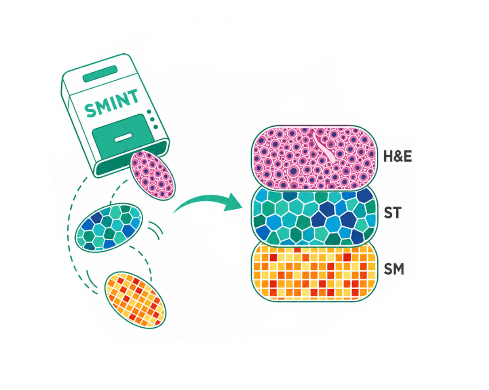
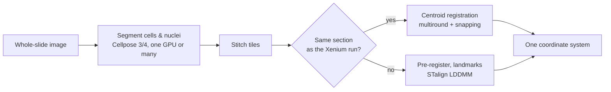

# SMINT - Spatial Multi-Omics Integration Toolkit

<p align="center">
  
</p>

[](https://opensource.org/licenses/MIT)
[](https://www.python.org/downloads/)
[](https://jurgenkriel.github.io/SMINT/)

SMINT segments cells and nuclei across whole-slide images, then brings spatial
transcriptomics, spatial metabolomics and post-stain imaging into one
coordinate system — interactively in napari, from the command line, or as
SLURM jobs on a GPU cluster.

**Documentation: [jurgenkriel.github.io/SMINT](https://jurgenkriel.github.io/SMINT/)**
· [Quick start](https://jurgenkriel.github.io/SMINT/quickstart/)
· [Tutorials](https://jurgenkriel.github.io/SMINT/tutorials/)
· [Reference](https://jurgenkriel.github.io/SMINT/reference/)



## Features

- **Whole-slide segmentation** of cells and nuclei with Cellpose 3 or 4, on
  one machine or spread over Dask workers (local GPUs or SLURM jobs), with
  overlapping tiles stitched and every nucleus assigned to a cell.
- **Same-section registration** of post-stain nuclei onto Xenium cells:
  multi-round displacement voting, then snapping matched nuclei exactly onto
  their cells, with errors reported on held-out data.
- **Sequential-section registration** of spatial metabolomics onto spatial
  transcriptomics: coarse pre-registration, manual landmarks and STalign
  LDDMM.
- **napari plugin** to load datasets, pre-register by eye, place landmarks
  and launch registration jobs.
- **`smint-alignment` command line** for the same workflow, run locally or
  submitted to SLURM (CPU or a chosen GPU type).
- **R scripts** for transcript assignment and metabolomics integration, and
  `run_r_script` to call R from Python.

## Installation

SMINT is not on PyPI (the `smint` name there is an unrelated placeholder).
Install it from GitHub:

```bash
pip install "git+https://github.com/JurgenKriel/SMINT.git"

# distributed segmentation (Dask, SLURM workers, Zarr)
pip install "smint[distributed] @ git+https://github.com/JurgenKriel/SMINT.git"
```

STalign registration needs its own environment with numpy < 2, and the napari
plugin needs napari. The
[installation guide](https://jurgenkriel.github.io/SMINT/installation/) has an
environment matrix, the Cellpose 3 vs 4 choice and a check-your-install
script.

## Quick start

Same-section registration, post-stain nuclei onto Xenium cells:

```bash
smint-alignment centroid --source nuclei.csv --target cells.csv --output-dir run1 --watch
```

Sequential sections, spatial metabolomics onto spatial transcriptomics, with
landmarks placed in napari (**Plugins → SMINT Registration**):

```bash
smint-alignment st-sm --st st.csv --sm sm.csv \
    --st-points st_points.npy --sm-points sm_points.npy \
    --orientation stalign --output-dir run2 \
    --submit --partition gpuq --gpus 1 --watch
```

Whole-slide segmentation from Python:

```python
from smint.segmentation import run_distributed_segmentation

if __name__ == "__main__":
    results = run_distributed_segmentation(
        image_path="slide.ome.tif",
        output_dir="seg_run",
        cell_model="cyto3",                      # or a path to a fine-tuned model
        nuclei_model="nuclei",
        cell_params={"diameter": 60, "channels": [2, 1]},
        nuclei_params={"diameter": 30, "channels": [1, 0]},
        backend="local",                         # or "slurm"
    )
    print(results["total_cells"], results["cells_summary_path"])
```


*Spatial metabolomics (MALDI, pink) registered onto Xenium spatial
transcriptomics (blue) from a neighbouring section with 11 paired landmarks
and STalign LDDMM (Sample 2).*

Next: the [quick start](https://jurgenkriel.github.io/SMINT/quickstart/), the
[tutorials](https://jurgenkriel.github.io/SMINT/tutorials/), and the guides for
[segmentation](https://jurgenkriel.github.io/SMINT/segmentation/),
[alignment](https://jurgenkriel.github.io/SMINT/alignment/) and
[running on HPC](https://jurgenkriel.github.io/SMINT/hpc_deployment/).

## Repository layout

| Path | Contents |
|---|---|
| `smint/` | The Python package: `segmentation`, `alignment`, `napari`, `cli`, `r_integration`, … |
| `configs/` | Example segmentation configuration (`segmentation_config.yaml`) |
| `scripts/` | `run_segmentation.py`, SLURM templates, figure scripts |
| `examples/` | Example scripts, including the ones that render the documentation figures |
| `stitching/`, `assignment/`, `integration/` | R workflows: stitching, transcript assignment, metabolomics integration ([guide](https://jurgenkriel.github.io/SMINT/r_integration/)) |
| `segmentation/` | Cellpose training notebook and CZI tile export |
| `tests/` | `pytest` suite |
| `docs/` | This documentation (MkDocs Material) |

## Contributing

Contributions are welcome — open an issue or a pull request. To set up a
development copy, run the tests and build the documentation:

```bash
pip install -e ".[distributed,dev]"
pytest tests

pip install -r docs/requirements.txt
mkdocs serve                  # preview at http://127.0.0.1:8000
mkdocs build --strict         # the check CI runs
```

The site is deployed to GitHub Pages by `.github/workflows/deploy-docs.yml` on
every push to `main`. See the
[contributing guide](https://jurgenkriel.github.io/SMINT/contributing/) for
code and documentation conventions.

## Citation

If you use SMINT in your research, please cite it — use GitHub's **Cite this
repository** button (from `CITATION.cff`) or see the
[citation page](https://jurgenkriel.github.io/SMINT/citation/).

## License

MIT — see [LICENSE](LICENSE).
