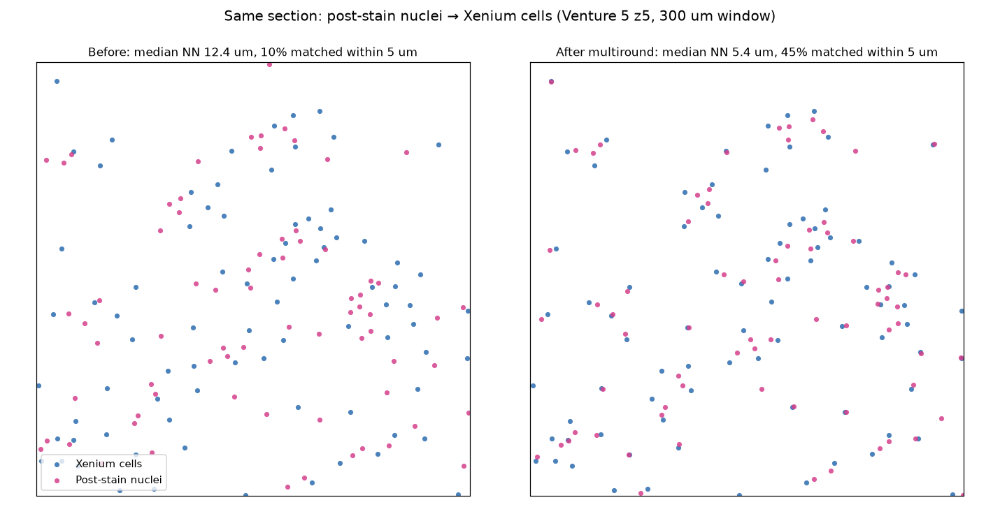
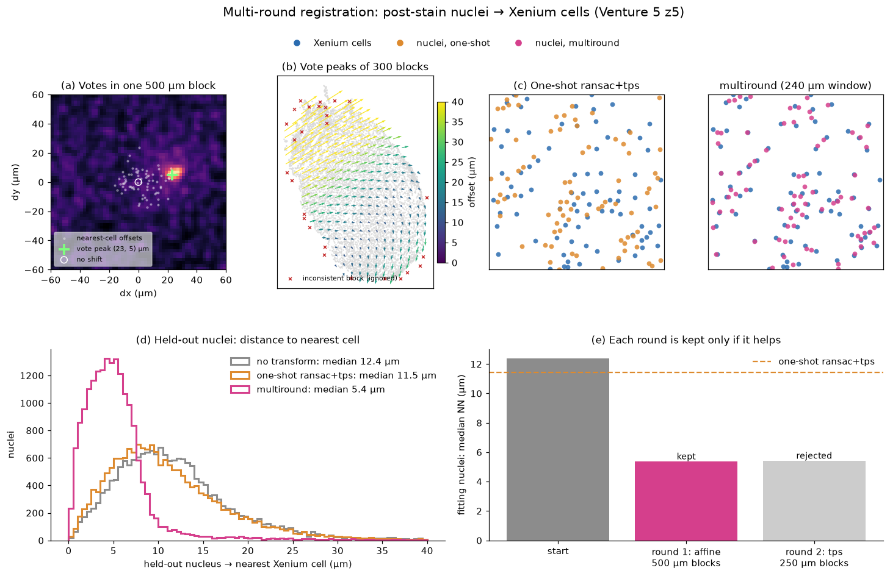
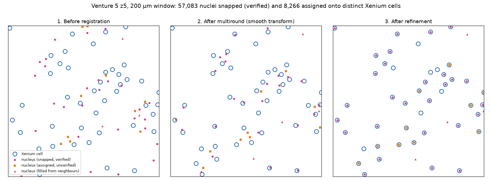

# Spatial Alignment

SMINT aligns spatial omics modalities in two quite different situations, and
picking the right one matters more than any parameter you will tune afterwards.

| Situation | What is true | Use |
|---|---|---|
| **Sequential sections** — the modalities come from different physical sections | The tissue genuinely differs between them; no cell corresponds one-to-one | STalign LDDMM ([`register_sm_to_st`](#st-sm-registration)) |
| **Same section, post-staining** — a second modality is acquired on the *exact same* section | Centroids really do correspond one-to-one | Correspondence fitting ([`register_centroids`](#centroid-registration)) |

Using the same-section tools on sequential sections will happily produce a
number, but it will be fitting noise: nearest-neighbour "correspondences"
between different sections pair cells that are merely nearby, not the same.

---

## Coarse pre-registration

Spatial metabolomics arrives on its own pixel grid, frequently rotated or
mirrored relative to the Xenium section and at a completely different scale.
LDDMM will not recover from a gross orientation mismatch, so bring the datasets
roughly together first.

```python
from smint.alignment import build_pretransform, apply_pretransform, overlap_score

matrix = build_pretransform(
    sm_xy, xen_xy,
    scale_mode="extent",   # match bounding-box spans
    rotation=30,           # degrees counter-clockwise
    flip_x=True,
)
moved = apply_pretransform(sm_xy, matrix)
print(overlap_score(moved, xen_xy))     # 0-1, higher is better
```

Operations are applied in a fixed order — **flip → rotate → scale → translate**
— about the source centroid. The order is fixed because rotations and flips do
not commute.

!!! note "Scale is fitted after orientation is corrected"
    Bounding-box extents change under rotation, so fitting scale on the raw
    source bakes in an error. On a 30° rotated test shape, fitting first gave
    8.10 against a true 10.0. `build_pretransform` handles this for you by
    applying flip and rotation before fitting.

`scale_mode` options:

- **`"extent"`** (default) — match the bounding-box *span* per axis. Robust to
  the two datasets having different origins.
- **`"max"`** — match maximum coordinates directly. Literal, but wrong whenever
  either dataset does not start near zero.
- **`"none"`** — no scaling.

Scaling is isotropic by default (`preserve_aspect=True`). Anisotropic scaling
can force bounding boxes to agree while making the shapes match *worse*, which
then misleads the landmark step.

Use `describe_pretransform(matrix)` to decompose a transform into scale,
rotation, shear and whether it reflects — a negative determinant means a
reflection crept in, which is easy to introduce by combining a flip with a
rotation.

---

## ST-SM registration

For sequential sections, using STalign's LDDMM. The workflow is deliberately
split into two phases around a **manual landmark step**, because that step is
where the biological judgement lives.

### Phase 1 — prepare landmark inputs

```python
from smint.alignment import prepare_landmark_inputs

out = prepare_landmark_inputs(
    st_file="Z2_final_aligned_annos.csv",
    sm_file="Ven5B_information_matrix_tissue_only_full_with_xy.csv",
    output_prefix="/path/to/ven5_z2",
    dx=30.0,
    sm_kwargs=dict(scale_xy=10.0, rotate_left_90=True),
)
```

This writes `<prefix>_st.npz` and `<prefix>_sm.npz`.

### Phase 2 — annotate, then register

Annotate both `.npz` files, picking the **same anatomical features in the same
order** in each — correspondence is positional, so an ordering mismatch
silently produces a wrong registration. Either use the
[napari plugin](napari_plugin.md) or STalign's standalone annotator
(`STalign/point_annotator.py` in the STalign repository — it is not part of SMINT):

```bash
python point_annotator.py ven5_z2_st.npz ven5_z2_sm.npz
```

That writes `<prefix>_st_points.npy` and `<prefix>_sm_points.npy`. Then:

```python
from smint.alignment import register_sm_to_st

df = register_sm_to_st(
    st_file=..., sm_file=...,
    st_points_file=out["st_points"],
    sm_points_file=out["sm_points"],
    output_path="sm_transformed.csv",
    niter=1000, epV=200.0,
    orientation="stalign",   # x/y in the ST frame; see below
)
```


### Choosing which columns to register

ST tables routinely carry several coordinate pairs from successive processing
stages — `x_centroid` alongside `x_new` and `x_new_add`, say. Which one you
register against is a real choice, and the wrong one **misregisters silently
rather than raising**.

Inspect first:

```bash
smint-alignment columns Ven5_z2_pre_aligned_1.csv
```

Then be explicit:

```python
register_sm_to_st(
    ..., st_x_col="x_new_add", st_y_col="y_new_add",
    sm_kwargs=dict(x_col="x", y_col="y"),
)
```

```bash
smint-alignment st-sm ... --st-x-col x_new_add --st-y-col y_new_add
```

Omitting them auto-detects in the priority order `x_final`, `x_centroid`,
`centroid_x`, `x_transformed`, `x` — and logs the choice, so it appears in the
job log. In the napari plugin the columns are dropdowns populated from the file
you pick, with the detected pair preselected.

### Coordinate orientation

STalign works in **row-column** order throughout. `LDDMM` takes grids as
`[Y, X]`, and `transform_points_source_to_target` both accepts and returns
points as `(row, col)` — it applies the transform in place and does not
transpose.

Registering through STalign therefore returns coordinates whose axes are
transposed relative to the source dataset. `transform_points` exposes this:

- **`orientation="stalign"`** — true x/y in the ST target frame. Use this
  whenever the result is overlaid on, compared with or joined to the ST data.
- **`orientation="dataset"`** (default) — the transposed layout earlier
  pipeline runs wrote. It reproduces historical outputs, so existing
  downstream code keeps working, but these coordinates do **not** line up with
  the ST cells.

The two differ by a transpose. Plotting `dataset` output over ST gives a
mirrored, misaligned overlay that looks like a failed registration, so pass
the orientation explicitly; it is recorded on the output frame.

---

## Centroid registration

For post-staining on the same section, where centroids correspond one-to-one.

```python
from smint.alignment import register_centroids

result = register_centroids(nucleus_xy, xenium_xy)   # method="multiround"
print(result["tre_validation"])                       # the number that matters
print(result["validation"]["after"])                  # median NN, matched fractions
```



| Method | What it does |
|---|---|
| `multiround` (default) | Coarse-to-fine displacement voting: an affine, then optional smooth TPS rounds |
| `affine` | Least-squares affine on all nearest-neighbour pairs |
| `ransac` | RANSAC-robust affine; rejects bad correspondences |
| `tps` | Thin-plate spline after an affine pre-alignment |
| `ransac+tps` | RANSAC affine, then TPS on the inliers |

### Why multiple rounds

The single-round methods match every nucleus to its nearest cell *once*,
before fitting. When the starting offset is comparable to the cell spacing,
most of those matches are wrong, and no transform fitted to them can recover:
on Venture 5 z5 (cells ~17 µm apart, nuclei ~12 µm off) they barely move the
alignment.

`multiround` never commits to nearest neighbours. Within each block of tissue,
every nucleus votes for the displacements to several nearby cells; wrong
candidates scatter, while the true offset — shared by the whole block — piles
up as a peak (`vote_block_displacements`). Then:

1. **Round 1** fits an affine through the block peaks (500 µm blocks).
2. **Round 2** votes again in 250 µm blocks on the result and adds a smooth TPS
   through those peaks, following local warps.
3. A round is **kept only if it improves** the fitting nuclei's alignment;
   otherwise registration stops there.



*(a) In one block the nearest-cell offsets (white) cluster around zero, but the
votes peak at the true offset of (23, 5) µm — more than a cell spacing. (b) The
block peaks across the section form a smooth field (a small rotation and
scale), which round 1 fits as an affine; red crosses are blocks that disagree
and are ignored. (c) The same window after the old one-shot fit and after
`multiround`. (d) Held-out nuclei: distance to the nearest cell. (e) The finer
TPS round didn't improve this section, so it was rejected.
`examples/multiround_figure.py` renders this figure.*

Each round's outcome is in `result["rounds"]`. Tune with `schedule=` —
`(max_distance, block_size, bin_size)` per round, in microns — and
`min_improvement=`.

| Venture 5 z5, held-out nuclei | median NN | matched ≤ 5 µm | matched ≤ 10 µm |
|---|---|---|---|
| no transform | 12.4 µm | 10% | 34% |
| `ransac+tps` (one round) | 11.5 µm | 13% | 40% |
| **`multiround`** | **5.4 µm** | **45%** | **76%** |

*Matched = mutual nearest neighbours. 88,906 nuclei, 74,247 cells; 3 s.*

### Snapping matched nuclei onto their cells

A smooth transform leaves every nucleus a few microns from its cell — partly
because a stained nucleus genuinely sits off-centre in its Xenium cell. To make
matched nuclei overlap their cells exactly, `register_centroid_files` (and so
`smint-alignment centroid`) follows registration with
`refine_by_assignment`, a port of the lab's `alignment_refinement.r`:

1. **Pair** registered nuclei one-to-one with Xenium cells (mutual nearest
   neighbours within `snap_radius`, 10 µm).
2. **Check** each pair against its neighbourhood: its offset must be within
   `consistency_tol` (default 0.4 × the cell spacing) of the median offset of
   the pairs around it. A nucleus paired with the wrong cell disagrees with
   its neighbours.
3. **Snap** pairs that pass: the nucleus moves exactly onto its cell.
4. **Fill in** every other nucleus with the median offset of its nearest
   snapped neighbours; nuclei with none within 100 µm stay put.
5. **Repeat** pairing for what is left, up to four passes.
6. **Assign** the nuclei still left to the free cells around them by a
   one-to-one, minimum-total-distance assignment (within 0.75 × the cell
   spacing), and move them onto those cells. These skipped the neighbourhood
   check, so they are marked `assigned` rather than `snapped`.



On Venture 5 z5, **65,349 nuclei — 88% of Xenium cells — end up exactly on a
distinct cell**: 57,083 snapped and 8,266 assigned. 9,147 follow their
neighbours, and 14,410 lie outside the Xenium area (median 250 µm from any
cell). On synthetic sections with known correspondence, the passes snap 98% of
the nuclei that have a cell, and 98% of snaps are on the right one.

!!! warning "Assigned pairs are not verified"
    Each placed nucleus has a `neighbour_deviation`: how far its offset is from
    the median offset of the snapped nuclei around it. Right pairs sit at the
    nucleus-in-cell scatter; a nucleus put on a neighbour's cell deviates by
    about a cell spacing. On z5 the snapped pairs' median is 4.1 µm and the
    assigned pairs' 8.5 µm, and on synthetic data only 25–33% of assigned
    pairs are correct — most leftovers are nuclei with no Xenium cell
    (over-segmentation, or outside the Xenium plane). Large cells can hold a
    nucleus far off-centre, so some assigned pairs will be right; centroids
    alone can't say which. Filter on `registration_status` /
    `neighbour_deviation`, or pass `--no-assign-remaining`.

The output CSV holds the snapped positions in `x_transformed` /
`y_transformed`, the smooth-transform positions in `*_smooth`, a
`registration_status` (`snapped` / `assigned` / `filled` / `unmoved`), the
partner's row in `target_index` and `neighbour_deviation`. Use `--no-refine` (or `refine=False`) for the smooth
transform alone.

!!! note "A snapped nucleus has zero residual by construction"
    So its TRE says nothing about whether it is on the *right* cell. The
    check is `refinement["validation"]`: a tenth of the accepted pairs is
    left out, their positions are predicted from their neighbours alone, and
    the error is reported. On z5 that is a median 4.0 µm — the nucleus-in-cell
    scatter that only individual snapping removes.

### Measuring quality honestly

Target Registration Error is easy to compute in a way that is **circular**.
Correspondences here are established by nearest neighbour, so a sufficiently
flexible transform can drive TRE to ~0 on the pairs it was fitted to,
regardless of whether those correspondences are correct. An unregularised TPS
with as many control points as pairs will *always* report TRE ≈ 0 on those
pairs — that is interpolation, not accuracy.

`register_centroids` therefore always holds data out of fitting and reports
TRE on it. The single-round methods hold out matched pairs; `multiround`
re-estimates correspondences each round, so it holds out a quarter of the
*nuclei* before anything is matched:

```
tre_initial      before any transform
tre_fit          on the data used for fitting      <- not evidence
tre_validation   on held-out data                  <- the real number
```

For `multiround`, TRE is the distance from each held-out nucleus to its mutual
nearest cell. `result["validation"]` adds a correspondence-free summary of the
held-out nuclei `before` and `after`: median distance to the nearest cell, and
the fractions matched within 5 and 10 µm.

A large gap between fit and validation means the transform is memorising
correspondences; a validation TRE no better than the initial one means it did
not help. The function warns in both cases.

!!! warning "Matching is mutual by default"
    `mutual=True` keeps only pairs that are each other's nearest neighbour.
    One-directional matching lets many source points collapse onto a single
    popular target, inflating the pair count. On a real Venture 5 section this
    was the difference between 75,146 apparent pairs and 40,135 real ones.

### Interpreting the result

- **A single-round method doesn't beat the initial TRE.** Usually the starting
  offset is close to the cell spacing and nearest-neighbour matching is
  pairing nuclei with neighbouring cells. Use `multiround`.
- **Compare with the target's cell spacing.** A residual that is a large
  fraction of it means many "matches" are neighbouring cells, not the same
  cell.
- **Expect a floor of a few microns.** Xenium reports *cell* centroids; a
  stained nucleus's centroid is legitimately a few microns away from its
  cell's.
- **Sweep `max_distance`.** If TRE shrinks in proportion rather than reaching a
  plateau, the threshold is setting the residual, not alignment error.

---

## Running on HPC

Registration can be submitted to SLURM or run locally through a job spec; see
[HPC Deployment](hpc_deployment.md) and the [napari plugin](napari_plugin.md).

```python
from smint.alignment.jobs import JobSpec, SlurmResources, submit, poll

spec = JobSpec(
    round="st_sm",
    inputs={"st_file": ..., "sm_file": ..., "st_points": ..., "sm_points": ...},
    params={"niter": 1000},
    output_dir="/vast/scratch/you/run1",
    backend="sbatch",
    resources=SlurmResources(partition="gpuq", gpus=1, gpu_type="A30", memory="64G"),
)
info = submit(spec)
print(poll(spec.output_dir)["state"])
```

!!! danger "Batch jobs need shared storage"
    An sbatch job runs on a different machine, so node-local paths (`/tmp`,
    `/var/tmp`, `/dev/shm`) are invisible to it — the job dies with no logs at
    all, because the log directory does not exist there. `JobSpec.validate()`
    rejects these up front. Use `/vast/scratch` or `/vast/projects`.

### GPU

LDDMM runs on GPU automatically when one is available. Request it with
`SlurmResources(partition="gpuq", gpus=1)`. GPU and CPU results are
bit-identical; on a Venture 5 Z2 section the GPU run took 82 s against 112 s on
8 CPU cores, so the benefit is modest at typical raster sizes.

`gpuq` mixes A30, A100 and P100 cards, and a bare `--gres=gpu:1` takes whatever
is free — so an untyped request can land on hardware generations apart from the
one a run was timed on. `gpu_type` defaults to `"A30"`, the card registration is
validated against, and renders as `--gres=gpu:A30:1`. Pass another name to pick
a different card, or `gpu_type=None` to accept any:

```python
SlurmResources(partition="gpuq", gpus=1, gpu_type="A100")  # --gres=gpu:A100:1
SlurmResources(partition="gpuq", gpus=1, gpu_type=None)    # --gres=gpu:1
```

Types are checked against the partition before submission, so a card that
partition does not have is reported by name rather than as SLURM's "Invalid
generic resource". An unknown partition likewise raises with the list of valid
ones. To see what the cluster offers:

```python
from smint.alignment.jobs import available_partitions, available_gpu_types
available_partitions()          # via sinfo; [] off-cluster
available_gpu_types("gpuq")     # e.g. ['A100', 'A30', 'P100']
```

---

## Environments

STalign requires **numpy < 2** — the `nptyping` dependency it pulls in via
`nrrd` uses `np.object0`, which numpy 2 removed. The centroid and
pre-registration paths have no STalign dependency and run anywhere.

If `stalign_available()` returns `False`, check numpy first:

```python
from smint.alignment import stalign_available
print(stalign_available())
```
