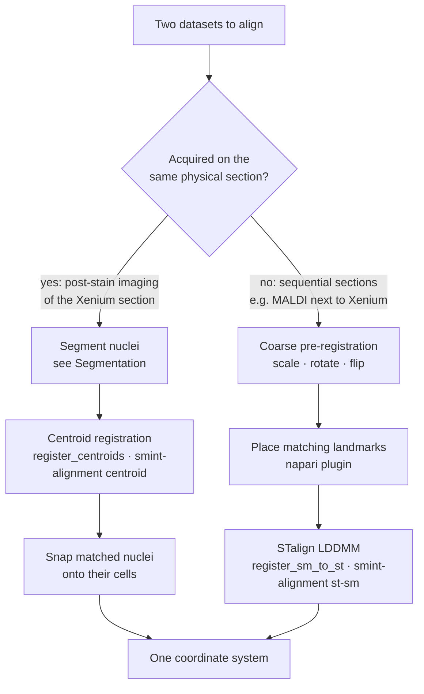

# Register spatial omics modalities

This guide shows you how to bring two spatial datasets into one coordinate
system with SMINT: post-stain nuclei onto Xenium cells from the **same**
section, or spatial metabolomics (SM) onto spatial transcriptomics (ST) from a
**neighbouring** section. Each task is shown in Python and on the command
line. For how the methods work and why there are two of them, read
[Choosing a registration method](concepts/registration_methods.md) and
[Coordinate frames](concepts/coordinate_frames.md).

## Pick the path for your data



| Your data | What is true | Use |
|---|---|---|
| **Same section**, imaged again after the Xenium run | Each nucleus really corresponds to one Xenium cell | [Centroid registration](#register-a-post-stain-onto-the-same-section) |
| **Sequential sections** (e.g. MALDI on the next section) | The tissue differs between sections; no cell-to-cell correspondence | [STalign LDDMM](#register-sequential-sections-with-stalign) |

!!! warning "Do not use centroid registration on sequential sections"
    It will return a number, but it fits noise: nearest-neighbour
    "correspondences" between different sections pair cells that are merely
    close, not the same cell.

## Before you start: check your coordinate columns

Tables often carry several coordinate pairs from earlier processing steps
(`x_centroid` next to `x_new` and `x_final`, say). Registering the wrong pair
does not raise an error; it silently misregisters. List the columns first:

```console
$ smint-alignment columns cells.csv
2 columns in cells.csv:
  x_centroid  <- auto-detected
  y_centroid  <- auto-detected
```

When you leave columns out, ST tables are auto-detected in the order
`x_final`, `x_centroid`, `centroid_x`, `x_transformed`, `x`, and the choice is
logged. Pass them explicitly whenever the table holds more than one pair.

## Register a post-stain onto the same section

Use this when nuclei segmented from a post-Xenium stain (DAPI, H&E, IF) have
to land on the Xenium cells of the same section. Both inputs are centroid
tables in µm; see
[Use the results for registration](segmentation.md#use-the-results-for-registration)
for turning segmentation output into one.

=== "Command line"

    ```bash
    smint-alignment centroid \
        --source nuclei.csv --source-cols centroid_x centroid_y \
        --target cells.csv  --target-cols x_centroid y_centroid \
        --output-dir results/same_section --watch
    ```

    This registers with the default `multiround` method, snaps matched nuclei
    onto their cells, and writes `results/same_section/centroids_transformed.csv`
    plus `status.json` with the quality metrics. Add `--submit` to run it as a
    SLURM job ([Running on HPC](hpc_deployment.md)).

=== "Python (files)"

    ```python
    from smint.alignment import register_centroid_files

    table, result = register_centroid_files(
        "nuclei.csv", "cells.csv",
        source_cols=("centroid_x", "centroid_y"),
        target_cols=("x_centroid", "y_centroid"),
        output_path="results/centroids_transformed.csv",
    )
    print(result["tre_validation"])             # (mean, sd) on held-out nuclei
    print(table["registration_status"].value_counts())
    ```

=== "Python (arrays)"

    ```python
    from smint.alignment import register_centroids, refine_by_assignment

    result = register_centroids(nucleus_xy, xenium_xy)   # (N, 2) and (M, 2), µm
    moved = result["transform"](nucleus_xy)               # smooth transform only
    snap = refine_by_assignment(moved, xenium_xy)         # optional snapping step
    placed_xy = snap["refined_xy"]
    ```

<figure markdown>

<figcaption>Sample 2, section z5: post-stain nuclei (pink) onto Xenium cells
(blue), before and after multiround registration.</figcaption>
</figure>

<a id="why-multiple-rounds"></a>

### What multiround does

Single-round methods match every nucleus to its nearest cell *once* and fit a
transform to those pairs. When the starting offset is close to the spacing
between cells, most of those pairs are wrong and no fit can recover.
`multiround` (the default) lets every nucleus vote for the displacements to
several nearby cells within a block of tissue; the true, shared offset piles
up as a peak. Round 1 fits an affine through the block peaks (500 µm blocks);
round 2 votes again in 250 µm blocks and adds a smooth thin-plate spline. A
round is kept only if it improves the alignment.


On Sample 2 z5 (88,906 nuclei, 74,247 Xenium cells about 17 µm apart; held-out
nuclei):

| | median distance to nearest cell | mutual matches within 5 µm | TRE |
|---|---|---|---|
| no transform | 12.4 µm | 10% | 11.0 µm |
| **`multiround`** | **5.4 µm** | **45%** | **4.9 µm** |

The run took 3 s. Other methods (`affine`, `ransac`, `tps`, `ransac+tps`) are
available through `method=` / `--method`; they are compared in
[Choosing a registration method](concepts/registration_methods.md).

<a id="snapping-matched-nuclei-onto-their-cells"></a>

### Snapping nuclei onto their cells

A smooth transform leaves each nucleus a few microns from its cell, partly
because a stained nucleus genuinely sits off-centre in its Xenium cell.
`register_centroid_files` (and so `smint-alignment centroid`) therefore
follows registration with `refine_by_assignment`:

1. **Pair** nuclei one-to-one with cells (mutual nearest neighbours within
   `snap_radius`, 10 µm).
2. **Check** each pair against its neighbours: its offset must agree with the
   median offset of the pairs around it.
3. **Snap** pairs that pass exactly onto their cell; move every other nucleus
   with its snapped neighbours. Repeat for what is left, up to four passes.
4. **Assign** the remaining nuclei to free cells nearby by a one-to-one,
   minimum-total-distance assignment, marked `assigned`.


On Sample 2 z5, 57,083 nuclei were snapped and 8,266 assigned: 88% of Xenium
cells received a distinct nucleus.

!!! warning "`assigned` pairs are not verified"
    Each placed nucleus has a `neighbour_deviation`: how far its offset is
    from the median offset of the snapped nuclei around it. On z5 the median
    is 4.1 µm for snapped and 8.5 µm for assigned nuclei, so many assigned
    pairs sit on a neighbouring cell. Filter on `registration_status` and
    `neighbour_deviation`, or pass `--no-assign-remaining`
    (`refine_kwargs={"assign_remaining": False}`).

The output table keeps every input column and adds:

| Column | Meaning |
|---|---|
| `x_transformed`, `y_transformed` | Final position (snapped where possible) |
| `x_transformed_smooth`, `y_transformed_smooth` | Position after the smooth transform alone |
| `registration_status` | `snapped`, `assigned`, `filled` (moved with neighbours) or `unmoved` |
| `target_index` | Row of the matched Xenium cell, for `snapped` / `assigned` |
| `neighbour_deviation` | Disagreement with the neighbourhood's offset, µm |

Use `--no-refine` (`refine=False`) for the smooth transform only.

## Register sequential sections with STalign

Use this for SM onto ST from a neighbouring section. It needs STalign in a
numpy < 2 environment ([Installation](installation.md)) and runs in three
steps around a **manual landmark** stage, because choosing matching
anatomical features is a biological judgement.

<figure markdown>

<figcaption>Sample 2, Xenium section Z2 (blue) and MALDI section B (pink):
before registration, the 11 paired landmarks, and after LDDMM.</figcaption>
</figure>

### 1. Pre-register coarsely

SM arrives on its own pixel grid, often rotated or mirrored relative to the
ST section and at a different scale. LDDMM does not recover from a gross
orientation mismatch, so bring the datasets roughly together first.

=== "napari"

    The *Pre-register* widget of the [napari plugin](napari_plugin.md) shows
    both datasets and lets you scale, rotate and flip by eye.

=== "Command line"

    ```console
    $ smint-alignment pretransform --source sm.csv --target st.csv \
          --search --output sm_pre.csv
    scale        : 10.0000, 10.0000
    rotation     : 150.00 deg
    reflects     : True
    overlap      : 1.000
    wrote        : sm_pre.csv
    transform    : sm_pre.csv.transform.json
    ```

    `--search` tries rotations in 15° steps with and without flips and keeps
    the best overlap; or set `--rotation`, `--flip-x`, `--flip-y` yourself.

=== "Python"

    ```python
    from smint.alignment import (apply_pretransform, build_pretransform,
                                 describe_pretransform, overlap_score)

    matrix = build_pretransform(sm_xy, st_xy, scale_mode="extent",
                                rotation=30, flip_x=True)
    moved = apply_pretransform(sm_xy, matrix)
    print(overlap_score(moved, st_xy))          # 0-1, higher is better
    print(describe_pretransform(matrix))        # scale, rotation, shear, reflects
    ```

    To save the result for the next steps, write `moved` back into the SM
    table's `x` / `y` columns and save it as `sm_pre.csv`.

Operations are applied flip → rotate → scale → translate, about the source
centroid. Scale is fitted *after* orientation is corrected, because
bounding-box extents change under rotation. Scaling is isotropic unless you
ask otherwise (`--anisotropic`, `preserve_aspect=False`).

!!! warning "Hand `sm_pre.csv` on unscaled"
    `sm_pre.csv` is already scaled and oriented into the ST frame (µm). Steps 2
    and 3 read SM tables through `read_sm_matrix`, which by default multiplies
    x/y by 10 and shifts negative coordinates to ≥ 0. For the pre-registered
    table, turn both off: `scale_xy=1.0, keep_positive=False` in Python
    (`--scale-xy 1 --no-keep-positive` on the command line), and use the
    **same** settings in steps 2 and 3 so the landmarks line up.

    If a 90° turn and a fixed pixel pitch are all your data needs, you can
    skip `sm_pre.csv` and register the raw SM CSV with
    `sm_kwargs={"scale_xy": <pixel pitch>, "rotate_left_90": True}` instead,
    as [Tutorial 3](tutorials/03_sequential_registration.ipynb) does.

### 2. Place landmarks

Rasterise both datasets and pick the **same anatomical features in the same
order** on each. Correspondence is positional, so an ordering mismatch
silently gives a wrong registration.

```python
from smint.alignment import prepare_landmark_inputs

out = prepare_landmark_inputs(
    st_file="st.csv", sm_file="sm_pre.csv",    # the step-1 output
    output_prefix="landmarks/section_b",
    dx=30.0,                                   # raster pixel, µm; reuse it in step 3
    st_x_col="x_centroid", st_y_col="y_centroid",
    sm_kwargs=dict(scale_xy=1.0, keep_positive=False),   # already in the ST frame
)
print(out["st_points"], out["sm_points"])      # where the landmark files will go
```

This writes `landmarks/section_b_st.npz` and `landmarks/section_b_sm.npz`.
Annotate them in the [napari plugin](napari_plugin.md)'s *Landmarks* widget,
or with STalign's own `point_annotator.py` (part of the STalign repository,
not SMINT):

```bash
python point_annotator.py landmarks/section_b_st.npz landmarks/section_b_sm.npz
```

Either way you end up with `…_st_points.npy` and `…_sm_points.npy`.

!!! tip "How many landmarks?"
    Spread them over the whole section, including the edges, and favour
    features that are sharp in both modalities (tissue boundaries, vessels,
    folds). The Sample 2 example used 11.

### 3. Run LDDMM

=== "Command line"

    ```bash
    smint-alignment st-sm \
        --st st.csv --sm sm_pre.csv \
        --st-points landmarks/section_b_st_points.npy \
        --sm-points landmarks/section_b_sm_points.npy \
        --st-x-col x_centroid --st-y-col y_centroid \
        --scale-xy 1 --no-keep-positive --dx 30 \
        --orientation stalign \
        --output-dir results/section_b --watch
    ```

    The result is `results/section_b/sm_transformed.csv`. Add `--submit
    --partition gpuq --gpus 1` to run it on a GPU node.

=== "Python"

    ```python
    from smint.alignment import register_sm_to_st, stalign_available

    assert stalign_available(), "STalign needs an environment with numpy<2"

    sm_moved = register_sm_to_st(
        st_file="st.csv", sm_file="sm_pre.csv",
        st_points_file=out["st_points"], sm_points_file=out["sm_points"],
        output_path="results/sm_transformed.csv",
        dx=30.0, niter=1000, epV=200.0,
        st_x_col="x_centroid", st_y_col="y_centroid",
        sm_kwargs=dict(scale_xy=1.0, keep_positive=False),   # same as step 2
        orientation="stalign",                  # x/y in the ST frame
    )
    ```

The SM table comes back with `x_transformed` / `y_transformed` appended. On
Sample 2 (11 landmarks, 459,969 SM pixels, 53,622 ST cells) this took about
72 s on one A30 GPU, and SM pixels ended up a median 16.4 µm from the nearest
ST cell.

<a id="coordinate-orientation"></a>

!!! danger "Pass `orientation=\"stalign\"` when you overlay on ST"
    STalign works in (row, column) order. `orientation="stalign"` returns true
    x/y in the ST frame. The default, `"dataset"`, reproduces the transposed
    layout of earlier pipeline runs: plotted over ST it looks mirrored and
    misaligned, like a failed registration. See
    [Coordinate frames](concepts/coordinate_frames.md).

### Tuning LDDMM

| Setting | Where | Effect |
|---|---|---|
| `dx` | `--dx`, `dx=` | Raster pixel size (µm). Too small: sparse, noisy images and slow runs; too large: lost detail. Must be the same in steps 2 and 3. |
| `niter` | `--niter`, `niter=` | Optimisation iterations (default 1000). Raise it if the result is still changing. |
| `epV` | `--epv`, `epV=` | Regularisation of the deformation (default 200). Higher gives a smoother, more conservative warp. |
| other STalign options | `lddmm_params={...}` (Python) | Forwarded to `STalign.LDDMM`. Leave `sigmaM`, `sigmaB`, `sigmaA` at their defaults when you use landmarks. |

LDDMM uses the GPU automatically when torch finds one (`device=` overrides).

## Check the result

Every centroid registration holds data out of fitting and reports the error
on it, because TRE on the pairs a flexible transform was fitted to can be
driven to zero regardless of whether the pairs are right.

```text
tre_initial      before any transform
tre_fit          on the data used for fitting      <- not evidence
tre_validation   on held-out data                  <- the number to trust
```

`multiround` also reports `result["validation"]["before"]` and `["after"]`:
median distance to the nearest cell and the fraction of mutual matches
within 5 and 10 µm. With the command line, all of this is in the
`metrics` section of `status.json`.

- **Validation TRE no better than initial**: the transform did not help (SMINT
  warns). With single-round methods, the starting offset was probably close to
  the cell spacing; use `multiround`.
- **Large gap between fit and validation**: the transform is memorising
  correspondences.
- **Expect a floor of a few µm**: Xenium reports *cell* centroids, and a
  nucleus is legitimately off-centre in its cell.

For sequential sections there is no ground truth per cell. Overlay the result
on ST (as in the figure above) and check that tissue boundaries and landmark
features coincide.

## Troubleshooting

??? question "The SM result looks mirrored or rotated by 90°"
    Pass `--orientation stalign` / `orientation="stalign"`. If the input
    itself is mirrored, fix it in pre-registration (`--flip-x` / `--flip-y`)
    and re-place the landmarks.

??? question "`stalign_available()` returns False"
    STalign needs numpy < 2 (its `nptyping` dependency uses `np.object0`,
    removed in numpy 2). Run LDDMM in a separate worker environment; see
    [Installation](installation.md).

??? question "LDDMM runs out of GPU memory or takes very long"
    Increase `dx`: the raster grows with the square of 1/`dx`.

??? question "The warp tears tissue apart"
    Raise `epV`, check that landmarks are in the same order in both files,
    and remove landmarks you are unsure of.

??? question "Registration silently lands in the wrong place"
    Check which coordinate columns were used (`smint-alignment columns`, and
    the log line naming the auto-detected pair).

## Next steps

- Executed walkthroughs: [same-section](tutorials/02_same_section_registration.ipynb)
  and [sequential-section](tutorials/03_sequential_registration.ipynb) tutorials
- Do it interactively: [napari plugin](napari_plugin.md)
- Run it on a cluster: [Running on HPC](hpc_deployment.md)
- All options: [Command line](reference/cli.md) ·
  [Alignment API](reference/api/alignment.md)
