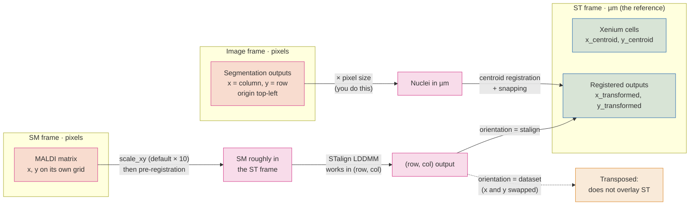
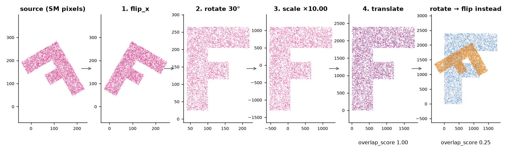
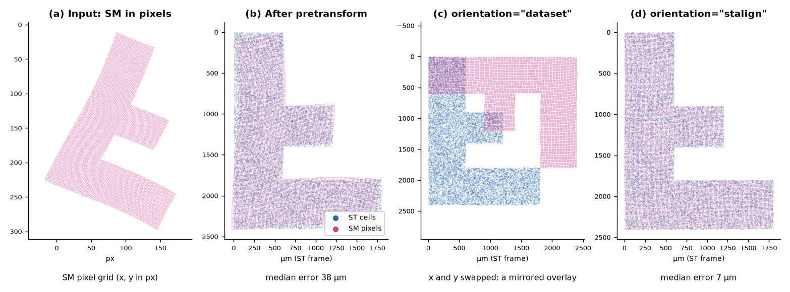

# Coordinate frames

Most registration failures are not registration failures. They are two tables
in different units, a flip applied in the wrong order, or x and y swapped on
the way out of STalign. This page lists every frame your data passes through,
the conversions between them, and which output column is in which frame, so
you can check your inputs before you trust an overlay.



The spatial transcriptomics (ST) frame, in microns, is the reference. Every
other dataset moves into it, and nothing ever moves the ST data.

## Microns and pixels

| Data | Units | Origin and axes |
|---|---|---|
| Xenium cells, transcripts | µm | Xenium's own frame |
| SMINT segmentation outputs | **pixels** of the full image | top-left; `x` is the column, `y` is the row |
| MALDI / SM matrix `x, y` | **pixels** of the SM grid | as exported by the instrument software |
| All registered outputs | µm, in the ST frame | as the ST data |

SMINT registration parameters are in microns: `max_distance` (100), the
`multiround` block sizes (500 and 250), `snap_radius` (10) and the LDDMM raster
pixel size `dx` (30). Give them pixel coordinates and every one of those
defaults is wrong by your pixel size.

Segmentation does not convert to microns for you. Multiply by the pixel size
from your image metadata (OME-TIFF `PhysicalSizeX` / `PhysicalSizeY`) before
registering:

```python
import pandas as pd
import tifffile

with tifffile.TiffFile("slide.ome.tif") as tif:          # the image you segmented
    pixels = tifffile.xml2dict(tif.ome_metadata)["OME"]["Image"]["Pixels"]
pixel_size_um = float(pixels["PhysicalSizeX"])            # check PhysicalSizeXUnit if set

nuclei = pd.read_csv("seg_out/nuclei_summary.csv")       # x_centroid, y_centroid in pixels
nuclei[["x_centroid", "y_centroid"]] *= pixel_size_um
nuclei.to_csv("nuclei_um.csv", index=False)
```

For an OME file holding several images, `["Image"]` is a list; pick the one
you segmented.

If the post-stain image was not acquired in the Xenium frame, the nuclei are
now in microns but still offset; bring them within `max_distance` with
`smint-alignment pretransform` first (it fits scale from the extents and moves
the centroid onto the reference).

### SM pixel scaling: `scale_xy`

`read_sm_matrix` (used by `register_sm_to_st`, `prepare_landmark_inputs` and
`smint-alignment st-sm`) applies three steps to the SM `x, y`, in this order:

1. **Scale** by `scale_xy` (default `10.0`, `--scale-xy`): MALDI pixels to
   microns for the data SMINT was developed on. Set it to your SM pixel pitch.
2. **Rotate** 90° anticlockwise if `rotate_left_90=True`: `(x, y) → (−y, x)`.
3. **Shift** so all coordinates are ≥ 0 (`keep_positive=True`).

!!! warning "Scale once"
    If you already pre-registered the SM table (its coordinates are in µm in the
    ST frame), register it with `sm_kwargs={"scale_xy": 1.0, "keep_positive": False}`
    (`--scale-xy 1 --no-keep-positive` on the command line). Otherwise it is
    scaled a second time, and pre-registered coordinates that fall below 0 are
    shifted, which moves the table away from its landmarks. The same applies to
    landmarks: they must be in the frame of the SM coordinates *after*
    `read_sm_matrix`. Landmarks from `prepare_landmark_inputs` are, because it
    rasterises with the same settings; landmarks picked on the CSV as stored
    (for example in napari) are not, unless `scale_xy` is 1 and `keep_positive`
    is False.

## Pre-registration order

`build_pretransform` composes one 3 × 3 matrix from four operations, always in
this order, about the source centroid:

**flip → rotate → scale → translate**

The order matters because flips and rotations do not commute: "flip, then
rotate 30°" is a different transform from "rotate 30°, then flip". Scale is
fitted *after* the flip and rotation, because bounding-box extents change when
you rotate.

<figure markdown>

<figcaption>A synthetic SM section that is mirrored, turned 30° and on a grid
ten times coarser than the reference. Each panel adds one operation from
<code>build_pretransform(sm_xy, st_xy, rotation=30, flip_x=True)</code>; the
fitted scale is 10.00 and the overlap score reaches 1.00. Applying the same
rotation and flip in the other order leaves an overlap of 0.25. Plotted with
y up.</figcaption>
</figure>

```python
from smint.alignment import build_pretransform, apply_pretransform, describe_pretransform, overlap_score

matrix = build_pretransform(sm_xy, st_xy, rotation=30, flip_x=True)  # (N, 2) x, y arrays
moved = apply_pretransform(sm_xy, matrix)
print(overlap_score(moved, st_xy))      # 1.0 on the synthetic data above
print(describe_pretransform(matrix))    # scale_x 10.0, rotation_deg -150.0, reflects True, ...
```

`describe_pretransform` is the quickest sanity check: `reflects: True` means
the matrix contains a mirror, so a rotation of −150° here is "flip, then turn
30°", not a turn of −150°.

!!! note "Which way is anticlockwise?"
    `rotation` is anticlockwise with the y axis pointing up. Images are usually
    displayed with y pointing down, where the same rotation looks clockwise.

## STalign works in (row, column)

STalign stores images as `[Y, X]` and points as `(row, col) = (y, x)`.
SMINT converts at the edges so you can stay in `(x, y)`:

- Landmark files hold `(x, y)` per label (the format of STalign's
  `point_annotator.py` and of the napari plugin); `load_landmarks` swaps them to
  `(row, col)` for STalign.
- napari layers are also `(row, col)`; the plugin converts in both directions.
- On the way out, `transform_points` (and so `register_sm_to_st` and
  `smint-alignment st-sm`) takes an `orientation`:

| `orientation` | `x_transformed`, `y_transformed` are | Use it for |
|---|---|---|
| `"stalign"` | true `x, y` in the ST frame | Anything new: overlays, joins, the R scripts |
| `"dataset"` (default) | `x` and `y` swapped relative to the ST frame | Reproducing outputs of earlier pipeline runs |

The default is `"dataset"` so that older analyses keep producing the same
files. For new work, always pass `orientation="stalign"` (`--orientation
stalign`).

<figure markdown>

<figcaption>SMINT's sequential path run end to end on synthetic data:
<code>smint-alignment pretransform</code>, five landmark pairs, then
<code>register_sm_to_st</code> once per orientation. (a) SM input in pixels.
(b) After pre-registration the median error is 38 µm. (c) With
<code>orientation="dataset"</code> the output is the transpose of the right
answer and does not overlay the ST cells. (d) With
<code>orientation="stalign"</code> the median error is 7 µm. Plotted with
y down, as an image.</figcaption>
</figure>

!!! warning "The orientation is not stored in the CSV"
    `register_sm_to_st` records it in `df.attrs["orientation"]`, which lives
    only in memory. Runs launched by `smint-alignment` or napari record it in
    `job_spec.json` in the output directory. If you call the function yourself,
    put the orientation in the output file name. A mirrored overlay along the
    diagonal is the signature of a `"dataset"` output plotted against ST.

## Which column is in which frame

| File | Columns | Frame |
|---|---|---|
| `cells_outlines.csv`, `nuclei_outlines.csv` | `global_cell_id`, `x`, `y` | Image pixels |
| `cells_summary.csv`, `nuclei_summary.csv` | `x_centroid`, `y_centroid`, `area` | Image pixels (area in px²) |
| `<base>_cells.csv`, `<base>_nuclei.csv` (`process_large_image`) | `global_cell_id`, `chunk_id`, `x`, `y` | Image pixels |
| `cells.zarr`, `nuclei.zarr` | label masks | Image pixels; per-tile IDs, not the stitched IDs |
| Pretransform output CSV | the source's own coordinate columns, **overwritten** | Reference (ST) frame |
| `<output>.transform.json` | `matrix`, `described` | Maps the original source onto the reference |
| `centroids_transformed.csv` | the source's original columns | Source frame, unchanged |
| | `x_transformed`, `y_transformed` | ST frame (snapped where `registration_status` is `snapped` or `assigned`) |
| | `x_transformed_smooth`, `y_transformed_smooth` | ST frame, transform only |
| | `target_index` | Row of the partner in the target table, −1 if none |
| `sm_transformed.csv` | `x`, `y` | SM frame **after** `scale_xy`, rotation and shift, not the original pixels |
| | `x_transformed`, `y_transformed` | ST frame with `orientation="stalign"`; transposed with `"dataset"` |
| Landmark `.npy` | `{label: [(x, y)]}` | The frame of the data you clicked on |

!!! tip "Check before you register"
    `smint-alignment columns my_table.csv` lists a table's columns and shows
    which pair SMINT would pick. ST tables often carry several coordinate pairs
    from different processing stages, and registering the wrong pair fails
    silently. Pass the columns explicitly when in doubt.

## Next steps

- See where each conversion happens in the pipeline: [The SMINT workflow](workflow.md).
- File formats in full: [Data formats](../reference/data_formats.md).
- Pre-registration in napari: [napari plugin](../napari_plugin.md).
- A complete sequential run: [Sequential-section registration](../tutorials/03_sequential_registration.ipynb).

<small>Figures are generated by `docs/assets/concepts/src/make_registration_figures.py`
and `docs/assets/concepts/src/make_stalign_figure.py`.</small>
