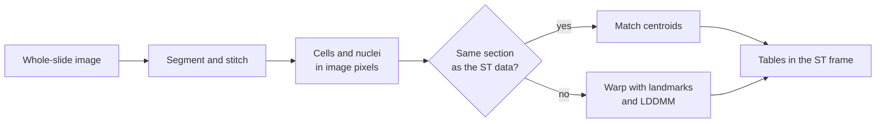

# User guide

This guide explains how SMINT works, so you can choose the right path for your
data and spot a bad result when you see one. Start with the workflow, then
read the page for the step you are on. The how-to guides further down the
navigation give the exact commands; the concept pages explain why they work
the way they do.

## The mental model

SMINT does two jobs, in order. First it **finds cells**. Cellpose segments
cells and nuclei in a whole-slide image tile by tile, and SMINT stitches the
tiles back into one set of outlines in which every nucleus sits inside exactly
one cell. Then it **puts everything in one coordinate system**. Each extra
modality, such as post-stain nuclei or spatial metabolomics pixels, is
registered onto the spatial transcriptomics (ST) cells, which stay fixed as the
reference. How SMINT registers depends on one question: *was the second
modality measured on the same physical section as the ST data, or on a
neighbouring one?* On the same section the cells correspond one-to-one, so
SMINT matches points. On sequential sections they do not, so SMINT warps one
image onto the other with landmarks and STalign LDDMM. Everything you get at
the end is a table with coordinates in the ST frame, ready for the R scripts
that assign transcripts and metabolites to cells.

## Concepts

-   :material-sitemap-outline:{ .lg .middle } **The SMINT workflow**

    ---

    Every step from image to integrated table: what goes in, which function,
    command or napari widget runs it, what comes out and how long it takes.

    [:octicons-arrow-right-24: The SMINT workflow](workflow.md)

-   :material-source-branch:{ .lg .middle } **Choosing a registration method**

    ---

    A decision tree for same-section and sequential data, measured results on
    real data, and the two ways validation numbers can mislead you.

    [:octicons-arrow-right-24: Choosing a registration method](registration_methods.md)

-   :material-axis-arrow:{ .lg .middle } **Coordinate frames**

    ---

    Pixels versus microns, the order of pre-registration operations, the
    STalign row/column transpose, and which output column is in which frame.

    [:octicons-arrow-right-24: Coordinate frames](coordinate_frames.md)

-   :material-view-grid-outline:{ .lg .middle } **Tiling and stitching**

    ---

    How a slide is cut into overlapping tiles, how duplicate cells are merged,
    trimmed or removed, and how to choose `tile_overlap`.

    [:octicons-arrow-right-24: Tiling and stitching](tiling_and_stitching.md)

## How-to guides

Once you know which path you are on, these pages cover every option:

- [Segmentation](../segmentation.md): one GPU or many, models and parameters.
- [Alignment](../alignment.md): pre-registration, centroid registration and
  STalign LDDMM in detail.
- [napari plugin](../napari_plugin.md): the registration steps in a viewer.
- [Running on HPC](../hpc_deployment.md): SLURM submission for segmentation
  and registration.
- [R integration](../r_integration.md): the downstream R scripts.

If you would rather learn by running code, the [tutorials](../tutorials/index.md)
walk through each path on example data with every output shown.
