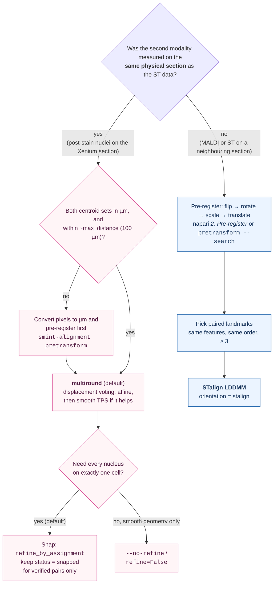
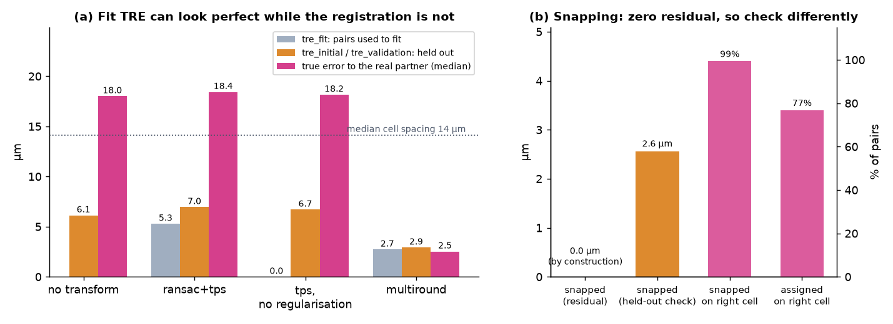

# Choosing a registration method

The right registration method depends far more on how your data were acquired
than on any parameter. This page helps you pick a path, shows what each path
achieved on real data, and explains how to read the validation numbers SMINT
reports, including two cases where a good-looking number means nothing.

## Decision tree

The first question is the important one. On the **same section** each nucleus
really has a partner Xenium cell, so SMINT solves a matching problem and can
place nuclei exactly. On **sequential sections** no cell has a partner, so
SMINT solves an image-warping problem. Running the same-section tools on
sequential sections still produces a number, but it is fitting noise: the
"partners" it finds are merely nearby cells.

## Same section: which centroid method

`register_centroids` (and `smint-alignment centroid --method`) offers five
models. Use `multiround` unless you have a reason not to.

| Method | What it fits | When it works | Watch out for |
|---|---|---|---|
| **`multiround`** (default) | Round 1: affine through per-block displacement peaks (500 µm blocks). Round 2: smooth TPS through finer peaks (250 µm), kept only if it helps | Starting offset comparable to or larger than the cell spacing; local warps | Tissue that is a regular lattice, where every whole-spacing shift looks equally good |
| `affine` | Least-squares affine on nearest-neighbour pairs | Offset well below the cell spacing, purely global | Wrong pairs bias the fit |
| `ransac` | RANSAC-robust affine on nearest-neighbour pairs | As `affine`, with some bad pairs | Cannot recover when most pairs are wrong |
| `tps` | Affine, then thin-plate spline on the pairs | Small offset with local distortion | Memorises pairs when under-regularised |
| `ransac+tps` | RANSAC affine, then TPS on the inliers | As `tps`, with outliers | Same as `tps` |

**Why multiround.** The single-round methods match every nucleus to its
nearest cell *once*, before fitting. When the starting offset is close to the
cell spacing, many of those first matches are wrong, and no transform fitted
to them can recover. `multiround` never commits to matches: within each block,
every nucleus votes for the displacements to several nearby cells. Wrong
candidates scatter, but the true offset is shared by the whole block and piles
up as a peak.

**When to snap.** A smooth transform leaves each nucleus a few microns from its
cell, partly because a nucleus really is off-centre in its cell.
`refine_by_assignment` pairs nuclei and cells one-to-one, keeps a pair only if
its offset agrees with its neighbours' offsets, and moves the nucleus exactly
onto the cell (`snapped`). Nuclei that fail the neighbourhood check can then be
assigned to the nearest free cell (`assigned`); these are less certain. It runs
by default in `register_centroid_files` and the CLI.

## Sequential sections: pre-register first

STalign's LDDMM refines an alignment; it does not find one from scratch.
Spatial metabolomics usually arrives on its own pixel grid, often rotated or
mirrored and at a different scale, so bring it roughly onto the ST data first
(see [Coordinate frames](coordinate_frames.md#pre-registration-order)). Then
place at least three landmark pairs, the same anatomical features in the same
order in both datasets, and run LDDMM. Correspondence is by position in the
list, so a swapped pair silently produces a wrong warp.

## Measured on real data

=== "Same section (Sample 2, z5)"

    88,906 post-stain nuclei registered onto 74,247 Xenium cells, whose
    centroids are about 17 µm apart. Numbers are for the quarter of nuclei
    **held out** from fitting.

    | Held-out nuclei | Median distance to nearest cell | Mutual match ≤ 5 µm | Mutual match ≤ 10 µm |
    |---|---|---|---|
    | No transform | 12.4 µm | 10% | 34% |
    | `ransac+tps` (one round) | 11.5 µm | 13% | 40% |
    | **`multiround`** | **5.4 µm** | **45%** | **76%** |

    Held-out TRE fell from 11.0 to 4.9 µm, in 3 s. Snapping then placed
    65,349 nuclei, 88% of the Xenium cells, exactly on a distinct cell:
    57,083 `snapped` and 8,266 `assigned`. The median neighbour deviation was
    4.1 µm for snapped pairs and 8.5 µm for assigned ones, so treat the
    assigned pairs with more caution.

    

=== "Sequential sections (Sample 2, Z2 and MALDI section B)"

    459,969 MALDI pixels registered onto 53,622 Xenium cells of the
    neighbouring section with 11 landmark pairs, in about 72 s on one A30
    GPU. After LDDMM the median distance from an SM pixel to the nearest ST
    cell was 16.4 µm.

    

    There is no ground truth on sequential sections, so this distance is a
    sanity check (the pixels landed on tissue), not an accuracy. Judge the
    result by overlaying anatomical features you did not use as landmarks.

## Reading the validation numbers

### Same-section metrics

| Key in the result | Meaning | Trust it? |
|---|---|---|
| `tre_initial` | Mean distance between matched pairs before any transform | A baseline |
| `tre_fit` | The same after the transform, on the pairs used to fit it | **No**: see trap 1 |
| `tre_validation` | The same on held-out data (pairs, or for `multiround` held-out nuclei matched by mutual nearest neighbour) | Yes, with trap 1 in mind |
| `validation["before"]`, `["after"]` (`multiround`) | Correspondence-free: `median_nn` and the fractions `mutual_within_5` / `mutual_within_10` for held-out nuclei | Yes |
| `rounds` (`multiround`) | Per-round log: blocks, consistent fraction, median NN, whether the round was kept | For diagnosis |
| `refinement["validation"]` | Held-out check of snapping: kept pairs predicted from their neighbours alone | Yes: see trap 2 |
| `registration_status`, `neighbour_deviation` (per row) | How each nucleus was placed, and how far its offset is from its neighbourhood's | Filter on these |

SMINT logs a warning when held-out TRE is no better than the initial TRE, when
validation TRE exceeds five times fit TRE (single-round methods), and when assigned pairs deviate far
more than snapped ones. Read the log.

### Trap 1: TRE against nearest-neighbour pairs is circular

Correspondences are found by nearest neighbour, so TRE measures distance to
the *nearest* cell, not to the *right* one. A flexible enough transform drives
it to zero on the pairs it was fitted to: that is interpolation, not accuracy.
Holding pairs out protects you against over-fitting, but not against the pairs
themselves being wrong.

<figure markdown>

<figcaption>Synthetic same-section data where every nucleus's true cell is
known: 7,271 cells about 14 µm apart, 6,934 nuclei shifted by roughly
15 µm with a small rotation, scale and warp. (a) Before registration the
nearest-neighbour TRE is 6.1 µm while the true error is 18.0 µm. One-round
`ransac+tps` and an unregularised TPS report small TREs (an unregularised fit
TRE of 0.0) yet leave the true error at about 18 µm: they fitted the wrong
pairs. `multiround` reports 2.9 µm held out, and the true error is 2.5 µm.
(b) After snapping, the residual of a snapped nucleus is 0 by construction.
The held-out check (2.6 µm) is the number to report; here 99% of snapped and
77% of assigned nuclei sit on their true cell.</figcaption>
</figure>

How to protect yourself:

- **Compare TRE with the cell spacing.** If the initial TRE is a large
  fraction of the spacing, nearest-neighbour pairs are ambiguous and the
  single-round methods cannot be trusted. Use `multiround`.
- **Prefer the correspondence-free numbers** (`validation["after"]`) and an
  overlay plot.
- **Never set `validation_fraction=0`** unless you accept that the reported
  TRE is then uninformative.

### Trap 2: a snapped nucleus has zero residual by construction

Snapping moves a nucleus exactly onto its partner cell, so its residual is 0
whether the partner is right or wrong. The meaningful check is
`refinement["validation"]`: a tenth of the accepted pairs are left out of the
offset field and predicted from their neighbours alone. On Sample 2 z5 the
median neighbour deviation was 4.1 µm for snapped and 8.5 µm for assigned
pairs; a nucleus put on a neighbour's cell deviates by about a cell spacing.

!!! tip "Keep only verified pairs"
    For analyses where a wrong nucleus–cell pair would mislead you, keep rows
    with `registration_status == "snapped"`, filter on `neighbour_deviation`,
    or run with `--no-assign-remaining` (`assign_remaining=False`).

## Next steps

- Make sure both inputs are in the frame you think: [Coordinate frames](coordinate_frames.md).
- Every option for each method: [Alignment](../alignment.md).
- Run both branches on example data:
  [Same-section registration](../tutorials/02_same_section_registration.ipynb),
  [Sequential-section registration](../tutorials/03_sequential_registration.ipynb).
- API details: [Alignment reference](../reference/api/alignment.md).

<small>The synthetic figure is generated by
`docs/assets/concepts/src/make_registration_figures.py`, which runs
`register_centroids` and `refine_by_assignment` exactly as shown.</small>
