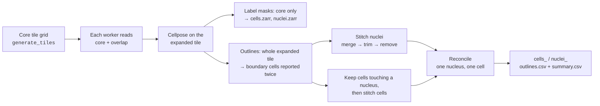
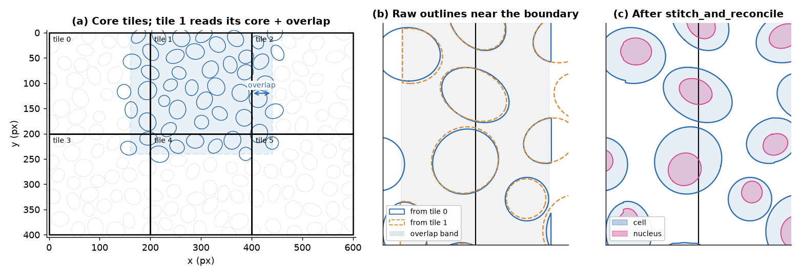
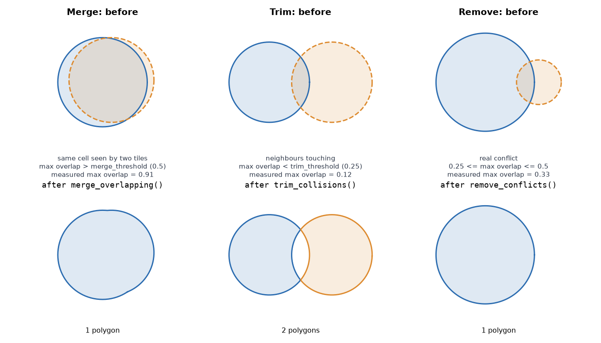
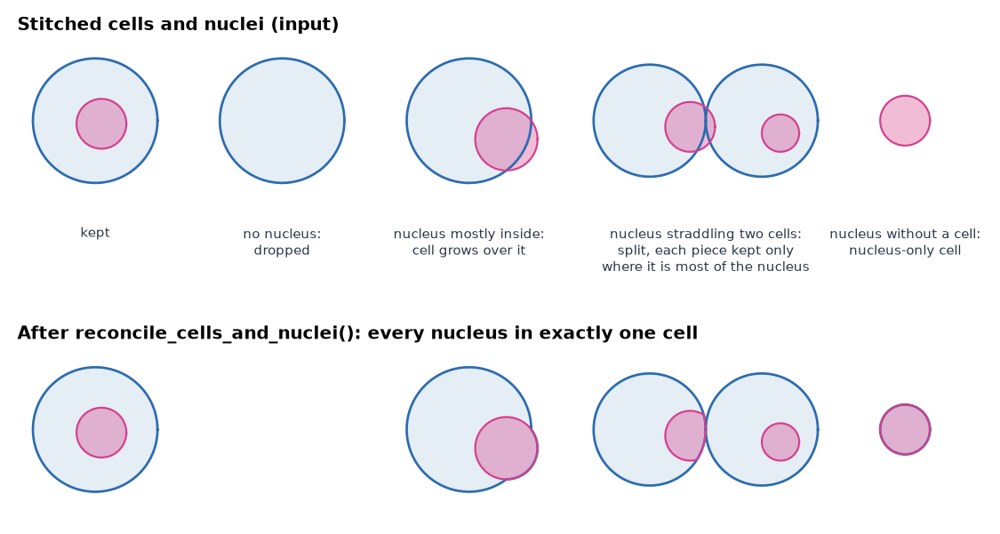
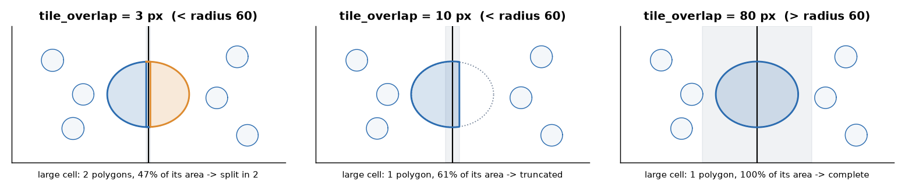

# Tiling and stitching

A whole slide is too large for one Cellpose call, so SMINT cuts it into tiles,
segments the tiles in parallel and joins the results. This page shows how the
tiles overlap, why that creates duplicate cells, how the three stitching phases
remove them, how cells and nuclei are reconciled, and how to choose
`tile_overlap`. Every figure was made by running SMINT's own stitching code on
synthetic outlines; only the Cellpose step is simulated.



## Core tiles and the overlap

`run_distributed_segmentation` divides the image into a grid of square **core
tiles** (`tile_size`, default 2048 px). Each Dask worker reads its core tile
**expanded by `tile_overlap`** on every side (default 256 px, clipped at the
image edge) and runs Cellpose on the whole expanded region. Then:

- It writes only the **core** of its label masks into the shared
  `cells.zarr` / `nuclei.zarr`, so no pixel is written twice.
- It extracts outlines from the **whole expanded** region, so a cell that
  crosses a core boundary is reported complete by at least one tile.

The price is that every cell inside an overlap band is reported by two tiles
(four at a corner). That is what stitching removes.

<figure markdown>

<figcaption>A synthetic 600 × 400 px field with 167 cells, cut into six
200 px core tiles with a 40 px overlap. (a) Tile 1 reads its core plus the
shaded margin, so it sees every blue cell. (b) Near the boundary between
tiles 0 and 1, both tiles report the same cells with slightly different
outlines, and cells cut by the edge of a window come back as fragments.
(c) After <code>stitch_and_reconcile</code>: one outline per cell, each
with its nucleus. The six tiles reported 273 cell outlines; merging left
167, and 166 of them match a true cell with IoU > 0.5.</figcaption>
</figure>

## The three stitching phases

`stitch_polygons` (a Python port of `stitching/stitching.Rmd`)
measures every intersecting pair by its **maximum overlap**: the intersection
area divided by the smaller polygon's area. Then it runs three phases, each on
the result of the last:

| Phase | Applies to pairs with | Action | Why |
|---|---|---|---|
| **Merge** | max overlap > `stitch_merge_thresh` (0.5) | Union the pair; repeat until nothing more merges | The same cell seen by two tiles, or a fragment of it |
| **Trim** | max overlap < `stitch_trim_thresh` (0.25) | Remove the overlap from both | Neighbouring cells that touch |
| **Remove** | max overlap ≥ 0.25 (and not merged) | Drop the smaller polygon | A genuine conflict that neither merging nor trimming explains |

<figure markdown>

<figcaption>Each phase on a pair of polygons, with the maximum overlap
measured by SMINT: 0.91 is merged into one polygon, 0.12 is trimmed so the
two cells no longer overlap, and 0.33 loses the smaller polygon.</figcaption>
</figure>

Nuclei are stitched first. Cells that touch no stitched nucleus are then
dropped, and the remaining cells are stitched the same way. Both thresholds
can be set in the `distributed` section of the config or as arguments; the
defaults suit most tissue.

## Reconciling cells and nuclei

Stitching makes each object type consistent on its own. Reconciliation
(`reconcile_cells_and_nuclei`, on by default as `reconcile_nuclei`) makes the
two consistent with each other, so every nucleus ends up inside exactly one
cell:

1. Drop cells with no nucleus, and cells whose only nucleus barely touches
   them (less than 10% of the nucleus inside).
2. Grow a cell over a nucleus that is more than half inside it and touches no
   other cell.
3. Split a nucleus that straddles several cells. A piece is kept if it is at
   least half the nucleus, or, for a cell with no other nucleus, at least 40%
   (two cells) or 30% (three or more).
4. Remove duplicate, contained and mostly covered objects; cut any remaining
   overlap out of the larger one.
5. Assign each nucleus to its cell. A nucleus with no cell becomes a
   nucleus-only cell.

<figure markdown>

<figcaption>Five reconciliation cases run through
<code>reconcile_cells_and_nuclei</code>: 5 cells and 5 nuclei in, 5 cells
and 5 nuclei out, each nucleus in one cell. The cell without a nucleus is
dropped and the nucleus without a cell becomes a cell of its own.</figcaption>
</figure>

The output summaries record the result: `n_nuclei` per cell in
`cells_summary.csv`, and the containing cell's `global_cell_id` as `cell_id`
in `nuclei_summary.csv`. Before outlines are extracted, each worker also splits
cells that contain several nuclei with a watershed seeded on the nuclei
(`split_multinucleated`, on by default).

## Choosing `tile_overlap`

Stitching can only rebuild a cell that at least one tile saw whole, or whose
two fragments overlap enough to merge. Both are guaranteed when **the overlap
is larger than the radius of the largest cell**, in pixels: a cell that
crosses a core boundary then lies entirely inside the expanded window of the
tile that holds its centre.

<figure markdown>

<figcaption>A cell 60 px in radius centred on a tile boundary, stitched with
three overlaps. At 3 px the two fragments barely overlap, are trimmed, and the
cell is split in two. At 10 px they overlap enough to conflict, and the
smaller fragment is removed, leaving 61% of the cell. At 80 px, larger than
the radius, each tile sees the whole cell and the copies merge into one
complete outline.</figcaption>
</figure>

Rules of thumb:

- Set `tile_overlap` above the **largest** cell radius you expect, not the
  typical one. The default of 256 px covers cells up to about 500 px across.
- A larger overlap costs extra Cellpose time on every tile: each tile reads
  `(tile_size + 2 × tile_overlap)²` pixels.
- Raise `tile_size` rather than shrinking the overlap if you need fewer,
  larger tiles. Very many tiles can also overflow the per-tile label IDs, which
  SMINT reports before it starts.

=== "Python"

    ```python
    from smint.segmentation import run_distributed_segmentation

    out = run_distributed_segmentation(
        "slide.ome.tif", "seg_out/", config_path="segmentation.yaml",
        chunk_size=2048,          # core tile size, px
        tile_overlap=256,         # > largest cell radius, px
        stitch_merge_thresh=0.5,
        stitch_trim_thresh=0.25,
    )
    ```

=== "Command line"

    ```bash
    smint-segment-distributed \
        --image_path slide.ome.tif --output_dir seg_out/ \
        --config_path segmentation.yaml \
        --tile_size 2048 --tile_overlap 256
    ```

=== "Config (YAML)"

    ```yaml
    chunk_size: 2048
    distributed:
      tile_overlap: 256
      stitch_merge_thresh: 0.5
      stitch_trim_thresh: 0.25
      reconcile_nuclei: true
      split_multinucleated: true
    ```

## Stitching outlines you already have

The stitching functions work on any Shapely polygons in a consistent unit, so
you can also use them on outlines from another tool:

```python
import pandas as pd
from smint.segmentation.distributed_seg import stitch_and_reconcile

# Outline dicts as segment_tile / get_cell_outlines return them:
# {"x_coords": [...], "y_coords": [...]}. From vertex CSVs (global_cell_id, x, y):
def outlines_from_csv(path):
    return [{"x_coords": g.x.to_numpy(), "y_coords": g.y.to_numpy()}
            for _, g in pd.read_csv(path).groupby("global_cell_id")]

cell_outlines = outlines_from_csv("cells_outlines.csv")
nuclei_outlines = outlines_from_csv("nuclei_outlines.csv")
cells, nuclei, nucleus_cell = stitch_and_reconcile(cell_outlines, nuclei_outlines)
# nucleus_cell[k] is the index in `cells` of the cell holding nucleus k
```

## Next steps

- All segmentation options: [Segmentation](../segmentation.md).
- Run it across GPUs: [Distributed segmentation on SLURM](../tutorials/04_distributed_segmentation.ipynb)
  and [Running on HPC](../hpc_deployment.md).
- Config keys: [Configuration](../reference/configuration.md).
- API: [Segmentation reference](../reference/api/segmentation.md).

<small>Figures are generated by `docs/assets/concepts/src/make_tiling_figures.py`,
which calls `generate_tiles`, `stitch_and_reconcile`, `stitch_polygons` and the
individual phase functions.</small>
