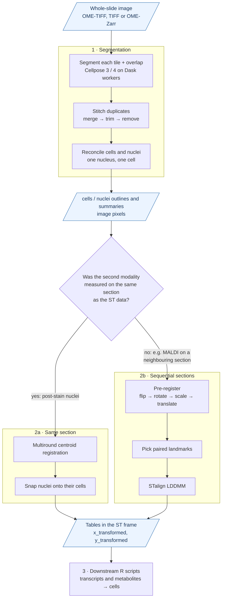

# The SMINT workflow

This page follows one dataset from raw image to an integrated table. For each
step it lists what goes in, how to run it from Python, the command line or
napari, what comes out, and how long it took on real data. Use it to find
where you are and what the next step needs from you.



*Blue boxes are files you hand from one step to the next. The registration
branch is the one decision you have to make; see
[Choosing a registration method](registration_methods.md).*

Throughout, the **spatial transcriptomics (ST) data is the fixed reference**:
every other modality moves onto it, and every final coordinate is in the ST
frame, in microns. [Coordinate frames](coordinate_frames.md) explains each
frame on the way.

## 1 · Segment and stitch

Cellpose finds cells and nuclei in tiles of the slide. SMINT reads each tile
with an overlap margin, so cells on a tile boundary are seen whole, then
stitches the duplicates this creates and reconciles cells with nuclei. The
stitching runs automatically at the end of the distributed run; you only see
it through its outputs. [Tiling and stitching](tiling_and_stitching.md) shows
each phase.

| | |
|---|---|
| **Inputs** | A multichannel whole-slide image (OME-TIFF, TIFF, Zarr or OME-Zarr) on storage every worker can read; a cell and/or nucleus Cellpose model (built-in name or path to a fine-tuned model); per-model `diameter`, `flow_threshold`, `cellprob_threshold`, `channels`, usually in a YAML config |
| **Python** | `smint.segmentation.run_distributed_segmentation(image_path, output_dir, config_path=...)`; stitching on its own: `smint.segmentation.distributed_seg.stitch_and_reconcile` |
| **Command line** | `python -m smint.segmentation.distributed_seg --image_path ... --output_dir ...` |
| **napari** | — (segmentation runs as a job; the napari plugin covers registration) |
| **Outputs** | `cells_outlines.csv`, `nuclei_outlines.csv` (one row per vertex: `global_cell_id, x, y`); `cells_summary.csv` (`global_cell_id, x_centroid, y_centroid, area, n_nuclei`); `nuclei_summary.csv` (`cell_id` in place of `n_nuclei`); raw label masks `cells.zarr`, `nuclei.zarr`. All in **full-image pixels**. |
| **Typical runtime** | Sample 3, 4096 × 4096 px, 16 tiles on 4 A30 GPUs: 0.6 min (44 cells, 44 nuclei). A 2048 px crop with Cellpose 4 and a fine-tuned Cellpose-SAM model on one A30: 23 s. |

=== "Python"

    ```python
    from smint.segmentation import run_distributed_segmentation

    out = run_distributed_segmentation(
        "slide.ome.tif", "seg_out/",
        config_path="segmentation.yaml",  # models, diameters, channels
        backend="slurm",                   # or "local" for the GPUs on this machine
        n_workers=4,
        tile_overlap=256,                  # > the largest cell radius, in pixels
    )
    print(out["total_cells"], out["total_nuclei"], out["cells_summary_path"])
    ```

=== "Command line"

    ```bash
    python -m smint.segmentation.distributed_seg \
        --image_path slide.ome.tif --output_dir seg_out/ \
        --config_path segmentation.yaml \
        --backend slurm --n_workers 4 --slurm_gpu_type A30 \
        --tile_size 2048 --tile_overlap 256
    ```

!!! note "One GPU without stitching"
    `smint.segmentation.process_large_image` segments a slide on one GPU in
    non-overlapping chunks and writes `<base>_cells.csv` / `<base>_nuclei.csv`.
    It does **not** stitch, so cells cut by a chunk border stay cut. On one
    machine with one GPU you can still get stitched outputs from
    `run_distributed_segmentation(..., backend="local")`.

How-to: [Segmentation](../segmentation.md) ·
[Running on HPC](../hpc_deployment.md) ·
tutorials [Segment a whole slide](../tutorials/01_segmentation.ipynb) and
[Distributed segmentation on SLURM](../tutorials/04_distributed_segmentation.ipynb) ·
reference [Configuration](../reference/configuration.md).

## 2a · Same section: centroid registration

Use this branch when the second modality was imaged on the *same* physical
section as the ST data, for example nuclei stained and imaged after the Xenium
run. Each nucleus then has a partner Xenium cell, so registration is a
point-matching problem. SMINT fits a coarse-to-fine transform by displacement
voting (`multiround`), then *snaps* each confidently matched nucleus exactly
onto its cell.

| | |
|---|---|
| **Inputs** | Source (moving) centroid CSV, e.g. nucleus centroids; target (fixed) centroid CSV, e.g. Xenium `x_centroid, y_centroid`. Both in **microns** and within roughly `max_distance` (default 100 µm) of each other. |
| **Python** | `smint.alignment.register_centroid_files(source_file, target_file, output_path=...)`, or `register_centroids` + `refine_by_assignment` on arrays |
| **Command line** | `smint-alignment centroid --source ... --target ... --output-dir ...` (add `--submit` for SLURM) |
| **napari** | *4. Register* widget, round `centroid` |
| **Outputs** | `centroids_transformed.csv`: the source table plus `x_transformed, y_transformed` (snapped positions), `x_transformed_smooth, y_transformed_smooth` (transform only), `registration_status`, `target_index`, `neighbour_deviation`; `status.json` with the validation metrics |
| **Typical runtime** | Sample 2 z5, 88,906 nuclei onto 74,247 Xenium cells: 3 s for `multiround` |

=== "Python"

    ```python
    from smint.alignment import register_centroid_files

    table, result = register_centroid_files(
        "nuclei_um.csv", "xenium_cells.csv",
        source_cols=("x_centroid", "y_centroid"),
        target_cols=("x_centroid", "y_centroid"),
        output_path="nuclei_registered.csv",
    )
    print(result["tre_validation"])            # held-out, the number to trust
    print(result["refinement"]["n_snapped"])
    ```

=== "Command line"

    ```bash
    smint-alignment centroid \
        --source nuclei_um.csv --target xenium_cells.csv \
        --source-cols x_centroid y_centroid \
        --target-cols x_centroid y_centroid \
        --output-dir reg_same_section/
    ```

!!! warning "Segmentation outputs are in pixels"
    `cells_summary.csv` and `nuclei_summary.csv` hold image pixels, and the
    centroid CLI defaults to source columns `centroid_x, centroid_y`. Convert
    the centroids to microns in the ST frame first, and name the columns you
    pass. See [Coordinate frames](coordinate_frames.md#which-column-is-in-which-frame).

How-to: [Alignment](../alignment.md) ·
tutorial [Same-section registration](../tutorials/02_same_section_registration.ipynb) ·
reference [Command line](../reference/cli.md).

## 2b · Sequential sections: pre-registration, landmarks and LDDMM

Use this branch when the second modality comes from a *neighbouring* section,
such as MALDI spatial metabolomics. The tissue really differs between
sections, so there are no one-to-one partners. SMINT instead brings the two
datasets roughly together, takes a few paired landmarks from you, and lets
STalign's LDDMM find a smooth, invertible warp.

### Pre-register

| | |
|---|---|
| **Inputs** | Source CSV (SM pixels with `x, y`, or any table with detectable coordinate columns); reference CSV (ST cells) |
| **Python** | `build_pretransform`, `apply_pretransform`, `overlap_score`, `save_transform` |
| **Command line** | `smint-alignment pretransform --source ... --target ... --output ...` (`--search` grid-searches rotation and flips by overlap) |
| **napari** | *1. Load datasets*, then *2. Pre-register* (sliders, live overlap score) |
| **Outputs** | The source table with its coordinate columns overwritten in the reference frame, and `<output>.transform.json` (3 × 3 matrix plus its decomposition) |
| **Typical runtime** | Interactive |

### Pick landmarks

| | |
|---|---|
| **Inputs** | The pre-registered SM table and the ST table |
| **Python** | `prepare_landmark_inputs(st_file, sm_file, output_prefix)` rasterises both and writes `.npz` files for STalign's `point_annotator.py` |
| **napari** | *3. Landmarks*: place points on both layers, then save |
| **Outputs** | `<prefix>_st_points.npy`, `<prefix>_sm_points.npy`: the same features, in the same order, in both |
| **Typical runtime** | Manual; Sample 2 used 11 landmark pairs |

### Register with LDDMM

| | |
|---|---|
| **Inputs** | ST CSV, SM CSV, the two landmark files |
| **Python** | `smint.alignment.register_sm_to_st(st_file, sm_file, st_points_file, sm_points_file, orientation="stalign", ...)` |
| **Command line** | `smint-alignment st-sm --st ... --sm ... --st-points ... --sm-points ... --output-dir ... --orientation stalign` (add `--submit` for SLURM) |
| **napari** | *4. Register* widget, round `st_sm` |
| **Outputs** | `sm_transformed.csv`: every SM pixel with all m/z columns plus `x_transformed, y_transformed`; `status.json` |
| **Typical runtime** | Sample 2, section Z2 with MALDI section B: 459,969 SM pixels onto 53,622 ST cells with 11 landmarks, about 72 s on one A30 |

=== "Python"

    ```python
    from smint.alignment import register_sm_to_st

    df = register_sm_to_st(
        st_file="st_cells.csv", sm_file="sm_matrix.csv",
        st_points_file="z2_st_points.npy", sm_points_file="z2_sm_points.npy",
        output_path="sm_registered.csv",
        orientation="stalign",       # x, y in the ST frame
    )
    ```

=== "Command line"

    ```bash
    smint-alignment st-sm \
        --st st_cells.csv --sm sm_matrix.csv \
        --st-points z2_st_points.npy --sm-points z2_sm_points.npy \
        --orientation stalign \
        --output-dir reg_sequential/ --submit --gpus 1 --partition gpuq
    ```

!!! warning "STalign needs its own environment"
    STalign requires numpy < 2. SMINT runs the LDDMM step in a separate worker
    interpreter (`smint-register`, launched for you by the CLI and napari), so
    the rest of SMINT can stay on numpy 2. See [Installation](../installation.md).

How-to: [Alignment](../alignment.md) · [napari plugin](../napari_plugin.md) ·
tutorial [Sequential-section registration](../tutorials/03_sequential_registration.ipynb) ·
reference [Data formats](../reference/data_formats.md).

## 3 · Integrate in R

After registration every table shares the ST coordinate frame, so joining
modalities is a spatial join. The repository ships R templates for the two
joins; edit the input paths at the top of each.

| Script | What it does |
|---|---|
| `assignment/transcript_assignment.R` | Joins Xenium transcripts (`x_location, y_location`, filtered to `qv >= 20`) to aligned cell polygons with `sf`, and builds a `SpatialExperiment` of counts per cell |
| `integration/metabolomics_integration.R` | Takes the registered SM pixels, averages every metabolite over the pixels within 20 µm of each ST cell centroid, and combines the result with the ST data in one `SpatialExperiment` |
| `stitching/stitching.Rmd` | The original R implementation of the stitching that SMINT ports to Python |

From Python you can launch them with `smint.r_integration.run_r_script`.
How-to: [R integration](../r_integration.md).

## Next steps

- Decide your branch: [Choosing a registration method](registration_methods.md).
- Check your units before registering: [Coordinate frames](coordinate_frames.md).
- Tune segmentation tiles: [Tiling and stitching](tiling_and_stitching.md).
- Run it: [Tutorials](../tutorials/index.md).
