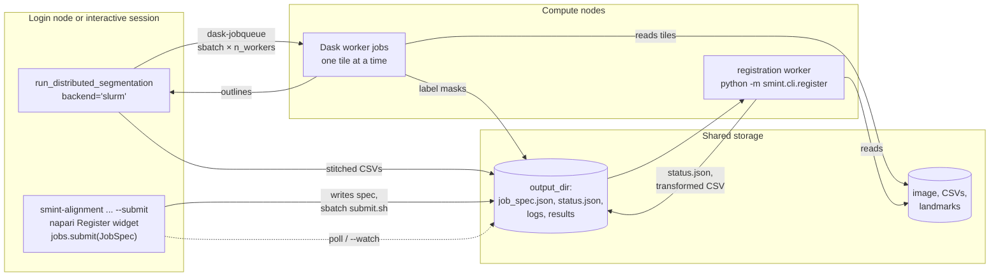

# Run SMINT on an HPC cluster

This guide shows you how to run SMINT's heavy steps on a SLURM cluster:
whole-slide segmentation on GPU workers, and registration jobs submitted from
the command line, Python or the napari plugin. It covers the environments you
need, the one storage rule that matters, how jobs flow, and what to do when a
job misbehaves.

!!! note "Partition and GPU names"
    The examples use the partitions of the cluster SMINT was developed on:
    `regular` (CPU) and `gpuq` (GPU, with A30, A100 and P100 cards). Replace
    them with your cluster's; `sinfo -s` lists them.

## How jobs flow



- **Segmentation** keeps a *driver* process running where you started it. It
  asks SLURM for worker jobs, sends them tiles, collects the outlines and
  stitches them. The driver must stay alive until the run finishes.
- **Registration** is fire-and-forget: SMINT writes a job spec to
  `output_dir`, submits an sbatch script that runs a worker on it, and the
  worker reports through `status.json`. You can close the terminal or napari
  and poll later.

## Set up the environments

You need up to three Python environments, because their requirements
conflict:

| Environment | For | Key constraint | Install |
|---|---|---|---|
| **Core / segmentation** | Segmentation, centroid registration, pre-registration, submitting jobs | Cellpose 3 *or* 4 with a CUDA build of torch | `pip install "smint[distributed] @ git+https://github.com/JurgenKriel/SMINT.git"` |
| **STalign worker** | LDDMM registration (`st_sm` jobs) | **numpy < 2** | see [Installation](installation.md#registration-with-stalign) |
| **napari** | The interactive plugin | Kept apart from the numpy < 2 STalign env (napari works with numpy 1 or 2) | `pip install "napari[all]"` plus SMINT |

Install them on **shared storage** so compute nodes can run them, and tell
SMINT which interpreter runs registration workers:

```bash
export SMINT_WORKER_PYTHON=/shared/envs/smint-stalign/bin/python
```

Without it, SMINT looks for an `STalign_env/bin/python` beside the installed
package, then falls back to the current interpreter. The centroid round has no
STalign dependency, so any environment with SMINT can run it.

!!! tip "Cellpose 3 or 4 on the cluster"
    Cellpose 4 (Cellpose-SAM) is what fine-tuned `cpsam` models need, and it
    is the version the Sample 3 GPU runs used. Cellpose 3 is lighter and keeps
    the classic `cyto3` / `nuclei` models. One environment holds one version;
    see [Installation](installation.md#cellpose-3-or-cellpose-4).

## The shared-storage rule

!!! danger "Everything a job touches must be on shared storage"
    A batch job runs on a different machine. Node-local paths (`/tmp`,
    `/var/tmp`, `/dev/shm`, `/run`) do not exist there, and the job dies
    **without any log**, because the log directory does not exist either.
    This applies to the image, the input CSVs and landmarks, `output_dir`, the
    Python environment, and for segmentation the directory you launch from
    (Dask worker logs go to `./dask_logs`). `JobSpec.validate()` rejects
    node-local paths before submitting.

## Segment on SLURM

### Option 1: Dask workers as SLURM jobs

Each worker is its own SLURM job with one GPU, so you can spread a slide over
several GPUs on several nodes. Start the driver from a login node, an
interactive session or a small CPU job:

=== "Python"

    ```python
    from smint.segmentation import run_distributed_segmentation


    def main():
        results = run_distributed_segmentation(
            image_path="/shared/project/slide.ome.zarr",
            output_dir="/shared/project/seg_run",
            config_path="configs/segmentation_config.yaml",
            cell_model="/shared/models/cpsam_finetuned",   # model path or built-in name
            nuclei_model="nuclei",
            backend="slurm",
            n_workers=4,                                    # 4 SLURM jobs, 1 GPU each
            use_gpu=True,
            slurm={"queue": "gpuq", "gpu_type": "A30",
                   "memory": "64GB", "walltime": "04:00:00"},
        )
        print(results["total_cells"], results["cells_summary_path"])


    if __name__ == "__main__":
        main()
    ```

=== "Command line"

    ```bash
    python -m smint.segmentation.distributed_seg \
        --image_path /shared/project/slide.ome.zarr \
        --output_dir /shared/project/seg_run \
        --config_path configs/segmentation_config.yaml \
        --cell_model /shared/models/cpsam_finetuned --nuclei_model nuclei \
        --backend slurm --n_workers 4 --use_gpu --slurm_gpu_type A30
    ```

    For more SLURM options than the GPU type, use the YAML `distributed.slurm`
    section (next tab).

=== "YAML config"

    ```yaml
    use_gpu: true
    n_workers: 4
    distributed:
      backend: slurm
      tile_overlap: 256
      worker_wait_timeout: 600       # seconds to wait for the first worker
      slurm:                         # passed to dask_jobqueue.SLURMCluster
        queue: gpuq
        gpu_type: A30                # SMINT adds --gres=gpu:A30:1
        memory: 64GB
        walltime: "04:00:00"
        job_extra_directives: ["--account=myproject"]
    ```

The `slurm` dictionary is passed to `dask_jobqueue.SLURMCluster`. SMINT's
defaults are `queue="gpuq"`, `cores=1`, `processes=1`, `memory="64GB"`,
`walltime="12:00:00"`, `log_directory="dask_logs"` and the current Python
interpreter for the workers. `gpu_type` is SMINT's own key: with
`use_gpu=True` it adds `--gres=gpu:<type>:1` (or `--gres=gpu:1` without a
type). The generated worker job script is printed to the log, so you can check
what was requested.

On Sample 3, a 4096 × 4096 px crop split into 16 tiles ran on 4 A30 workers in
0.6 min, using Cellpose 4 with a fine-tuned Cellpose-SAM model. The
[distributed segmentation tutorial](tutorials/04_distributed_segmentation.ipynb)
walks through it.

### Option 2: one GPU job

For a slide that one GPU can handle, submit a single job that runs
`scripts/run_segmentation.py`. The repository has a template in
`scripts/hpc_submit_scripts/slurm_segmentation.sh`; a minimal version:

```bash
#!/bin/bash
#SBATCH --job-name=smint_seg
#SBATCH --partition=gpuq
#SBATCH --gres=gpu:A30:1
#SBATCH --cpus-per-task=8
#SBATCH --mem=128G
#SBATCH --time=12:00:00
#SBATCH --output=%x_%j.out

source /shared/envs/smint/bin/activate
export PYTHONUNBUFFERED=1

python scripts/run_segmentation.py \
    --image /shared/project/slide.ome.tif \
    --output-dir /shared/project/seg_single \
    --config configs/segmentation_config.yaml \
    --save-config
```

Add `--distributed --use-gpu` to run `run_distributed_segmentation` inside the
job instead, with local Dask workers (one per GPU when `dask-cuda` is
installed). In that mode the models and their parameters come from the config
file only.

## Register on SLURM

### From the command line

Add `--submit` to any `smint-alignment` registration to send it to SLURM, and
`--watch` to wait for the result:

```console
$ smint-alignment st-sm --st st.csv --sm sm.csv \
      --st-points st_points.npy --sm-points sm_points.npy \
      --orientation stalign \
      --output-dir /shared/project/reg_b \
      --submit --partition gpuq --gpus 1 --memory 64G --time-limit 01:00:00 \
      --watch
submitted st_sm via sbatch (<job id>)
output dir: /shared/project/reg_b
```

| Flag | Default | Meaning |
|---|---|---|
| `--partition` | `regular` | SLURM partition |
| `--cpus` | 8 | CPUs per task |
| `--memory` | `64G` | Memory request |
| `--time-limit` | `04:00:00` | Walltime |
| `--gpus` | 0 | GPUs to request; with `--gpus 1` the job asks for an A30 (`--gres=gpu:A30:1`). The GPU type is fixed to A30 on the command line: for another card, or any card, submit with `JobSpec` / `SlurmResources(gpu_type=...)` or the napari widget |
| `--worker-python` | `$SMINT_WORKER_PYTHON` | Interpreter that runs the worker |

Without `--submit`, the same job runs as a background process on the current
machine (log in `output_dir/worker.log`).

### From Python

`smint.alignment.jobs` is the machinery behind the CLI and the napari plugin:

```python
from smint.alignment.jobs import JobSpec, SlurmResources, poll, submit

spec = JobSpec(
    round="st_sm",                     # or "centroid"
    inputs={"st_file": "st.csv", "sm_file": "sm.csv",
            "st_points": "st_points.npy", "sm_points": "sm_points.npy"},
    params={"niter": 1000, "orientation": "stalign"},
    output_dir="/shared/project/reg_b",
    backend="sbatch",                  # or "local"
    resources=SlurmResources(partition="gpuq", gpus=1, gpu_type="A30",
                             memory="64G", time_limit="01:00:00"),
)
info = submit(spec)                    # validates, writes job_spec.json, runs sbatch
print(info["job_id"])
print(poll(spec.output_dir)["state"])  # queued / running / completed / failed
```

For the `centroid` round, `inputs` are `source_file` and `target_file`, and
`params` are keyword arguments of `register_centroid_files`.

### Choose a partition and a GPU

```python
from smint.alignment.jobs import available_partitions, available_gpu_types

available_partitions()          # read from sinfo; [] off-cluster
available_gpu_types("gpuq")     # e.g. ['A100', 'A30', 'P100']
```

`SlurmResources.gpu_type` defaults to `"A30"`, the card registration was
validated on, and renders as `--gres=gpu:A30:1`. A bare `--gres=gpu:1` takes
whatever card is free, which may be generations older than the one you timed
a run on. Choose a type explicitly, or accept any card:

```python
SlurmResources(partition="gpuq", gpus=1, gpu_type="A100")   # --gres=gpu:A100:1
SlurmResources(partition="gpuq", gpus=1, gpu_type=None)     # --gres=gpu:1
```

Before submitting, SMINT checks the request against `sinfo`: an unknown
partition or a GPU type the partition does not have raises an error that
lists the valid options, and asking for GPUs on a partition that does not look
like a GPU partition logs a warning.

LDDMM uses the GPU automatically when one is allocated. The Sample 2 section
in the [Alignment guide](alignment.md#3-run-lddmm) took about 72 s on one
A30.

### What a job leaves in `output_dir`

| File | Written by | Contents |
|---|---|---|
| `job_spec.json` | `submit` | The full job, re-runnable with `python -m smint.cli.register job_spec.json` |
| `submit.sh` | `submit` (sbatch) | The generated batch script |
| `status.json` | `submit`, then the worker | `state`, `message`, and on success `outputs` and `metrics` |
| `<job name>_<job id>.out` / `.err` | SLURM | Worker stdout and stderr (job name `smint_st_sm` or `smint_centroid` from the CLI) |
| `worker.log` | local backend | Worker output |
| `sm_transformed.csv` / `centroids_transformed.csv` | worker | The registered table |

`poll()` reconciles `status.json` with `squeue`/`sacct`, so a job killed for
running out of memory or time shows as `failed` rather than "running" forever.

## Troubleshooting

??? question "The job failed immediately and there are no logs"
    A path is node-local or otherwise invisible to the compute node, often
    `output_dir` under `/tmp`. Move everything to shared storage.

??? question "The job sits in the queue forever"
    You asked for a GPU on a CPU partition (SMINT logs a warning), or for a
    GPU type that is busy. Check with `squeue -j <id> --start`; use
    `gpu_type=None` to accept any card.

??? question "`Invalid partition name` or `Invalid generic resource`"
    SMINT raises these locally with the valid options when `sinfo` is
    available. Check `available_partitions()` and
    `available_gpu_types(partition)`.

??? question "`status.json` says failed: SLURM completed but the worker did not report success"
    The worker crashed before writing its status. Read the `.err` file in
    `output_dir`; for `st_sm` jobs the most common cause is a worker
    interpreter without STalign or with numpy ≥ 2 (`--worker-python` /
    `SMINT_WORKER_PYTHON`).

??? question "The worker imports packages from the wrong environment"
    sbatch exports the submitting shell's environment. SMINT unsets
    `PYTHONPATH`, `PYTHONHOME`, `PYTHONSTARTUP` and `LD_PRELOAD` in the batch
    script and for local workers, so install SMINT *into* the worker
    environment rather than relying on `PYTHONPATH`.

??? question "Distributed segmentation times out waiting for workers"
    The worker jobs are still queued. Raise `worker_wait_timeout`, pick a less
    busy queue, or ask for fewer workers. Worker logs are in `./dask_logs`.

??? question "Workers start but every tile fails"
    The workers cannot read the image or load the model: both must be on
    shared storage, and the workers use the driver's Python interpreter by
    default, so that environment must exist on the compute nodes.

## Next steps

- [Segmentation guide](segmentation.md) · [Alignment guide](alignment.md)
- Launch registration jobs from the viewer: [napari plugin](napari_plugin.md)
- [Jobs API reference](reference/api/jobs.md)
