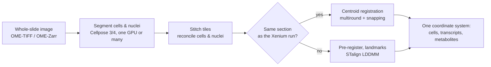
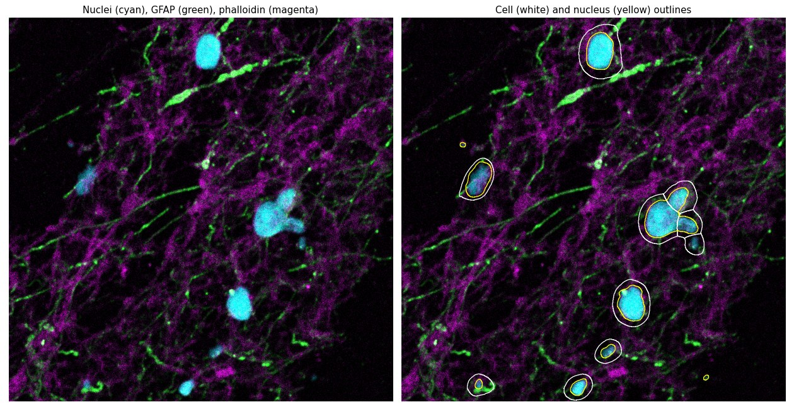
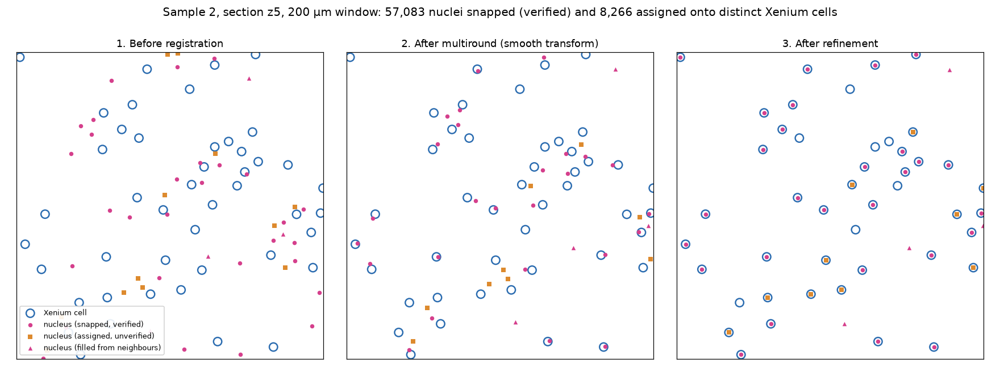
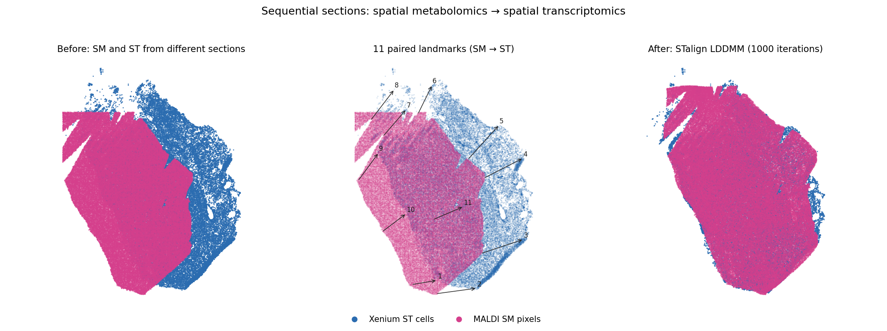

---
hide:
  - navigation
  - toc
---

<div class="grid" markdown>

<div markdown>

# SMINT

**Spatial Multi-Omics Integration Toolkit.** SMINT segments cells and nuclei
across whole-slide images, then brings spatial transcriptomics, spatial
metabolomics and post-stain imaging into one coordinate system — interactively
in napari, from the command line, or as SLURM jobs on a GPU cluster.

```bash
pip install "git+https://github.com/JurgenKriel/SMINT.git"
```

[Get started](quickstart.md){ .md-button .md-button--primary }
[Tutorials](tutorials/index.md){ .md-button }

</div>

<p align="center" markdown>
{ width="380" }
</p>

</div>

## The workflow



See [The SMINT workflow](concepts/workflow.md) for each step, and
[Choosing a registration method](concepts/registration_methods.md) for the
branch in the middle.

## Where to go next

<div class="grid cards" markdown>

-   :material-rocket-launch:{ .lg .middle } **Getting started**

    ---

    Install SMINT and run a registration and a segmentation on example data
    in ten minutes.

    [:octicons-arrow-right-24: Quick start](quickstart.md)

-   :material-notebook-outline:{ .lg .middle } **Tutorials**

    ---

    Executed notebooks with every output shown: segmentation, same-section
    and sequential registration, distributed runs on SLURM.

    [:octicons-arrow-right-24: Tutorials](tutorials/index.md)

-   :material-book-open-variant:{ .lg .middle } **User guide**

    ---

    How SMINT works: the workflow, coordinate frames, tiling and stitching,
    and how to choose a registration method.

    [:octicons-arrow-right-24: User guide](concepts/index.md)

-   :material-cursor-default-click-outline:{ .lg .middle } **napari plugin**

    ---

    Load datasets, pre-register by eye, place landmarks and launch
    registration jobs without leaving the viewer.

    [:octicons-arrow-right-24: napari plugin](napari_plugin.md)

-   :material-console:{ .lg .middle } **Reference**

    ---

    Command-line options, input and output formats, configuration keys and
    the Python API.

    [:octicons-arrow-right-24: Reference](reference/index.md)

-   :material-server-network:{ .lg .middle } **Running on HPC**

    ---

    Submit segmentation and registration to SLURM, on CPU or GPU, from
    Python, the command line or napari.

    [:octicons-arrow-right-24: Running on HPC](hpc_deployment.md)

</div>

## What it looks like

<div class="grid" markdown>

<figure markdown>

<figcaption>Whole-slide segmentation: cells (white) and nuclei (yellow) on
nuclei, GFAP and phalloidin.</figcaption>
</figure>

<figure markdown>

<figcaption>Same-section registration: post-stain nuclei placed onto Xenium
cells.</figcaption>
</figure>

</div>

<figure markdown>

<figcaption>Sequential-section registration: MALDI spatial metabolomics
registered onto Xenium spatial transcriptomics with STalign LDDMM.</figcaption>
</figure>

## Citation

If you use SMINT in your research, please [cite it](citation.md).
