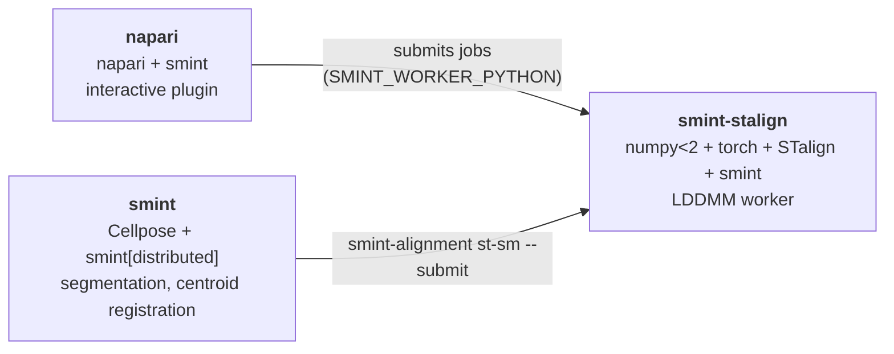

# Installation

This page tells you what to install for the parts of SMINT you want to use,
and how to check that it worked. SMINT runs on Python 3.10 or newer (it is
developed and tested on 3.11 on Linux). A CUDA GPU speeds up segmentation
and LDDMM registration but is not required.

```bash
pip install "git+https://github.com/JurgenKriel/SMINT.git"
```

## Which environment do I need?

Some of SMINT's dependencies cannot share one Python environment: STalign
needs numpy < 2, while napari and recent Cellpose builds use numpy 2. Install
only what your task needs:

| I want to… | Install | Notes |
|---|---|---|
| Segment on one machine | `smint[distributed]` | Pulls in Cellpose; the extra adds `shapely`, which `smint.segmentation` imports. Add a CUDA build of torch for GPU |
| Segment with Dask, locally or on SLURM | `smint[distributed]` | Adds `distributed`, `dask-jobqueue`, `zarr`, `shapely`; `dask-cuda` for one local worker per GPU |
| Register same-section centroids, pre-register | `smint` | No STalign or GPU needed |
| Register sequential sections (LDDMM) | A **separate** environment with numpy < 2, torch, STalign and SMINT | [See below](#registration-with-stalign); point `SMINT_WORKER_PYTHON` at it |
| Use the napari plugin | napari + SMINT | Launches registration in the STalign environment |
| Call R from Python | R on your `PATH`; `smint[r_integration]` for rpy2 | See [Work with R](r_integration.md) |
| Build this documentation | `pip install -r docs/requirements.txt` | See [Contributing](contributing.md) |

A typical cluster setup is therefore two or three environments:



## Install

=== "Core"

    ```bash
    python -m venv smint && source smint/bin/activate
    pip install "git+https://github.com/JurgenKriel/SMINT.git"
    ```

    This installs SMINT with Cellpose, numpy, pandas, scikit-image, tifffile,
    OpenCV, Dask and matplotlib, and the command-line tools
    `smint-alignment` and `smint-register`.

=== "Distributed segmentation"

    ```bash
    pip install "smint[distributed] @ git+https://github.com/JurgenKriel/SMINT.git"
    pip install dask-cuda        # optional: one local worker per GPU
    ```

=== "From source (development)"

    ```bash
    git clone https://github.com/JurgenKriel/SMINT.git
    cd SMINT
    pip install -e ".[distributed,dev]"
    ```

    The `configs/` and `scripts/` folders (including
    `scripts/run_segmentation.py`) are only in a source checkout; they are not
    part of the installed package.

### Cellpose 3 or Cellpose 4

SMINT works with both (`cellpose>=3`); pip installs the newest unless you pin
it. The difference matters for which models you can use:

| | Cellpose 3 | Cellpose 4 |
|---|---|---|
| Built-in models | `cyto`, `cyto2`, `cyto3`, `nuclei` | `cpsam` (Cellpose-SAM) only |
| Legacy names (`cyto`, `nuclei`) | Used as given | Fall back to `cpsam` with a warning |
| Your fine-tuned model | Cellpose 3 models | `cpsam` fine-tuned models |
| Install | `pip install "cellpose>=3,<4"` | `pip install "cellpose>=4"` |

`channels` (`[main, nuclear]`, 1-based, 0 = none) means the same on both:
SMINT selects the channels before calling Cellpose. For a GPU, install the
CUDA build of torch that matches your driver (see
[pytorch.org](https://pytorch.org/get-started/locally/)) before Cellpose. On a
machine without an NVIDIA GPU, install the much smaller CPU build first:
`pip install torch --index-url https://download.pytorch.org/whl/cpu`.

### Registration with STalign

[STalign](https://github.com/JEFworks-Lab/STalign) runs the LDDMM step for
sequential sections. It needs **numpy < 2**: its `nptyping` dependency uses
`np.object0`, which numpy 2 removed. Give it its own environment:

```bash
python -m venv smint-stalign && source smint-stalign/bin/activate
pip install "numpy<2" torch          # choose the CUDA build of torch for GPU nodes
pip install "git+https://github.com/JEFworks-Lab/STalign.git"
pip install "numpy<2" pandas scikit-image pyyaml tifffile opencv-python-headless matplotlib dask
pip install --no-deps "git+https://github.com/JurgenKriel/SMINT.git"   # no Cellpose here
python -c "from smint.alignment import stalign_available; print(stalign_available())"   # True
```

Then tell SMINT to run registration workers with it, from whichever
environment you submit jobs:

```bash
export SMINT_WORKER_PYTHON=/path/to/smint-stalign/bin/python
```

or pass `--worker-python` to `smint-alignment`. Same-section (centroid)
registration and pre-registration do not need STalign.

### napari plugin

```bash
python -m venv smint-napari && source smint-napari/bin/activate
pip install "napari[all]" "git+https://github.com/JurgenKriel/SMINT.git"
napari          # then Plugins → SMINT Registration
```

The plugin registers itself through napari's plugin manifest; no extra step
is needed. It never imports STalign, so it is fine in a numpy 2 environment.
See the [napari plugin guide](napari_plugin.md).

### R integration

`run_r_script` only needs `Rscript` on your `PATH`. The in-process helpers
need rpy2:

```bash
pip install "smint[r_integration] @ git+https://github.com/JurgenKriel/SMINT.git"
```

The R scripts in the repository need the R packages listed in
[Work with R](r_integration.md).

## Verify your install

Save this as `check_smint.py` and run it in each environment:

```python
import importlib.metadata as md

import numpy as np
import smint
from smint.alignment import register_centroids, stalign_available

print("SMINT", smint.__version__)
for pkg in ("cellpose", "torch", "distributed", "dask-jobqueue", "zarr", "shapely", "napari"):
    try:
        print(f"{pkg:>14}: {md.version(pkg)}")
    except md.PackageNotFoundError:
        print(f"{pkg:>14}: not installed")
print("STalign usable:", stalign_available())   # True only with numpy<2

# Self-test of the registration maths on synthetic centroids (a few seconds)
rng = np.random.default_rng(0)
cells = rng.uniform(0, 2000, size=(3000, 2))
nuclei = cells + [8.0, -5.0] + rng.normal(0, 1.0, size=cells.shape)
result = register_centroids(nuclei, cells)
print("held-out TRE (mean, sd):", np.round(result["tre_validation"], 2))
```

In the STalign worker environment it prints:

```text
SMINT 2.0.0
      cellpose: not installed
         torch: 2.6.0+cu124
   distributed: not installed
 dask-jobqueue: not installed
          zarr: not installed
       shapely: not installed
        napari: not installed
STalign usable: True
held-out TRE (mean, sd): [1.28 0.67]
```

The nuclei were displaced by (8, −5) µm plus 1 µm of noise per axis, so a
held-out TRE of about 1.3 µm means registration removed the offset and only
the noise is left.

## Missing optional dependencies

SMINT imports its subpackages lazily, so a missing optional dependency only
affects the feature that needs it:

| Missing | What happens |
|---|---|
| Cellpose | `process_large_image` returns `{"error": ...}`; `run_distributed_segmentation` raises `ImportError` |
| `distributed`, `zarr` | `run_distributed_segmentation` raises `ImportError` naming the package and `smint[distributed]` |
| `dask-jobqueue` | `backend="slurm"` raises `ImportError` |
| `dask-cuda` | Local GPU runs fall back to CPU workers, with a warning |
| `shapely` | `import smint.segmentation` fails (stitching needs it); install `smint[distributed]` |
| STalign or torch, or numpy ≥ 2 | A warning when `smint.alignment` is imported; `stalign_available()` is `False`; LDDMM raises. Everything else in `smint.alignment` works |
| rpy2 | A warning when `smint.r_integration` is imported; `run_r_script` still works |

!!! tip "Silence the import warnings"
    The STalign and rpy2 warnings are informational. If you do not use those
    features, raise the log level *before* importing SMINT:
    `logging.getLogger("smint").setLevel(logging.ERROR)` silences the STalign
    one; the rpy2 one goes to the root logger.

## Next steps

- [Quick start](quickstart.md): a first registration and segmentation
- [Running on HPC](hpc_deployment.md): environments and jobs on a cluster
