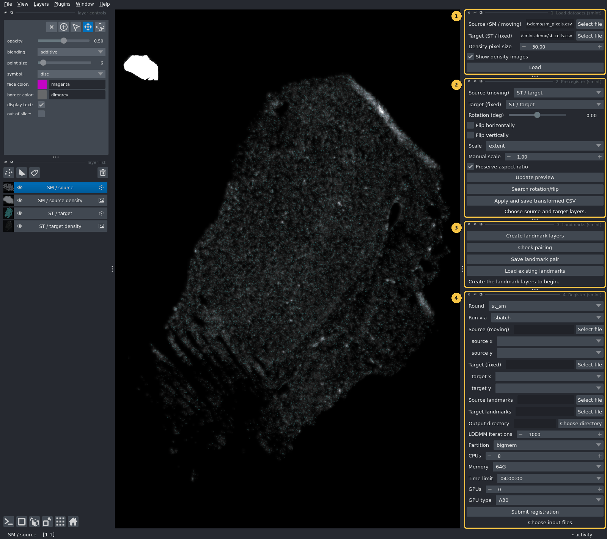
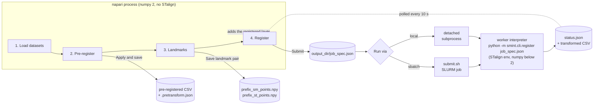
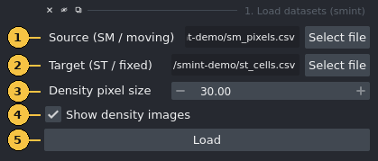
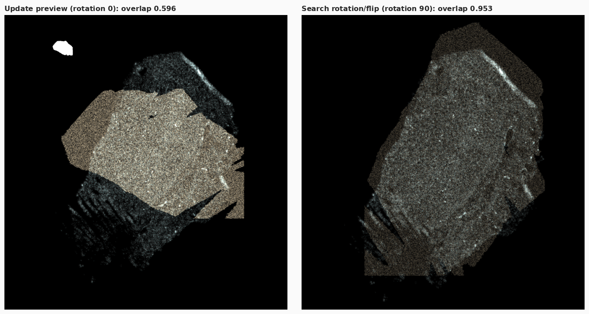
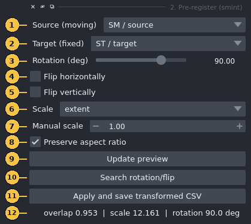
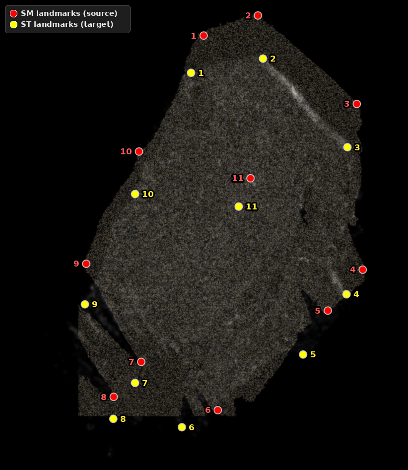
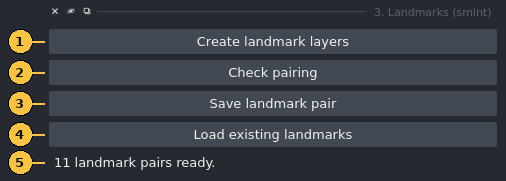
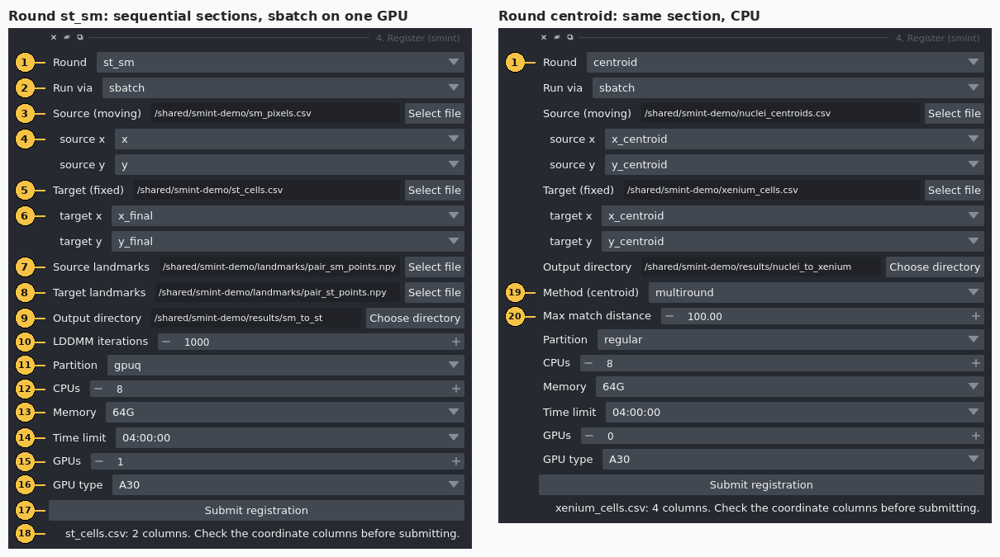

# napari plugin

The SMINT napari plugin covers the hands-on part of registration. You load two
datasets, line them up roughly by eye, place matching landmarks, and send the
registration to a SLURM job or a local worker without leaving the viewer. The
plugin has four dock widgets, numbered in the order you use them. This page
goes through each one: every control, what it writes to disk, and the mistakes
that most often cost an afternoon.

<figure markdown>
  
  <figcaption>The four SMINT widgets docked in napari after <b>1. Load datasets</b>:
  (1) Load datasets, (2) Pre-register, (3) Landmarks, (4) Register. The canvas shows
  a Sample 2 Xenium section (grey density) with the MALDI section still in its own pixel
  grid (white blob, top left). Screenshots on this page were taken with napari 0.5.5.</figcaption>
</figure>

| Widget | Use it to | Writes |
|---|---|---|
| [**1. Load datasets**](#1-load-datasets) | Show a source and a target table as Points layers, with optional density images | nothing |
| [**2. Pre-register**](#2-pre-register) | Coarsely scale, rotate and flip the source onto the target | `<name>.csv` + `<name>.pretransform.json` |
| [**3. Landmarks**](#3-landmarks) | Place, check and save paired landmarks | `<prefix>_sm_points.npy`, `<prefix>_st_points.npy` |
| [**4. Register**](#4-register) | Submit the registration and load the result back | a job directory with `job_spec.json`, `status.json`, logs and the transformed CSV |

!!! tip "Which widgets you need"
    **Sequential sections** (for example Xenium and MALDI on neighbouring sections) use all
    four widgets and the `st_sm` round, which runs STalign LDDMM from your landmarks.
    **The same section** (post-Xenium staining segmented into nuclei) needs only widgets 1 and 4,
    with the `centroid` round. That round matches centroids itself, so you place no landmarks.
    For help choosing, see [Choosing a registration method](concepts/registration_methods.md).

## Install and launch

You need two Python environments. They cannot be merged.

- **The napari environment** runs the viewer and the widgets. napari works with
  numpy 2.
- **The worker environment** runs the registration. The `st_sm` round needs STalign, and
  STalign needs numpy < 2. This environment must also have SMINT installed, because the worker
  imports `smint` and does not inherit your `PYTHONPATH` (see [How it fits together](#how-it-fits-together)).

=== "napari environment"

    ```bash
    python -m venv napari-env
    napari-env/bin/pip install "napari[pyqt5]"
    # SMINT's own dependencies include Cellpose and torch, which the plugin does not use:
    napari-env/bin/pip install --no-deps -e /path/to/SMINT
    ```

    napari already brings numpy, pandas, scipy and magicgui, which are all the plugin imports.

=== "Worker environment"

    Set up the STalign environment described in [Installation](installation.md), install
    SMINT into it, and tell the plugin where its interpreter is. **Set the variable before
    you start napari**, because the plugin reads it when you click *Submit*:

    ```bash
    export SMINT_WORKER_PYTHON=/path/to/stalign-env/bin/python
    napari
    ```

    If `SMINT_WORKER_PYTHON` is not set, SMINT looks for `STalign_env/bin/python` in the
    directory that holds your SMINT checkout. If it finds nothing there, it falls back to the
    interpreter napari itself is running in. That fallback is fine for the `centroid` round
    but fails for `st_sm`.

Open the widgets from **Plugins → SMINT Registration**. You can also dock all four from a
script, which is how the screenshots on this page were made:

```python
import napari

viewer = napari.Viewer()
for name in ("1. Load datasets", "2. Pre-register", "3. Landmarks", "4. Register"):
    viewer.window.add_plugin_dock_widget("smint", name)
napari.run()
```

## How it fits together

The plugin **never imports STalign**. The *Register* widget writes a job spec to disk and
starts a separate worker interpreter. The worker runs the registration and reports back
through a `status.json` file, which the widget checks every 10 seconds.



There are three reasons for the split. napari and STalign need different numpy major versions,
so they cannot share a process. A multi-minute LDDMM run in the background leaves the viewer
responsive. And if a registration crashes, napari keeps running.

The batch and local paths differ only in how the worker starts. On both paths SMINT removes
`PYTHONPATH`, `PYTHONHOME`, `PYTHONSTARTUP` and `LD_PRELOAD` from the worker's environment, so
packages from the napari environment cannot get into the worker.

Everything a run produces lands in the **Output directory** you choose in widget 4:

| File | When | Contents |
|---|---|---|
| `job_spec.json` | always | Round, inputs, parameters, SLURM resources and the worker interpreter. You can re-run it (see [below](#rerun-or-adjust-a-job-outside-the-widget)). |
| `status.json` | always | `state` (`submitted` → `queued` or `running` → `completed` / `failed`), a message, and on success `outputs` and `metrics` |
| `submit.sh` | sbatch | The generated batch script |
| `smint_<round>_<jobid>.out` / `.err` | sbatch | Worker stdout and stderr |
| `worker.log` | local | Worker stdout and stderr |
| `sm_transformed.csv` | `st_sm` round | The SM table with `x_transformed` / `y_transformed` appended |
| `centroids_transformed.csv` | `centroid` round | The source table with transformed (and refined) coordinates appended |

---

## 1. Load datasets

<figure markdown>
  { width="420" }
</figure>

| # | Control | What it does |
|---|---|---|
| 1 | **Source (SM / moving)** | The CSV that will be moved, such as the MALDI pixel table or segmented nuclei |
| 2 | **Target (ST / fixed)** | The CSV that stays put, such as the Xenium cells |
| 3 | **Density pixel size** | Bin size of the density images in coordinate units, 1–500 (default 30). One value is used for **both** datasets. |
| 4 | **Show density images** | Also adds a smoothed 2D histogram of each dataset (Gaussian sigma of 1 bin, grey, additive, 60 % opacity) |
| 5 | **Load** | Reads both files and adds the layers below, then resets the view |

Clicking **Load** adds up to four layers:
`ST / target density` and `SM / source density` (images), then `ST / target` (cyan points) and
`SM / source` (magenta points).

**Coordinate columns are detected automatically.** The widget uses the first match in this
list, ignoring case: `x_final`, `x_centroid`, `centroid_x`, `x_transformed`, `x`, `X` (and the
`y` equivalents). Only those two columns are read. A 450 MB metabolomics matrix with hundreds
of m/z columns therefore loads in seconds.

**Display is capped at 200,000 points per dataset.** Larger tables are randomly subsampled
(fixed seed) for display only. The worker always reads every row.

!!! tip "Make the data visible"
    Points are drawn 6 coordinate units wide. On a whole section in µm that is smaller than a
    screen pixel, so the density images are what you actually see when zoomed out. To see the
    points, zoom in or raise **point size** in napari's layer controls. In the screenshots on
    this page, the point and landmark sizes were raised this way.

!!! note "Different units in the two files"
    The density pixel size applies to both datasets. If the source is still in raw instrument
    pixels while the target is in µm, as in the overview above, the source density image comes
    out as a coarse blob. That is expected, and widget 2 fixes the scale.

---

## 2. Pre-register

Spatial metabolomics data usually arrives on its own pixel grid, and is often rotated or
mirrored relative to the Xenium section. LDDMM cannot recover from a large orientation error,
so first bring the source roughly onto the target.

<figure markdown>
  
  <figcaption>The orange <code>Pre-registered preview</code> layer over the Sample 2 Xenium section.
  <b>Left:</b> scale fitted, no rotation (overlap 0.596). <b>Right:</b> after <b>Search rotation/flip</b>
  (90°, scale 12.161, overlap 0.953). The leftover mismatch at the tissue edges is what the
  landmarks and LDDMM correct.</figcaption>
</figure>

<figure markdown>
  { width="420" }
</figure>

| # | Control | What it does |
|---|---|---|
| 1 | **Source (moving)** | Any Points layer in the viewer. The list updates whenever layers are added or removed. |
| 2 | **Target (fixed)** | The Points layer to align to |
| 3 | **Rotation (deg)** | −180 to 180, counter-clockwise, about the source centroid |
| 4 | **Flip horizontally** | Mirror the source left–right |
| 5 | **Flip vertically** | Mirror the source top–bottom |
| 6 | **Scale** | `extent` matches the bounding-box span on each axis (default, robust to different origins). `max` matches the maximum coordinates, which only works when both datasets start near zero. `none` keeps the source scale. `manual` uses control 7. |
| 7 | **Manual scale** | An isotropic factor, used only when Scale is `manual` |
| 8 | **Preserve aspect ratio** | With `extent` / `max`, use one isotropic factor (the smaller of the two axis factors), so the tissue is not stretched |
| 9 | **Update preview** | Recompute the preview. Changing controls 3–8 also does this automatically. |
| 10 | **Search rotation/flip** | Try every 15° from −180° to 165° under all four flip combinations (96 candidates), keep the one with the highest overlap, and set controls 3–5 to match |
| 11 | **Apply and save transformed CSV** | Ask for the *original source CSV* and an output path, transform the coordinate columns of **every row**, and save |
| 12 | **Status** | The overlap score, fitted scale and rotation, plus `reflected` if the transform mirrors the data |

The transform applies the flip first, then the rotation, then the scale, all about the source
centroid. A final translation then puts the source centroid on the target centroid. Scale is
fitted *after* orientation, because bounding-box extents change when the data rotates.

The **overlap score** is the fraction of occupied 50-unit target bins that the source also
occupies, from 0 to 1, where higher is better. It needs no correspondences, so it is cheap
enough to recompute every time you move the slider.

**Apply and save** writes two files: the transformed table, and a JSON file beside it with the
same stem (for example `sm_prereg.csv` and `sm_prereg.pretransform.json`). The JSON records the
3×3 matrix, its decomposition (scale, rotation, reflection), and the slider and checkbox
settings, so you can reproduce the coarse step later.

!!! warning "Pitfalls"
    - **Pick the same file you loaded** when *Apply* asks for the original source CSV. The
      matrix was fitted to the loaded layer and is applied to whatever file you choose.
    - The preview layer is itself a Points layer, so it appears in the Source and Target lists.
      Do not select it as the source.
    - The matrix is fitted on the displayed points. For tables above 200,000 rows those points
      are a random subsample, so extents and centroid can differ very slightly from the full
      table.
    - A few stray points stretch the bounding box and shrink the fitted scale. Remove debris
      first, or switch to `manual`.

---

## 3. Landmarks

<figure markdown>
  { width="560" }
  <figcaption>The 11 landmark pairs for the Sample 2 sequential example, numbered in order, over the
  pre-registered preview. Red: <code>SM landmarks</code>. Yellow: <code>ST landmarks</code>.
  Pair <i>n</i> in one layer corresponds to pair <i>n</i> in the other. The consistent offset
  between partners is the misalignment left after pre-registration.</figcaption>
</figure>

<figure markdown>
  { width="470" }
</figure>

| # | Control | What it does |
|---|---|---|
| 1 | **Create landmark layers** | Add `ST landmarks` (yellow) and `SM landmarks` (red) Points layers, or reuse them if they already exist. It then selects `SM landmarks` in add mode, so your next click places a point. |
| 2 | **Check pairing** | Report whether the pair is ready (see the messages below) |
| 3 | **Save landmark pair** | Ask for an *output prefix* and write `<prefix>_sm_points.npy` and `<prefix>_st_points.npy` |
| 4 | **Load existing landmarks** | Ask for an SM and an ST `.npy` file and replace the contents of both landmark layers |
| 5 | **Status** | Feedback from the buttons |

**Placing landmarks.** You place landmarks with napari's own Points tools, directly on the
data and in the data's coordinates, so no raster and no pixel-to-µm conversion is involved.
Click a feature in `SM landmarks`, select `ST landmarks` in the layer list, switch it to add
mode (the ⊕ button in the layer controls), and click the same feature there. Repeat, keeping
the order the same in both layers.

!!! warning "Order is the correspondence"
    SMINT pairs landmarks by position in the list: point 1 with point 1, point 2 with point 2.
    If you skip or delete a point in one layer only, every later pair shifts by one. There is
    no error message. You just get a wrong registration.

**Check pairing** reports one of:

- `No landmarks placed yet.`
- `Counts differ: 5 source vs 4 target. Each landmark needs a partner, in the same order.`
- `Need at least 3 pairs for an affine, have 2.`
- `11 landmark pairs ready.`

**Save landmark pair** refuses to save until the check passes. The files use the same format as
STalign's `point_annotator.py`: a pickled `{"1": [(x, y)], "2": [(x, y)], ...}` dict in click
order. That means landmark files from the plugin and from the annotator work interchangeably.

!!! tip "Tips"
    - Landmark markers are 14 coordinate units wide. On a section in µm, raise **point size**
      in the layer controls (the figure above uses 220) so you can see them.
    - Use features both modalities show clearly: tissue corners, the ends of folds or tears,
      and the edges of large structures. Spread them over the whole section rather than
      clustering them.
    - **Landmarks are in the coordinates of the layer you click on.** If you click on the
      `Pre-registered preview`, your SM landmarks are in the pre-registered frame, so the file
      you register in widget 4 must be the CSV written by *Apply and save*, not the original.

---

## 4. Register

<figure markdown>
  
  <figcaption>The <b>Register</b> widget filled in for each round. The fields that do not apply
  are hidden: landmarks and LDDMM iterations appear only for <code>st_sm</code>; method and
  match distance only for <code>centroid</code>.</figcaption>
</figure>

| # | Control | What it does |
|---|---|---|
| 1 | **Round** | `st_sm`: STalign LDDMM for sequential sections, initialised from landmarks. `centroid`: correspondence fitting for the same section. |
| 2 | **Run via** | `sbatch` submits a SLURM job. `local` starts a detached subprocess on the machine running napari. |
| 3 | **Source (moving)** | Source CSV. Choosing a file fills controls 4 from its header. |
| 4 | **source x / source y** | Which source columns to register. The widget guesses from the list in [widget 1](#1-load-datasets). **Check the guess.** |
| 5 | **Target (fixed)** | Target CSV |
| 6 | **target x / target y** | Which target columns to register. Same guess and same caution as 4. |
| 7 | **Source landmarks** | `<prefix>_sm_points.npy` (`st_sm` only) |
| 8 | **Target landmarks** | `<prefix>_st_points.npy` (`st_sm` only) |
| 9 | **Output directory** | Where the job spec, status, logs and results go. For `sbatch` it must be on shared storage. |
| 10 | **LDDMM iterations** | 1–20,000 (default 1000; `st_sm` only) |
| 11 | **Partition** | The partitions `sinfo` reports on your cluster, so a typo cannot reach `sbatch`. **The first one in the list is preselected, so check it.** |
| 12 | **CPUs** | 1–64 (default 8) |
| 13 | **Memory** | 16G, 32G, 64G (default), 128G or 256G |
| 14 | **Time limit** | 00:30:00, 02:00:00, 04:00:00 (default), 12:00:00 or 1-00:00:00 |
| 15 | **GPUs** | 0–4 (default 0) |
| 16 | **GPU type** | `any` plus the GPU types `sinfo` reports for the selected partition. Defaults to `A30`, the card registration is validated on, if that partition has one. |
| 17 | **Submit registration** | Validate, write the job, submit it and start watching it |
| 18 | **Status** | Column counts after you choose a file, then the job ID or PID after you submit |
| 19 | **Method (centroid)** | `multiround` (default), `affine`, `ransac`, `tps` or `ransac+tps` |
| 20 | **Max match distance** | Largest distance at which two centroids can be matched, in coordinate units (default 100) |

!!! warning "Pick the coordinate columns explicitly"
    ST tables often carry several coordinate pairs from successive processing steps (here
    `x_centroid` beside `x_new`). The wrong pair gives a wrong registration without any error.
    The guess only follows the priority list, so always check controls 4 and 6.

### What happens when you click Submit

1. **Checks in the widget.** You get an error notification if the source, target or output
   directory is missing, or if the `st_sm` round has no landmark pair.
2. **Validation of the job spec.** Every input file must exist. The partition must be one
   `sinfo` lists, and the GPU type must be one that partition offers. For `sbatch`, no path may
   be node-local (`/tmp`, `/var/tmp`, `/dev/shm`, `/run`). Any failure appears as a notification
   and in the status line, and nothing is submitted.
3. **Submission.** SMINT writes `job_spec.json` and `status.json`. With `sbatch`, it also writes
   and submits `submit.sh` (job name `smint_st_sm` or `smint_centroid`) and records the job ID.
   With `local`, it starts the worker and records the PID.
4. **Watching.** A background thread reads `status.json` every 10 seconds and asks SLURM about
   the job. A job that SLURM kills for running out of memory or time is therefore reported as
   failed, instead of staying "running" forever.
5. **Result.** On success, the transformed CSV is added as a lime Points layer named
   `st_sm registered` or `centroid registered`. The `centroid` round also shows
   `Done. matched=… TRE <before> -> <after> (held-out)`. A failure shows the worker's error
   message.

!!! danger "Batch jobs need shared storage"
    An sbatch job runs on a different machine, so it cannot see node-local paths such as `/tmp`
    on the node where you run napari. SMINT rejects them before submitting. Without that check,
    the job would die with no logs at all, because its log directory would not exist on the
    compute node. Put inputs and the output directory on a shared file system.

### GPU or CPU

To run LDDMM on a GPU, choose a GPU partition, set **GPUs** to 1 and leave **GPU type** at
`A30` (or choose another card). LDDMM uses CUDA when the job has a GPU and the CPU otherwise.
For the Sample 2 sequential example (11 landmarks, 459,969 SM pixels, 53,622 ST cells), the
registration took about 72 s on one A30.

Choose the GPU type deliberately. `any` requests `--gres=gpu:1`, which takes whichever card is
free. On a partition with mixed hardware, that can be a card several generations older than
the one you timed. Two combinations are allowed but only produce a warning in the job's
log: GPUs on a partition that does not look like a GPU partition (the job sits in the queue),
and a GPU partition with **GPUs** at 0 (no GPU is allocated, so the job runs on the CPU).

!!! warning "Known limitations of the `st_sm` round from the widget"
    Two behaviours of the current code affect `st_sm` jobs submitted from this widget. Until
    they are fixed, submit sequential registrations with the Python snippet below.

    1. **SM coordinates are rescaled in the worker.** The worker reads the SM table with the
       defaults of `read_sm_matrix`, which multiply `x`/`y` by 10 (MALDI pixels to µm) and shift
       the data to non-negative coordinates. The widget does not change these defaults.
       Landmarks you place on the displayed coordinates are therefore in a different frame from
       the one the worker registers. Landmark files made with `prepare_landmark_inputs` and
       `point_annotator.py` already use the scaled frame and are not affected. We tested this
       on the Sample 2 example shown on this page, with pre-registered SM and landmarks placed
       in that frame. With the widget's defaults, the transformed SM pixels ended up tens of
       millimetres from the tissue. With the snippet below, the median distance to the nearest
       ST cell was 16.4 µm.
    2. **The output is transposed by default.** `x_transformed` / `y_transformed` are written
       with `orientation="dataset"`. Those coordinates are transposed relative to the ST cells
       (see [Coordinate frames](concepts/coordinate_frames.md)), so the `st_sm registered` layer
       does not overlay the target.

#### Rerun or adjust a job outside the widget

A job spec is plain data, so you can build one in Python with any parameter the worker accepts.
You can also re-run an existing `job_spec.json` from a shell in the worker environment.

=== "Python"

    ```python
    from smint.alignment.jobs import JobSpec, SlurmResources, poll, submit

    spec = JobSpec(
        round="st_sm",
        inputs={
            "st_file": "st_cells.csv",
            "sm_file": "sm_prereg.csv",                  # written by "Apply and save"
            "st_points": "landmarks/pair_st_points.npy",
            "sm_points": "landmarks/pair_sm_points.npy",
        },
        params={
            "niter": 1000,
            "st_x_col": "x_final",
            "st_y_col": "y_final",
            # landmarks were placed on this CSV's own coordinates: read them unchanged
            "sm_kwargs": {"scale_xy": 1.0, "keep_positive": False},
            # write x/y_transformed as true xy in the ST frame
            "orientation": "stalign",
        },
        output_dir="results/sm_to_st",
        backend="sbatch",
        resources=SlurmResources(partition="gpuq", gpus=1, gpu_type="A30"),
    )
    print(submit(spec))                   # {'backend': 'sbatch', 'job_id': ..., ...}
    print(poll(spec.output_dir)["state"])  # queued -> running -> completed
    ```

    Run this from a directory on shared storage, in any environment that has SMINT. Set
    `SMINT_WORKER_PYTHON` as above, or pass `worker_python=` to `JobSpec`.

=== "Command line"

    ```bash
    # In the worker environment: run an existing spec here, without SLURM
    smint-register results/sm_to_st/job_spec.json
    # equivalent:
    python -m smint.cli.register results/sm_to_st/job_spec.json
    ```

    The worker updates `status.json` in the spec's output directory as it goes. To change a
    parameter, edit `params` in `job_spec.json` first.

See the [Jobs API reference](reference/api/jobs.md) for every field of `JobSpec` and
`SlurmResources`.

---

## Troubleshooting

**SMINT Registration does not appear in the Plugins menu**
:   Install SMINT into the environment napari runs from (`pip install --no-deps -e /path/to/SMINT`),
    then restart napari. To check that napari can find the plugin:

    ```bash
    python -c "import npe2; pm = npe2.PluginManager.instance(); pm.discover(); print(pm.get_manifest('smint').display_name)"
    ```

    The command should print `SMINT Registration`.

**`Partition 'x' does not exist on this cluster. Available: …`**
:   The partition was checked against `sinfo` before submission. Choose one from the list.

**`GPU type 'A30' is not offered by partition 'x'. Available: …`**
:   Choose a GPU partition, or set **GPU type** to `any`.

**`sbatch jobs run on a different machine, so node-local paths are unreachable`**
:   An input or the output directory is under `/tmp`, `/var/tmp`, `/dev/shm` or `/run`. Move it
    to shared storage, or use **Run via** `local`.

**`sbatch not found on PATH`**
:   napari is running on a machine without SLURM. Use `local`, or start napari on a cluster node.

**`Registration failed: STalign is not importable in this interpreter`**
:   The worker ran in the napari environment. Set `SMINT_WORKER_PYTHON` to the STalign
    environment's interpreter **before** launching napari.

**The worker cannot import `smint`**
:   The worker does not inherit `PYTHONPATH`, so SMINT must be installed in the worker
    environment itself.

**`SLURM reported OUT_OF_MEMORY` / `TIMEOUT`**
:   Raise **Memory** or **Time limit** and submit again.

**`SLURM completed but the worker did not report success; check the .err log`**
:   The job ended without writing a final status. The traceback is in
    `smint_<round>_<jobid>.err` in the output directory.

**The status stays at "queued"**
:   The job is waiting for resources. Check with `squeue --me`. GPU requests on a busy
    partition can wait a while.

**Widget fails with `missing 1 required positional argument: 'viewer'`**
:   napari passes the viewer only to `QWidget` or magicgui `Widget` subclasses and to
    `magic_factory` widgets. A plain function contribution is called with no arguments.
    Widgets that need the viewer must be classes.

**`stalign_available()` is `False` in the napari environment**
:   This is expected, because the napari environment has numpy 2. Only the worker environment
    needs STalign. Pre-registration and the `centroid` round work in either environment.

??? note "How the screenshots were made"
    The figures were captured from the running plugin, not mocked up.
    [`capture_screenshots.py`](https://github.com/JurgenKriel/SMINT/blob/main/docs/assets/napari/src/capture_screenshots.py) registers the
    plugin manifest with npe2, docks the four widgets with `add_plugin_dock_widget`, presses
    their buttons, and saves `viewer.screenshot()` and `QWidget.grab()` images under a virtual X
    server. [`annotate_screenshots.py`](https://github.com/JurgenKriel/SMINT/blob/main/docs/assets/napari/src/annotate_screenshots.py) crops the
    images and adds the numbered callouts at widget positions recorded during capture.

    The data are de-identified coordinates from Sample 2. The landmark pairs were set from the
    saved landmark files instead of being clicked, and the file paths displayed in the fields
    were replaced with neutral ones under `/shared/smint-demo`.

    ```bash
    xvfb-run -s "-screen 0 1920x1200x24" \
      python docs/assets/napari/src/capture_screenshots.py \
        --source sm_pixels.csv --target st_cells.csv \
        --source-landmarks pair_sm_points.npy --target-landmarks pair_st_points.npy \
        --centroid-source nuclei_centroids.csv --centroid-target xenium_cells.csv \
        --out raw
    python docs/assets/napari/src/annotate_screenshots.py raw docs/assets/napari
    ```

## Next steps

- [Sequential-section registration tutorial](tutorials/03_sequential_registration.ipynb): the
  same `st_sm` workflow in code, from raw tables to the registered overlay.
- [Same-section registration tutorial](tutorials/02_same_section_registration.ipynb): the
  `centroid` round with multiround matching and snapping refinement.
- [Running on HPC](hpc_deployment.md): partitions, GPUs and shared storage for batch jobs.
- [Coordinate frames](concepts/coordinate_frames.md): `dataset` versus `stalign` orientation
  and why it matters for overlays.
