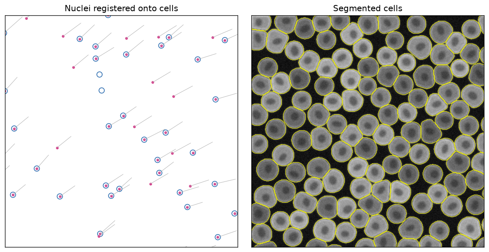
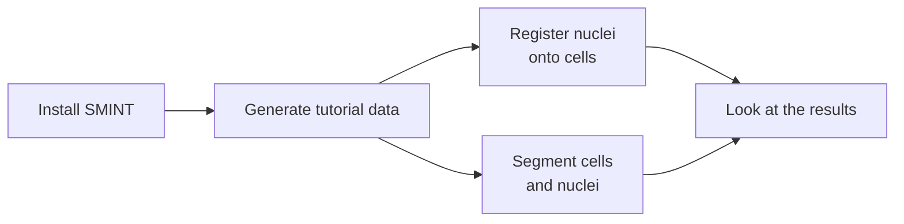

# Quick start

In about ten minutes, on a laptop CPU, you will install SMINT, generate a
small synthetic dataset, register post-stain nuclei onto spatial
transcriptomics cells, and segment cells and nuclei across an image. Every
command below was run as shown; the outputs are copied from that run.

<figure markdown>

<figcaption>What you will produce: nuclei moved onto their cells (grey lines
show how far each moved), and cell outlines segmented across the image.</figcaption>
</figure>



## 1. Install

SMINT installs from GitHub. Cellpose 3 provides the built-in `cyto3` and
`nuclei` models used here; the `distributed` extra adds Dask for tiled
segmentation.

```bash
python -m venv smint-env
source smint-env/bin/activate
git clone https://github.com/JurgenKriel/SMINT.git
cd SMINT
pip install -e ".[distributed]" "cellpose<4"
```

!!! tip "CPU-only machines"
    `pip` installs the CUDA build of PyTorch by default, which is large. On a
    machine without an NVIDIA GPU, install the CPU build first:
    `pip install torch --index-url https://download.pytorch.org/whl/cpu`.

You do not need STalign for this page; it is only used for
[sequential-section registration](tutorials/03_sequential_registration.ipynb).
See [Installation](installation.md) for GPUs, STalign and napari.

## 2. Generate the tutorial data

From the repository root:

```bash
python examples/make_tutorial_data.py
```

```text
synthetic_wsi.ome.tif      1024 x 1024 px, 2 channels, 753 cells
synthetic_cells/nuclei.csv 4000 cells, 4601 nuclei
synthetic_st/sm.csv        9000 ST cells, 51565 SM pixels, 8 landmark pairs
written to .../SMINT/docs/tutorials/data
```

The script is deterministic and writes small files (a few MB in total) to
`docs/tutorials/data/`, next to de-identified real-data crops used by the
tutorials. The two you need now:

| File | Contents |
|---|---|
| `synthetic_cells.csv` | 4,000 "Xenium" cell centroids, in µm (`x_centroid`, `y_centroid`) |
| `synthetic_nuclei.csv` | 4,601 post-stain nuclei (`centroid_x`, `centroid_y`), offset by about 17 µm, slightly rotated and warped; 10% of cells have no nucleus and some nuclei have no cell |
| `synthetic_wsi.ome.tif` | A 1024 × 1024 px image, `(C, Y, X)`: channel 0 nuclei, channel 1 cytoplasm, 753 cells |

## 3. Register nuclei onto cells

The nuclei were imaged on the same section as the cells, so each nucleus
belongs in one cell. SMINT finds the transform that puts them there
(`multiround` registration), then snaps confident pairs exactly onto their cell.

=== "Command line"

    ```bash
    smint-alignment centroid \
        --source docs/tutorials/data/synthetic_nuclei.csv \
        --target docs/tutorials/data/synthetic_cells.csv \
        --output-dir qs_registration --watch
    ```

    Without `--submit` the job runs on this machine; `--watch` waits for it and
    prints the report (shortened here):

    ```text
    submitted centroid via local (812900)
    output dir: qs_registration
    state: completed -- centroid round finished
    {
      "method": "multiround",
      "n_matched": 2867,
      "tre_initial": 12.383047602879103,
      "tre_fit": 3.4414342530713062,
      "tre_validation": 4.581062420235117,
      ...
      "refinement": {
        "n_assigned": 64,
        ...
        "n_snapped": 3585,
        ...
        "fraction_targets_matched": 0.91225,
        ...
    }
    {
      "transformed_csv": "qs_registration/centroids_transformed.csv"
    }
    ```

=== "Python"

    ```python
    from smint.alignment import register_centroid_files

    table, result = register_centroid_files(
        "docs/tutorials/data/synthetic_nuclei.csv",   # source: centroid_x, centroid_y
        "docs/tutorials/data/synthetic_cells.csv",    # target: x_centroid, y_centroid
        output_path="nuclei_registered.csv",
    )
    print(f"held-out TRE {result['tre_initial'][0]:.1f} -> {result['tre_validation'][0]:.1f} um")
    print(table["registration_status"].value_counts())
    ```

    ```text
    held-out TRE 12.4 -> 4.6 um
    registration_status
    snapped     3585
    filled       952
    assigned      64
    Name: count, dtype: int64
    ```

**What this tells you.** The target registration error (TRE) on nuclei held
out of the fit fell from 12.4 µm to 4.6 µm. 3,585 nuclei passed the
neighbourhood check and now sit exactly on a cell (`snapped`); 64 were paired
without that check (`assigned`, less certain); the rest moved with their
neighbours (`filled`), most of them nuclei with no cell. The output CSV keeps
every input column and adds `x_transformed`, `y_transformed`,
`registration_status`, `target_index` and `neighbour_deviation`.
[Same-section registration](tutorials/02_same_section_registration.ipynb)
explains each of these and runs the same steps on real data.

## 4. Segment cells and nuclei

The image is cut into 512 px tiles with a 64 px overlap, segmented by two
local CPU workers, and stitched, so cells on tile boundaries come out whole.

=== "Command line"

    Save the settings as `segmentation.yaml`:

    ```yaml
    model_paths: [cyto3, nuclei]
    cell_model_params: {diameter: 36, flow_threshold: 0.4, cellprob_threshold: 0.0, channels: [2, 1]}
    nuclei_model_params: {diameter: 15, flow_threshold: 0.4, cellprob_threshold: 0.0, channels: [1, 0]}
    chunk_size: 512
    use_gpu: false
    n_workers: 2
    distributed:
      backend: local
      tile_overlap: 64
    ```

    and run:

    ```bash
    python -m smint.segmentation.distributed_seg \
        --image_path docs/tutorials/data/synthetic_wsi.ome.tif \
        --output_dir qs_segmentation --config_path segmentation.yaml
    ```

=== "Python"

    Save as `segment.py` and run `python segment.py`. The
    `if __name__ == "__main__":` guard is needed because the local Dask
    workers are separate processes.

    ```python
    from smint.segmentation import run_distributed_segmentation

    if __name__ == "__main__":
        results = run_distributed_segmentation(
            image_path="docs/tutorials/data/synthetic_wsi.ome.tif",
            output_dir="qs_segmentation",
            cell_model="cyto3", nuclei_model="nuclei",
            cell_params={"diameter": 36, "flow_threshold": 0.4,
                         "cellprob_threshold": 0.0, "channels": [2, 1]},
            nuclei_params={"diameter": 15, "flow_threshold": 0.4,
                           "cellprob_threshold": 0.0, "channels": [1, 0]},
            chunk_size=512, tile_overlap=64,
            backend="local", n_workers=2, use_gpu=False,
        )
        print(results["total_cells"], "cells,", results["total_nuclei"], "nuclei")
    ```

`channels` is `[main, nuclear]`, counted from 1, with 0 for none: cells are
found on channel 2 (cytoplasm) helped by channel 1 (nuclei); nuclei on channel 1
alone. Both forms log the same steps (shown without timestamps, and without
the model and Dask dashboard lines):

```text
Tiles: 4 of 512 px, 64 px overlap
2 worker(s) ready
Tile 1/4 (0, 512, 512, 1024): 250 cells, 245 nuclei
Tile 2/4 (0, 0, 512, 512): 257 cells, 254 nuclei
Tile 3/4 (512, 0, 1024, 512): 236 cells, 225 nuclei
Tile 4/4 (512, 512, 1024, 1024): 267 cells, 257 nuclei
Stitching 981 nucleus outlines
Stitched 981 polygons: 753 after merging, 753 after trim/remove
26 of 1010 cell outlines touch no nucleus and were dropped
Stitching 984 cell outlines
Stitched 984 polygons: 753 after merging, 753 after trim/remove
Reconciled 753 cells / 753 nuclei -> 753 cells / 753 nuclei
753 cells -> qs_segmentation/cells_outlines.csv
753 nuclei -> qs_segmentation/nuclei_outlines.csv
Done in 1.1 min
```

The tiles report 1,010 cell outlines between them because cells near a
boundary are seen by two tiles; after stitching, all 753 cells in the image
are found once each. `qs_segmentation/` now holds:

| File | Contents |
|---|---|
| `cells_outlines.csv`, `nuclei_outlines.csv` | One row per outline vertex: `global_cell_id`, `x`, `y` (pixels) |
| `cells_summary.csv`, `nuclei_summary.csv` | One row per object: centroid, area, and which cell each nucleus is in |
| `cells.zarr`, `nuclei.zarr` | Full-resolution label masks |
| `distributed_seg_<time>.log` | The log |

## 5. Look at the results

This script draws the figure at the top of the page from the two outputs
(run it from the repository root after both steps):

```python
import matplotlib.pyplot as plt
import pandas as pd
import tifffile

cells = pd.read_csv("docs/tutorials/data/synthetic_cells.csv")
nuclei = pd.read_csv("nuclei_registered.csv")
image = tifffile.imread("docs/tutorials/data/synthetic_wsi.ome.tif")
outlines = pd.read_csv("qs_segmentation/cells_outlines.csv")

fig, (left, right) = plt.subplots(1, 2, figsize=(10, 5))

# Registration: each nucleus moved from its original position (line) onto a cell
left.scatter(cells.x_centroid, cells.y_centroid, s=60, facecolors="none", edgecolors="#2b6cb0")
for _, n in nuclei.iterrows():
    left.plot([n.centroid_x, n.x_transformed], [n.centroid_y, n.y_transformed], color="0.7", lw=0.6)
left.scatter(nuclei.x_transformed, nuclei.y_transformed, s=8, color="#d53f8c")
left.set(xlim=(900, 1100), ylim=(1100, 900), aspect="equal", title="Nuclei registered onto cells")

# Segmentation: stitched cell outlines over the cytoplasm channel
right.imshow(image[1], cmap="gray")
for _, cell in outlines.groupby("global_cell_id"):
    right.plot(cell.x, cell.y, color="yellow", lw=0.6)
right.set(xlim=(0, 400), ylim=(400, 0), title="Segmented cells")

for ax in (left, right):
    ax.set_xticks([]); ax.set_yticks([])
plt.tight_layout()
plt.savefig("quickstart.png", dpi=120, bbox_inches="tight")
```

## Next steps

<div class="grid cards" markdown>

-   :material-microscope:{ .lg .middle } **Segment a whole slide**

    ---

    Chunked segmentation with `process_large_image`, on the synthetic image and
    a real 3-channel crop.

    [:octicons-arrow-right-24: Tutorial 1](tutorials/01_segmentation.ipynb)

-   :material-vector-link:{ .lg .middle } **Same-section registration**

    ---

    Read the rounds log, the held-out checks, the statuses and
    `neighbour_deviation`, on synthetic and real data.

    [:octicons-arrow-right-24: Tutorial 2](tutorials/02_same_section_registration.ipynb)

-   :material-layers-triple-outline:{ .lg .middle } **Sequential-section registration**

    ---

    Orientation search, landmarks and STalign LDDMM for spatial metabolomics
    onto spatial transcriptomics.

    [:octicons-arrow-right-24: Tutorial 3](tutorials/03_sequential_registration.ipynb)

-   :material-server-network:{ .lg .middle } **Distributed segmentation**

    ---

    Tiles, overlap, stitching and SLURM GPU workers.

    [:octicons-arrow-right-24: Tutorial 4](tutorials/04_distributed_segmentation.ipynb)

</div>

Using your own data? Start from [The SMINT workflow](concepts/workflow.md) and
[Choosing a registration method](concepts/registration_methods.md).
