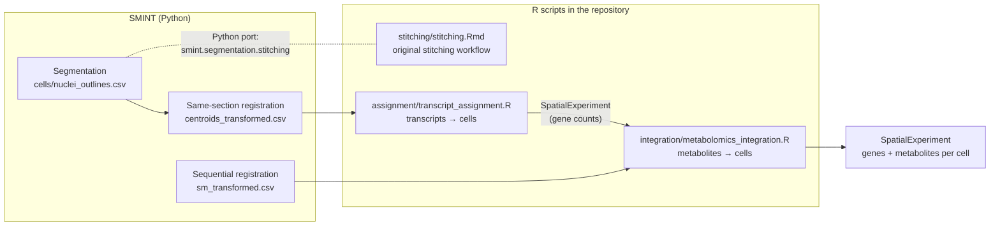

# Work with R

Much of the downstream analysis of spatial omics happens in R (`sf`,
`SpatialExperiment`, `Seurat`). This page shows how SMINT's outputs feed the R
scripts in the repository, and how to call R from Python with
`smint.r_integration`.

## Where R fits in the workflow



The R scripts are analysis templates, not a package: each starts with
`/path/to/...` placeholders that you edit before running. They need R ≥ 4 with
`sf`, `sfheaders`, `data.table`, `dplyr`, `stringr`, `ggplot2`, `forcats`,
`Seurat` and `SpatialExperiment` (Bioconductor).

## The R scripts

### `stitching/stitching.Rmd` — stitch tiled segmentations

The original stitching workflow, kept for reference and for data segmented
outside SMINT. `run_distributed_segmentation` now does the same job in Python
([`smint.segmentation.stitching`](concepts/tiling_and_stitching.md)), so you
do not need this notebook for SMINT segmentations.

| | |
|---|---|
| **Input** | A folder of per-field-of-view Cellpose outline files (`*.txt`, one object per line as `x1,y1,x2,y2,…`) for nuclei and another for cells, plus a CSV of field-of-view positions in pixels (no header; columns x, y) |
| **Steps** | Place outlines in the global frame, convert pixels to µm (the pixel size, 0.124 µm, is set in the notebook — change it to yours), merge overlaps above 50%, trim overlaps below 25%, remove the remaining conflicts, then join nuclei to cells |
| **Output** | `sf` objects saved as `sf_nuc_final_<sample>_<date>.rds` and `sf_cell_final_<sample>_<date>.rds`, plus centroid CSVs `nuc_centroids_…csv` and `cell_centroids_…csv` |

### `assignment/transcript_assignment.R` — assign transcripts to cells

Counts the transcripts inside each registered cell (or nucleus) polygon.

| | |
|---|---|
| **Input** | Xenium `transcripts.csv.gz` (`x_location`, `y_location`, `feature_name`, `qv`), and an `.rds` of `sf` polygons **in the Xenium frame** with a `cell` column |
| **Steps** | Keep transcripts with `qv ≥ 20`, spatially join points to polygons, count genes per cell |
| **Output** | A `SpatialExperiment` with a `counts` assay (genes × cells), saved as `.rds` |

### `integration/metabolomics_integration.R` — add metabolites to cells

Joins registered spatial metabolomics pixels to the ST cells.

| | |
|---|---|
| **Input** | The registered SM table (coordinates in the ST frame; metabolite columns prefixed with `X`, as `read_sm_matrix` writes them), the ST `SpatialExperiment` with a `logcounts` assay, and the ST cell polygons as `sf` |
| **Steps** | Buffer each cell centroid by 20 µm, average the SM pixels inside, combine with the ST log-counts |
| **Output** | One `SpatialExperiment` with genes and metabolites as rows and cells as columns, saved as `.rds` |

!!! warning "Edit before running"
    Besides the input paths, check three things in the script: the number of
    metabolites (`num_metabs`, set to 451 in the template), the SM coordinate
    column names it builds points from (`x_new`, `y_new`; SMINT writes
    `x_transformed`, `y_transformed`), and the data frame it builds them from
    (the template refers to `sm_section_c_out`; use the table you read in,
    `SM`).

## From SMINT outputs to R

`transcript_assignment.R` needs polygons in the Xenium frame. SMINT registers
*centroids*, so move each outline by its own registration offset, then build
the polygons in R.

**1. In Python**, shift each nucleus outline by the offset registration
applied to its centroid (this assumes you registered the
`nuclei_summary.csv` table converted to µm, as in the
[Segmentation guide](segmentation.md#use-the-results-for-registration)):

```python
import pandas as pd

pixel_size_um = 0.5      # placeholder: µm per pixel of the segmented image

# Registered nuclei: one row per row of nuclei_summary.csv (converted to µm)
reg = pd.read_csv("results/reg/centroids_transformed.csv")
shift = pd.DataFrame({
    "global_cell_id": reg["global_cell_id"],
    "dx": reg["x_transformed"] - reg["x_centroid"],
    "dy": reg["y_transformed"] - reg["y_centroid"],
})

outlines = pd.read_csv("results/seg_run/nuclei_outlines.csv")
outlines[["x", "y"]] *= pixel_size_um
outlines = outlines.merge(shift, on="global_cell_id")
outlines["x"] += outlines["dx"]
outlines["y"] += outlines["dy"]
outlines[["global_cell_id", "x", "y"]].to_csv("nuclei_outlines_registered.csv", index=False)
```

A per-object shift is exact for snapped nuclei and a close approximation for
the smooth transform at the scale of one cell.

**2. In R**, turn the vertices into polygons with the `cell` column the
assignment script expects:

```r
library(data.table)
library(sfheaders)

v <- fread("nuclei_outlines_registered.csv")
polys <- sf_polygon(v, x = "x", y = "y", polygon_id = "global_cell_id")
polys$cell <- polys$global_cell_id
saveRDS(polys, "aligned_sf.rds")
```

Point `transcript_assignment.R` at `aligned_sf.rds`. For the metabolomics
script, use `sm_transformed.csv` from
[sequential registration](alignment.md#register-sequential-sections-with-stalign),
run with `orientation="stalign"` so its coordinates overlay the ST cells.

## Call R from Python

`run_r_script` runs a script with the system `Rscript` and needs nothing
beyond R on your `PATH`:

```python
from smint.r_integration import run_r_script

code = run_r_script("to_sf.R")                                  # returns the exit code
code, out, err = run_r_script("to_sf.R", return_output=True)    # also captures output
code = run_r_script("analysis.R", args=["--input", "data.csv"]) # passed to the script
```

It returns `1` (with a logged error) when the script does not exist, and
otherwise R's exit code, so check it: a failing R script does not raise in
Python. On a cluster, load R first (for example `module load R`) in the shell
or job that runs Python.

### In-process R with rpy2

`smint.r_integration` also has helpers built on `rpy2` (`pip install
"smint[r_integration]"`): `initialize_r(packages)`, `pandas_to_r(df)`,
`r_to_pandas(obj)`, and in `smint.r_integration.r_bridge`, `exec_r_code`,
`r_function_to_python` and `load_r_analysis_script`.

!!! bug "The rpy2 helpers fail in the current version"
    These functions check a flag that is never defined and raise
    `NameError: name 'HAS_RPY2' is not defined`, whether or not rpy2 is
    installed. Use `run_r_script` until this is fixed. Importing
    `smint.r_integration` without rpy2 also logs a warning
    ("rpy2 package not available"), which you can ignore if you only use
    `run_r_script`.

## Next steps

- [Data formats](reference/data_formats.md) for every column SMINT writes
- [Segmentation](segmentation.md) and [Alignment](alignment.md) guides
