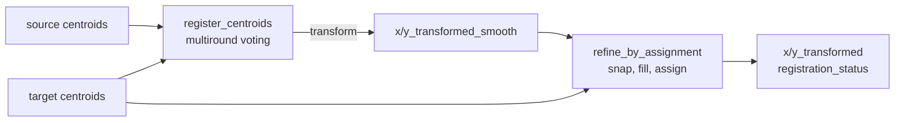
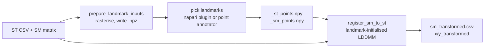

# Alignment API

Everything you need to bring two spatial modalities into one coordinate system,
importable from `smint.alignment`. The functions are grouped by the task they
serve, in the order you normally use them:

| Task | Use it when | Start with |
| --- | --- | --- |
| [Pre-registration](#pre-registration) | The datasets differ in scale, rotation or mirroring | [`build_pretransform`](#smint.alignment.build_pretransform) |
| [Centroid registration and refinement](#centroid-registration-and-refinement) | Both modalities come from the **same** section (post-staining) | [`register_centroid_files`](#smint.alignment.register_centroid_files) |
| [ST–SM registration](#stsm-registration-sequential-sections) | The modalities come from **sequential** sections | [`register_sm_to_st`](#smint.alignment.register_sm_to_st) |
| [Coordinate columns](#coordinate-columns) | You want to know which columns SMINT will read | [`detect_coordinate_columns`](#smint.alignment.columns.detect_coordinate_columns) |

To run a registration out of process, locally or on SLURM, see the
[Jobs API](jobs.md). For the files these functions read and write, see
[Data formats](../data_formats.md).

```python
from smint.alignment import register_centroid_files

table, result = register_centroid_files(
    "nuclei_centroids.csv", "xenium_cells.csv",
    source_cols=("x_centroid", "y_centroid"),
    output_path="nuclei_registered.csv",
)
print(result["tre_initial"][0], "->", result["tre_validation"][0])
print(table["registration_status"].value_counts())
```

!!! note "Coordinate conventions"
    Everything here is plain `(x, y)`, except inside the STalign wrappers:
    STalign works in row–column `(y, x)` order, and
    [`load_landmarks`](#smint.alignment.load_landmarks) swaps the pair on load.
    [`transform_points`](#smint.alignment.transform_points) returns `(x, y)` in the
    frame you choose with `orientation`.

## Pre-registration

A coarse scale, rotation and flip, held as one 3×3 affine so it can be inspected,
saved with [`save_transform`](#smint.alignment.save_transform) and replayed. Run it
before landmark picking or LDDMM when the two datasets start in different frames.
Operations are applied flip → rotate → scale about the source centroid, then the
source centroid is moved onto the reference centroid.

```python
import pandas as pd
from smint.alignment import build_pretransform, apply_pretransform, describe_pretransform

sm_xy = pd.read_csv("sm_matrix.csv", usecols=["x", "y"]).to_numpy(float)
xenium_xy = pd.read_csv("xenium_cells.csv", usecols=["x_centroid", "y_centroid"]).to_numpy(float)

matrix = build_pretransform(sm_xy, xenium_xy, rotation=90)
sm_pre = apply_pretransform(sm_xy, matrix)
print(describe_pretransform(matrix))   # scale_x, scale_y, rotation_deg, reflects, ...
```

::: smint.alignment.build_pretransform
    options:
      heading_level: 3

::: smint.alignment.apply_pretransform
    options:
      heading_level: 3

::: smint.alignment.fit_scale_to_reference
    options:
      heading_level: 3

::: smint.alignment.overlap_score
    options:
      heading_level: 3

::: smint.alignment.describe_pretransform
    options:
      heading_level: 3

::: smint.alignment.save_transform
    options:
      heading_level: 3

::: smint.alignment.load_transform
    options:
      heading_level: 3

### Matrix building blocks

::: smint.alignment.compose
    options:
      heading_level: 4

::: smint.alignment.rotation_matrix
    options:
      heading_level: 4

::: smint.alignment.flip_matrix
    options:
      heading_level: 4

::: smint.alignment.scale_matrix
    options:
      heading_level: 4

::: smint.alignment.translation_matrix
    options:
      heading_level: 4

## Centroid registration and refinement

For a second modality acquired on the **same** section, where nuclei and cells
correspond one-to-one. [`register_centroids`](#smint.alignment.register_centroids)
fits the transform (`multiround` displacement voting by default) and reports
target registration error on held-out points;
[`refine_by_assignment`](#smint.alignment.refine_by_assignment) then snaps
confidently matched nuclei exactly onto their cells.
[`register_centroid_files`](#smint.alignment.register_centroid_files) does both
from two CSV files and is what `smint-alignment centroid` runs.



::: smint.alignment.register_centroid_files
    options:
      heading_level: 3

::: smint.alignment.register_centroids
    options:
      heading_level: 3

::: smint.alignment.refine_by_assignment
    options:
      heading_level: 3

::: smint.alignment.alignment_quality
    options:
      heading_level: 3

::: smint.alignment.vote_block_displacements
    options:
      heading_level: 3

### Correspondence and error

::: smint.alignment.match_centroids
    options:
      heading_level: 4

::: smint.alignment.split_pairs
    options:
      heading_level: 4

::: smint.alignment.target_registration_error
    options:
      heading_level: 4

### Transform models

::: smint.alignment.estimate_affine
    options:
      heading_level: 4

::: smint.alignment.estimate_affine_ransac
    options:
      heading_level: 4

::: smint.alignment.apply_affine
    options:
      heading_level: 4

::: smint.alignment.fit_tps
    options:
      heading_level: 4

::: smint.alignment.apply_tps
    options:
      heading_level: 4

## ST–SM registration (sequential sections)

For spatial metabolomics (SM) and spatial transcriptomics (ST) from **different**
sections. STalign's LDDMM does the warping, initialised from landmarks you pick by
hand, so the workflow has two phases around a manual step:



These functions import STalign, which needs **numpy < 2** and torch. Run them in a
worker environment ([`stalign_available`](#smint.alignment.stalign_available) tells
you whether the current one qualifies), or submit them with the [Jobs API](jobs.md).

::: smint.alignment.prepare_landmark_inputs
    options:
      heading_level: 3

::: smint.alignment.register_sm_to_st
    options:
      heading_level: 3

::: smint.alignment.stalign_available
    options:
      heading_level: 3

### Reading inputs

::: smint.alignment.read_sm_matrix
    options:
      heading_level: 4

::: smint.alignment.read_st_annotations
    options:
      heading_level: 4

::: smint.alignment.resolve_st_columns
    options:
      heading_level: 4

::: smint.alignment.list_columns
    options:
      heading_level: 4

::: smint.alignment.sm_coordinates
    options:
      heading_level: 4

::: smint.alignment.st_coordinates
    options:
      heading_level: 4

::: smint.alignment.find_sm_matrix_files
    options:
      heading_level: 4

### Rasterising and landmarks

::: smint.alignment.rasterize_coordinates
    options:
      heading_level: 4

::: smint.alignment.save_rasterized
    options:
      heading_level: 4

::: smint.alignment.load_landmarks
    options:
      heading_level: 4

::: smint.alignment.check_landmark_pair
    options:
      heading_level: 4

::: smint.alignment.affine_from_landmarks
    options:
      heading_level: 4

### LDDMM and transforming points

::: smint.alignment.run_lddmm_alignment
    options:
      heading_level: 4

::: smint.alignment.transform_points
    options:
      heading_level: 4

::: smint.alignment.save_transformed_data
    options:
      heading_level: 4

## Coordinate columns

SMINT tables name their coordinates differently depending on where they came
from. These helpers resolve them in one place, trying the candidates below in
order (case-insensitive). See
[Data formats](../data_formats.md#coordinate-columns) for where auto-detection
applies and where you must name columns yourself.

::: smint.alignment.columns.X_CANDIDATES
    options:
      heading_level: 3

::: smint.alignment.columns.Y_CANDIDATES
    options:
      heading_level: 3

::: smint.alignment.columns.detect_coordinate_columns
    options:
      heading_level: 3

::: smint.alignment.columns.require_coordinate_columns
    options:
      heading_level: 3

## Next steps

- [Jobs API](jobs.md): run any of these registrations as a local or SLURM job.
- [Choosing a registration method](../../concepts/registration_methods.md): same-section or sequential?
- [Command line](../cli.md#smint-alignment): the same functions from `smint-alignment`.
