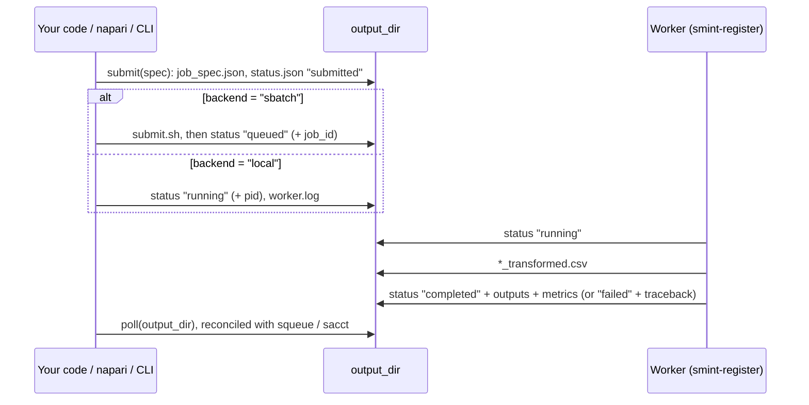

# Jobs API

`smint.alignment.jobs` runs a registration in a **separate process**: a local
subprocess, or an sbatch job on a SLURM cluster. The napari plugin and
`smint-alignment` both go through it. Keeping the worker out of process lets a
napari session (numpy ≥ 2) drive an STalign registration (numpy < 2), and lets a
failed job fail without taking the caller down.



## Submitting and polling a job

=== "Same section (centroid)"

    ```python
    import time
    from smint.alignment.jobs import JobSpec, SlurmResources, submit, poll

    spec = JobSpec(
        round="centroid",
        inputs={"source_file": "nuclei_centroids.csv",
                "target_file": "xenium_cells.csv"},
        params={"method": "multiround",
                "source_cols": ("x_centroid", "y_centroid"),
                "target_cols": ("x_centroid", "y_centroid")},
        output_dir="runs/centroid",
        backend="local",
    )
    info = submit(spec)            # {'backend': 'local', 'pid': ..., ...}

    while (status := poll(spec.output_dir))["state"] not in ("completed", "failed", "cancelled"):
        time.sleep(5)
    print(status["state"], status.get("metrics", {}).get("tre_validation"))
    ```

=== "Sequential sections (st_sm on a GPU)"

    ```python
    from smint.alignment.jobs import JobSpec, SlurmResources, submit

    spec = JobSpec(
        round="st_sm",
        inputs={"st_file": "st_cells.csv", "sm_file": "sm_matrix.csv",
                "st_points": "landmarks_st_points.npy",
                "sm_points": "landmarks_sm_points.npy"},
        params={"dx": 30.0, "niter": 1000, "epV": 200.0, "orientation": "stalign",
                "sm_kwargs": {"scale_xy": 10.0, "rotate_left_90": True}},
        output_dir="runs/st_sm",          # must be on storage the compute node sees
        backend="sbatch",
        resources=SlurmResources(partition="gpuq", gpus=1, time_limit="01:00:00"),
        worker_python="/path/to/stalign-env/bin/python",   # numpy < 2, STalign, torch
    )
    print(submit(spec))            # {'backend': 'sbatch', 'job_id': '...', ...}
    ```

`params` are passed as keyword arguments to
[`register_centroid_files`](alignment.md#smint.alignment.register_centroid_files)
(`centroid`) or [`register_sm_to_st`](alignment.md#smint.alignment.register_sm_to_st)
(`st_sm`); `params["output_path"]` overrides the default output file name. The
files a job writes are described in
[Data formats](../data_formats.md#registration-jobs).

## Job specification

::: smint.alignment.jobs.JobSpec
    options:
      heading_level: 3
      members: [validate, to_dict, from_dict]

::: smint.alignment.jobs.SlurmResources
    options:
      heading_level: 3
      members: [check, sbatch_directives]

## Launching and monitoring

::: smint.alignment.jobs.submit
    options:
      heading_level: 3

::: smint.alignment.jobs.poll
    options:
      heading_level: 3

::: smint.alignment.jobs.read_status
    options:
      heading_level: 3

::: smint.alignment.jobs.write_status
    options:
      heading_level: 3

::: smint.alignment.jobs.slurm_state
    options:
      heading_level: 3

## Spec files and sbatch scripts

::: smint.alignment.jobs.write_spec
    options:
      heading_level: 3

::: smint.alignment.jobs.read_spec
    options:
      heading_level: 3

::: smint.alignment.jobs.build_sbatch_script
    options:
      heading_level: 3

::: smint.alignment.jobs.status_path
    options:
      heading_level: 3

## Worker environment and cluster discovery

::: smint.alignment.jobs.default_worker_python
    options:
      heading_level: 3

::: smint.alignment.jobs.worker_env
    options:
      heading_level: 3

::: smint.alignment.jobs.available_partitions
    options:
      heading_level: 3

::: smint.alignment.jobs.available_gpu_types
    options:
      heading_level: 3

## Constants

::: smint.alignment.jobs.VALID_ROUNDS
    options:
      heading_level: 3

::: smint.alignment.jobs.VALID_BACKENDS
    options:
      heading_level: 3

::: smint.alignment.jobs.TERMINAL_STATES
    options:
      heading_level: 3

::: smint.alignment.jobs.LEAKY_ENV_VARS
    options:
      heading_level: 3

## The worker

::: smint.cli.register
    options:
      heading_level: 3
      show_root_heading: true
      members: false

## Next steps

- [Command line](../cli.md#smint-alignment): `smint-alignment … --submit --watch` wraps all of this.
- [Running on HPC](../../hpc_deployment.md): partitions, GPU types and shared storage.
- [Alignment API](alignment.md): the functions the worker calls.
