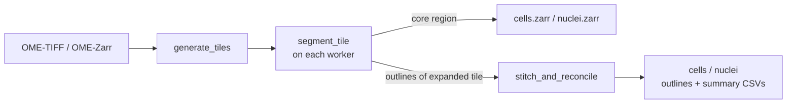
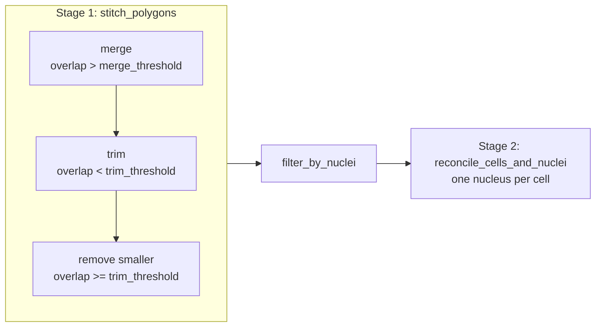

# Segmentation API

Cell and nucleus segmentation for whole-slide images with Cellpose 3 or 4,
importable from `smint.segmentation`. There are two pipelines; pick one by image
size and hardware:

| Pipeline | Runs on | Tiles | Boundary cells | Entry point |
| --- | --- | --- | --- | --- |
| [Distributed](#distributed-segmentation) | Dask workers: local CPUs/GPUs or SLURM | Overlapping | Stitched and reconciled | [`run_distributed_segmentation`](#smint.segmentation.run_distributed_segmentation) |
| [Single process](#single-process-segmentation) | One process, one GPU or CPU | Non-overlapping | Split at tile edges | [`process_large_image`](#smint.segmentation.process_large_image) |

Both write outline CSVs in pixel coordinates of the full image; see
[Data formats](../data_formats.md#segmentation-outputs). Every model load and
`eval` call goes through the [Cellpose compatibility](#cellpose-3-and-4-compatibility)
layer, so the same code runs on Cellpose 3 and 4.



## Distributed segmentation

The image is cut into core tiles; each worker segments its tile expanded by an
overlap margin, writes the core region into shared Zarr label masks and returns
outlines of every object it saw whole. The coordinator then stitches duplicate
outlines and reconciles cells with nuclei. Needs
`pip install 'smint[distributed]'` and Cellpose.

```python
from smint.segmentation import run_distributed_segmentation

result = run_distributed_segmentation(
    "slide.ome.tif", "results/dist", config_path="my_config.yaml",
    backend="slurm", n_workers=4, slurm={"gpu_type": "A30"},
)
print(result["total_cells"], result["total_nuclei"], result["failed_tiles"])
```

::: smint.segmentation.run_distributed_segmentation
    options:
      heading_level: 3
      docstring_style: google
      docstring_options:
        returns_named_value: false

### Building blocks

::: smint.segmentation.distributed_seg.open_image
    options:
      heading_level: 4
      docstring_style: google
      docstring_options:
        returns_named_value: false

::: smint.segmentation.distributed_seg.generate_tiles
    options:
      heading_level: 4
      docstring_style: google
      docstring_options:
        returns_named_value: false

::: smint.segmentation.distributed_seg.setup_dask_client
    options:
      heading_level: 4
      docstring_style: google
      docstring_options:
        returns_named_value: false

::: smint.segmentation.distributed_seg.segment_tile
    options:
      heading_level: 4
      docstring_style: google
      docstring_options:
        returns_named_value: false

::: smint.segmentation.distributed_seg.stitch_and_reconcile
    options:
      heading_level: 4
      docstring_style: google
      docstring_options:
        returns_named_value: false

::: smint.segmentation.distributed_seg.polygons_to_dataframe
    options:
      heading_level: 4
      docstring_style: google
      docstring_options:
        returns_named_value: false

::: smint.segmentation.distributed_seg.polygon_summary
    options:
      heading_level: 4
      docstring_style: google
      docstring_options:
        returns_named_value: false

::: smint.segmentation.distributed_seg.setup_logging
    options:
      heading_level: 4
      docstring_style: google
      docstring_options:
        returns_named_value: false

## Stitching and reconciliation

`smint.segmentation.stitching` is a Python port of an R stitching workflow
(`stitching.Rmd`).
It works on Shapely polygons, so you can also use it on outlines from any other
tiled segmentation. Stage 1 runs per object type, stage 2 on cells and nuclei
together:



```python
from smint.segmentation.stitching import (
    polygons_from_outlines, stitch_polygons, reconcile_cells_and_nuclei,
)

# cell_outlines / nucleus_outlines: lists of {"x_coords": array, "y_coords": array}
nuclei = stitch_polygons(polygons_from_outlines(nucleus_outlines))
cells = stitch_polygons(polygons_from_outlines(cell_outlines))
cells, nuclei, nucleus_cell = reconcile_cells_and_nuclei(cells, nuclei)
```

`*_outlines` are lists of dicts with `x_coords` / `y_coords` arrays, as
[`segment_tile`](#smint.segmentation.distributed_seg.segment_tile) and
[`get_cell_outlines`](#smint.segmentation.get_cell_outlines) return them.

::: smint.segmentation.stitching.stitch_polygons
    options:
      heading_level: 3
      docstring_style: google
      docstring_options:
        returns_named_value: false

::: smint.segmentation.stitching.reconcile_cells_and_nuclei
    options:
      heading_level: 3
      docstring_style: google
      docstring_options:
        returns_named_value: false

### Stitching steps

::: smint.segmentation.stitching.merge_overlapping
    options:
      heading_level: 4
      docstring_style: google
      docstring_options:
        returns_named_value: false

::: smint.segmentation.stitching.trim_collisions
    options:
      heading_level: 4
      docstring_style: google
      docstring_options:
        returns_named_value: false

::: smint.segmentation.stitching.remove_conflicts
    options:
      heading_level: 4
      docstring_style: google
      docstring_options:
        returns_named_value: false

::: smint.segmentation.stitching.filter_by_nuclei
    options:
      heading_level: 4
      docstring_style: google
      docstring_options:
        returns_named_value: false

::: smint.segmentation.stitching.polygons_from_outlines
    options:
      heading_level: 4
      docstring_style: google
      docstring_options:
        returns_named_value: false

::: smint.segmentation.stitching.clean_polygons
    options:
      heading_level: 4
      docstring_style: google
      docstring_options:
        returns_named_value: false

## Single-process segmentation

Segments the image chunk by chunk in one process, with no overlap and no
stitching, so a cell crossing a chunk edge is reported once per chunk. Use it for
images that fit in memory on one machine, or as the fallback when Dask is not
available.

::: smint.segmentation.process_large_image
    options:
      heading_level: 3
      docstring_style: google
      docstring_options:
        returns_named_value: false

::: smint.segmentation.segment_chunk
    options:
      heading_level: 3
      docstring_style: google
      docstring_options:
        returns_named_value: false

::: smint.segmentation.get_cell_outlines
    options:
      heading_level: 3
      docstring_style: google
      docstring_options:
        returns_named_value: false

## Cellpose 3 and 4 compatibility

Cellpose 4 ships a single model (Cellpose-SAM, `cpsam`), ignores `model_type` and
ignores `channels`. These helpers make a model name and a Cellpose 3 style
channel pair behave the same on both versions.

| `channels` | Cellpose sees |
| --- | --- |
| `[0, 0]` | the first channel, greyscale |
| `[2, 1]` | channel index 1 as the cytoplasm, channel index 0 as the nucleus |
| `[1, 0]` | channel index 0 alone |

Indices are 1-based into the channel axis; 0 means "none".

::: smint.segmentation.cellpose_compat.load_model
    options:
      heading_level: 3
      docstring_style: google
      docstring_options:
        returns_named_value: false

::: smint.segmentation.cellpose_compat.run_eval
    options:
      heading_level: 3
      docstring_style: google
      docstring_options:
        returns_named_value: false

::: smint.segmentation.cellpose_compat.select_channels
    options:
      heading_level: 3
      docstring_style: google
      docstring_options:
        returns_named_value: false

::: smint.segmentation.cellpose_compat.is_known_model
    options:
      heading_level: 3
      docstring_style: google
      docstring_options:
        returns_named_value: false

::: smint.segmentation.cellpose_compat.cellpose_major_version
    options:
      heading_level: 3
      docstring_style: google
      docstring_options:
        returns_named_value: false

::: smint.segmentation.cellpose_compat.use_gpu
    options:
      heading_level: 3
      docstring_style: google
      docstring_options:
        returns_named_value: false

## Post-processing

::: smint.segmentation.postprocess.calculate_centroids
    options:
      heading_level: 3
      docstring_style: google
      docstring_options:
        returns_named_value: false

::: smint.segmentation.postprocess.combine_segmentation_results
    options:
      heading_level: 3
      docstring_style: google
      docstring_options:
        returns_named_value: false

::: smint.segmentation.extract_contours
    options:
      heading_level: 3
      docstring_style: google
      docstring_options:
        returns_named_value: false

::: smint.segmentation.save_masks
    options:
      heading_level: 3
      docstring_style: google
      docstring_options:
        returns_named_value: false

## Configuration helpers

Used by `scripts/run_segmentation.py` to read and merge the YAML configuration
described in [Configuration](../configuration.md).

::: smint.utils.config.load_config
    options:
      heading_level: 3
      docstring_style: google
      docstring_options:
        returns_named_value: false

::: smint.utils.config.merge_configs
    options:
      heading_level: 3
      docstring_style: google
      docstring_options:
        returns_named_value: false

::: smint.utils.config.validate_config
    options:
      heading_level: 3
      docstring_style: google
      docstring_options:
        returns_named_value: false

::: smint.utils.config.save_config
    options:
      heading_level: 3
      docstring_style: google
      docstring_options:
        returns_named_value: false

::: smint.utils.config.get_config_value
    options:
      heading_level: 3
      docstring_style: google
      docstring_options:
        returns_named_value: false

::: smint.utils.config.get_default_config_path
    options:
      heading_level: 3
      docstring_style: google
      docstring_options:
        returns_named_value: false

## Next steps

- [Configuration](../configuration.md): every YAML key the pipelines read.
- [Tiling and stitching](../../concepts/tiling_and_stitching.md): why tiles overlap and how duplicates are resolved.
- [Command line](../cli.md#distributed_seg): run the distributed pipeline without writing Python.
