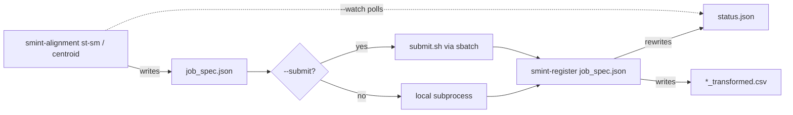

<!--
  GENERATED FILE -- do not edit by hand.
  Regenerate with:  PYTHONPATH=. python scripts/docs/gen_cli_reference.py
  Options, defaults and help text come from the real argparse parsers.
-->

# Command line

SMINT's command-line tools, generated from the parsers the commands actually use,
so every option, default and choice on this page is the one the code accepts. Each
command ends with a worked example; every example on this page is parsed by the real
parser when the page is generated. A default of &mdash; means the option is unset unless
you pass it: the command then falls back to the configuration file or to the built-in
value named in the description.

| Command | How it is installed | What it does |
| --- | --- | --- |
| [`smint-alignment`](#smint-alignment) | console script | Register spatial omics modalities: coarse pre-registration, same-section centroid registration and sequential-section STalign LDDMM. |
| [`smint-register`](#smint-register) | console script | Registration worker: runs one job spec and reports through status.json. |
| [`python scripts/run_segmentation.py`](#run_segmentation) | script in the repository | Segment cells and nuclei from a YAML configuration, in one process or distributed with Dask. |
| [`python -m smint.segmentation.distributed_seg`](#distributed_seg) | module entry point | Distributed whole-slide segmentation with Dask: tiles, workers, stitching and cell / nucleus reconciliation. |
| [`smint-viewer`](#smint-viewer) | console script | Tkinter window that follows a running segmentation tile by tile. |

## How the registration commands fit together

`smint-alignment` never runs a registration in its own process. It writes a job
spec and hands it to a worker, on this machine or through SLURM, so the napari
plugin, the command line and Python all share one code path, and STalign
(which needs numpy < 2) stays in its own environment.



## `smint-alignment` { #smint-alignment }

`smint-alignment` builds a registration job and either runs it on this machine or submits it to SLURM (`--submit`). The `st-sm` and `centroid` subcommands write `job_spec.json` and `status.json` into `--output-dir` and launch the [`smint-register`](#smint-register) worker; `pretransform` and `columns` run immediately. See [Data formats](data_formats.md) for every file these commands read and write.

```text
smint-alignment [-h] [-v] {st-sm,centroid,pretransform,columns} ...
```

**Options**

| Option | Default | Description |
| --- | --- | --- |
| `-v, --verbose` | off | Debug logging |

### `smint-alignment st-sm` { #smint-alignment-st-sm }

STalign LDDMM for sequential sections (needs manual landmarks).

```text
smint-alignment st-sm [-h] --st ST --sm SM --st-points ST_POINTS --sm-points SM_POINTS
                      --output-dir OUTPUT_DIR [--dx DX] [--niter NITER] [--epv EPV]
                      [--orientation {dataset,stalign}] [--st-x-col ST_X_COL]
                      [--st-y-col ST_Y_COL] [--sm-x-col SM_X_COL] [--sm-y-col SM_Y_COL]
                      [--scale-xy SCALE_XY] [--rotate-left-90] [--submit] [--watch]
                      [--partition PARTITION] [--cpus CPUS] [--memory MEMORY]
                      [--time-limit TIME_LIMIT] [--gpus GPUS]
                      [--worker-python WORKER_PYTHON]
```

**Options**

| Option | Default | Description |
| --- | --- | --- |
| `--st ST` | required | ST annotation CSV (target) |
| `--sm SM` | required | SM matrix CSV (source) |
| `--st-points ST_POINTS` | required | ST landmarks .npy |
| `--sm-points SM_POINTS` | required | SM landmarks .npy |
| `--output-dir OUTPUT_DIR` | required | Output directory |
| `--dx DX` | `30.0` | Raster pixel size *(float)* |
| `--niter NITER` | `1000` | LDDMM iterations *(int)* |
| `--epv EPV` | `200.0` | Velocity regularisation *(float)* |
| `--orientation {dataset,stalign}` | `dataset` | Output frame: 'stalign' is x/y in the ST frame (overlays ST); 'dataset' reproduces historical outputs, transposed relative to ST |
| `--st-x-col ST_X_COL` | &mdash; | ST column to register (default: auto-detect) |
| `--st-y-col ST_Y_COL` | &mdash; | ST y column to register (default: auto-detect) |
| `--sm-x-col SM_X_COL` | &mdash; | SM column to register (default: the column named 'x') |
| `--sm-y-col SM_Y_COL` | &mdash; | SM y column to register (default: the column named 'y') |
| `--scale-xy SCALE_XY` | `10.0` | SM coordinate scaling *(float)* |
| `--rotate-left-90` | off | Rotate SM 90 deg CCW |
| `--submit` | off | Submit to SLURM |
| `--watch` | off | Block until finished |

**SLURM (with --submit)**

| Option | Default | Description |
| --- | --- | --- |
| `--partition PARTITION` | `regular` | SLURM partition |
| `--cpus CPUS` | `8` | CPUs per task *(int)* |
| `--memory MEMORY` | `64G` | Memory request |
| `--time-limit TIME_LIMIT` | `04:00:00` | Walltime |
| `--gpus GPUS` | `0` | GPUs to request *(int)* |
| `--worker-python WORKER_PYTHON` | &mdash; | Interpreter for the worker; defaults to $SMINT_WORKER_PYTHON or an STalign_env beside the package |

Register a metabolomics section onto a Xenium section on a GPU node and wait for it to finish:

```bash
smint-alignment st-sm --st st_cells.csv --sm sm_matrix.csv --st-points landmarks_st_points.npy \
    --sm-points landmarks_sm_points.npy --output-dir runs/st_sm --orientation stalign \
    --submit --partition gpuq --gpus 1 --time-limit 01:00:00 --watch
```

!!! note "Good to know"

    - `--st-points` / `--sm-points` are landmark files in the point-annotator format (see [Data formats](data_formats.md#landmarks-npy)); both must hold the same number of landmarks, at least 3, in the same order.
    - The worker needs an interpreter where STalign imports (numpy < 2). Point `--worker-python` or `$SMINT_WORKER_PYTHON` at it.
    - `--orientation stalign` gives true x/y in the ST frame, so the result overlays the ST cells; `dataset` (the default) reproduces older outputs, which are transposed relative to ST.
    - `--submit` with `--gpus 1` needs a GPU partition (`--partition`); a GPU request on a CPU partition stays pending rather than failing.

### `smint-alignment centroid` { #smint-alignment-centroid }

Correspondence fitting for post-staining on the same section.

```text
smint-alignment centroid [-h] --source SOURCE --target TARGET --output-dir OUTPUT_DIR
                         [--method {multiround,affine,ransac,tps,ransac+tps}]
                         [--max-distance MAX_DISTANCE]
                         [--validation-fraction VALIDATION_FRACTION]
                         [--n-control N_CONTROL] [--tps-regularization TPS_REGULARIZATION]
                         [--no-refine] [--snap-radius SNAP_RADIUS] [--no-assign-remaining]
                         [--source-cols X Y] [--target-cols X Y] [--submit] [--watch]
                         [--partition PARTITION] [--cpus CPUS] [--memory MEMORY]
                         [--time-limit TIME_LIMIT] [--gpus GPUS]
                         [--worker-python WORKER_PYTHON]
```

**Options**

| Option | Default | Description |
| --- | --- | --- |
| `--source SOURCE` | required | Source centroid CSV (moving) |
| `--target TARGET` | required | Target centroid CSV (fixed) |
| `--output-dir OUTPUT_DIR` | required | Output directory |
| `--method {multiround,affine,ransac,tps,ransac+tps}` | `multiround` | Registration model; `multiround` is recommended (see [Choosing a registration method](../concepts/registration_methods.md)) |
| `--max-distance MAX_DISTANCE` | `100.0` | Correspondence cutoff, coordinate units *(float)* |
| `--validation-fraction VALIDATION_FRACTION` | `0.25` | Pairs held out from fitting; 0 makes the reported TRE meaningless *(float)* |
| `--n-control N_CONTROL` | `1000` | TPS control points *(int)* |
| `--tps-regularization TPS_REGULARIZATION` | &mdash; | Default: 1000 for multiround, 1 for the single-round methods *(float)* |
| `--no-refine` | off | Skip snapping matched nuclei onto their cells |
| `--snap-radius SNAP_RADIUS` | `10.0` | Refinement: maximum nucleus-cell distance for snapping *(float)* |
| `--no-assign-remaining` | off | Refinement: leave nuclei that fail the neighbourhood check filled, instead of assigning them to the nearest free cell |
| `--source-cols X Y` | `centroid_x centroid_y` | x and y column names in `--source` |
| `--target-cols X Y` | `x_centroid y_centroid` | x and y column names in `--target` |
| `--submit` | off | Submit to SLURM |
| `--watch` | off | Block until finished |

**SLURM (with --submit)**

| Option | Default | Description |
| --- | --- | --- |
| `--partition PARTITION` | `regular` | SLURM partition |
| `--cpus CPUS` | `8` | CPUs per task *(int)* |
| `--memory MEMORY` | `64G` | Memory request |
| `--time-limit TIME_LIMIT` | `04:00:00` | Walltime |
| `--gpus GPUS` | `0` | GPUs to request *(int)* |
| `--worker-python WORKER_PYTHON` | &mdash; | Interpreter for the worker; defaults to $SMINT_WORKER_PYTHON or an STalign_env beside the package |

Register segmented nuclei onto Xenium cells from the same section (multiround + snapping refinement, the defaults), on this machine:

```bash
smint-alignment centroid --source nuclei_centroids.csv --target xenium_cells.csv \
    --output-dir runs/centroid --source-cols x_centroid y_centroid --watch
```

!!! note "Good to know"

    - `--source-cols` and `--target-cols` are **not** auto-detected: their defaults (`centroid_x centroid_y` and `x_centroid y_centroid`) must exist in the files, otherwise the worker stops and `status.json` reports `failed`.
    - Only the validation TRE (`tre_validation` in `status.json`) is meaningful; keep `--validation-fraction` above 0.
    - The `centroid` round has no STalign dependency and runs in any SMINT environment.

### `smint-alignment pretransform` { #smint-alignment-pretransform }

Coarse scale / rotate / flip before fine registration.

```text
smint-alignment pretransform [-h] --source SOURCE --target TARGET --output OUTPUT
                             [--rotation ROTATION] [--flip-x] [--flip-y]
                             [--scale-mode {extent,max,none}] [--anisotropic] [--search]
```

**Options**

| Option | Default | Description |
| --- | --- | --- |
| `--source SOURCE` | required | Source CSV to transform |
| `--target TARGET` | required | Reference CSV defining the frame |
| `--output OUTPUT` | required | Transformed CSV to write |
| `--rotation ROTATION` | `0.0` | Degrees counter-clockwise *(float)* |
| `--flip-x` | off | Mirror horizontally |
| `--flip-y` | off | Mirror vertically |
| `--scale-mode {extent,max,none}` | `extent` | How the scale is fitted to the target: bounding-box span (`extent`), maximum coordinate (`max`) or not at all (`none`) |
| `--anisotropic` | off | Allow per-axis scaling (may distort tissue shape) |
| `--search` | off | Grid-search rotation and flips by overlap score |

Rotate a metabolomics grid by 90 degrees, scale it to the Xenium extent and centre it on the Xenium cells:

```bash
smint-alignment pretransform --source sm_matrix.csv --target xenium_cells.csv \
    --rotation 90 --output sm_pre.csv
```

Let SMINT search rotations (15-degree steps) and flips by overlap:

```bash
smint-alignment pretransform --source sm_matrix.csv --target xenium_cells.csv \
    --search --output sm_pre.csv
```

Output of the first example on a synthetic grid rotated by -90 degrees and stored at one tenth of the target's scale:

```text
scale        : 10.0205, 10.0205
rotation     : 90.00 deg
reflects     : False
overlap      : 0.997
wrote        : sm_pre.csv
transform    : sm_pre.csv.transform.json
```

!!! note "Good to know"

    - Coordinate columns are auto-detected in both files (see [column priority](data_formats.md#coordinate-columns)); the detected source columns are overwritten in the output CSV, every other column is kept.
    - The 3x3 matrix and its decomposition are saved next to the output as `<output>.transform.json`.
    - Operations are applied flip, then rotate, then scale, about the source centroid, then the source centroid is moved onto the target centroid.

### `smint-alignment columns` { #smint-alignment-columns }

List a CSV's columns and the auto-detected pair.

```text
smint-alignment columns [-h] file
```

**Positional arguments**

| Option | Default | Description |
| --- | --- | --- |
| `file` | required | CSV to inspect |

See which coordinate columns SMINT would pick:

```bash
smint-alignment columns sm_matrix.csv
```

Output on a small synthetic matrix with columns `x, y, 72.0796, 88.0399`:

```text
4 columns in sm.csv:
  x  <- auto-detected
  y  <- auto-detected
  72.0796
  88.0399
```

!!! note "Good to know"

    - Reads only the header, so it is instant even on a 450 MB metabolomics matrix.

## `smint-register` { #smint-register }

You rarely call `smint-register` yourself: `smint-alignment`, the napari plugin and `smint.alignment.jobs.submit` launch it, locally or inside an sbatch script, as `<worker python> -m smint.cli.register <output_dir>/job_spec.json`. Run it by hand to re-run a job from its spec or to debug a failed job in the foreground.

```text
smint-register [-h] [-v] spec
```

**Positional arguments**

| Option | Default | Description |
| --- | --- | --- |
| `spec` | required | Path to job_spec.json |

**Options**

| Option | Default | Description |
| --- | --- | --- |
| `-v, --verbose` | off | Enable debug logging |

Re-run a job in the foreground with debug logging:

```bash
smint-register runs/centroid/job_spec.json -v
```

!!! note "Good to know"

    - Exit status: 0 completed, 1 the registration failed (the traceback is in `status.json`), 2 the spec could not be read.

## `python scripts/run_segmentation.py` { #run_segmentation }

`scripts/run_segmentation.py` merges a YAML configuration with the flags below and runs either the single-process tiler (`process_large_image`) or, with `--distributed`, the Dask pipeline (`run_distributed_segmentation`). It ships in the repository rather than as a console script, so run it from a checkout. Every configuration key is described in [Configuration](configuration.md).

```text
python scripts/run_segmentation.py [-h] --image IMAGE --output-dir OUTPUT_DIR
                                   [--config CONFIG] [--distributed] [--use-gpu]
                                   [--cell-model CELL_MODEL] [--nuclei-model NUCLEI_MODEL]
                                   [--cell-diameter CELL_DIAMETER]
                                   [--nuclei-diameter NUCLEI_DIAMETER]
                                   [--chunk-size CHUNK_SIZE CHUNK_SIZE] [--visualize]
                                   [--live-viewer] [--debug] [--save-config]
```

**Options**

| Option | Default | Description |
| --- | --- | --- |
| `--image IMAGE` | required | Path to the input image file |
| `--output-dir OUTPUT_DIR` | required | Directory to save segmentation results |
| `--config CONFIG` | &mdash; | Path to configuration file |
| `--distributed` | off | Run segmentation in distributed mode using Dask |
| `--use-gpu` | off | Use GPU for computation |
| `--cell-model CELL_MODEL` | &mdash; | Path to cell segmentation model |
| `--nuclei-model NUCLEI_MODEL` | &mdash; | Path to nuclei segmentation model |
| `--cell-diameter CELL_DIAMETER` | &mdash; | Diameter of cells for segmentation *(float)* |
| `--nuclei-diameter NUCLEI_DIAMETER` | &mdash; | Diameter of nuclei for segmentation *(float)* |
| `--chunk-size CHUNK_SIZE CHUNK_SIZE` | &mdash; | Size of chunks for processing (height width); default from config, else 2048 2048 *(int)* |
| `--visualize` | off | Enable visualization |
| `--live-viewer` | off | Enable live viewer |
| `--debug` | off | Enable debug logging |
| `--save-config` | off | Save effective configuration to a file |

Single process, models and diameters on the command line:

```bash
python scripts/run_segmentation.py --image slide.ome.tif --output-dir results/seg \
    --config configs/segmentation_config.yaml --cell-model cyto3 --nuclei-model nuclei \
    --cell-diameter 60 --nuclei-diameter 25
```

Distributed over Dask workers, everything from the configuration file:

```bash
python scripts/run_segmentation.py --image slide.ome.tif --output-dir results/seg \
    --config my_config.yaml --distributed
```

!!! note "Good to know"

    - Without `--config` the script looks for `./configs/segmentation_config.yaml`, then `~/.smint/config.yaml`, then the repository's own `configs/segmentation_config.yaml`. The run stops if no `model_paths` is set by the file or the flags.
    - With `--distributed`, the Dask pipeline re-reads the file given by `--config` itself, so `--cell-model`, `--nuclei-model`, `--cell-diameter` and `--nuclei-diameter` are **ignored**: set them in the file. Without `--config` it falls back to the built-in `cyto` / `nuclei` models with Cellpose defaults.
    - In single-process mode pass `--cell-model` and `--nuclei-model` together: either one alone replaces the whole `model_paths` list.
    - `--use-gpu` can only switch the GPU on for `--distributed` runs (set `use_gpu: false` in the file to turn it off). Single-process runs use the GPU whenever Cellpose finds one.
    - `--save-config` writes the merged configuration to `<output-dir>/segmentation_config.yaml`.

## `python -m smint.segmentation.distributed_seg` { #distributed_seg }

The direct entry point to the distributed pipeline. Flags override the YAML file given by `--config_path`, which overrides the built-in defaults (see [Configuration](configuration.md#the-distributed-section)). Workers read the image themselves, so it must be on storage every worker can see. Needs `pip install 'smint[distributed]'` and Cellpose.

```text
python -m smint.segmentation.distributed_seg [-h] --image_path IMAGE_PATH --output_dir
                                             OUTPUT_DIR [--config_path CONFIG_PATH]
                                             [--backend {local,slurm}]
                                             [--scheduler_address SCHEDULER_ADDRESS]
                                             [--n_workers N_WORKERS] [--use_gpu | --no_gpu]
                                             [--tile_size TILE_SIZE]
                                             [--tile_overlap TILE_OVERLAP]
                                             [--cell_model CELL_MODEL]
                                             [--nuclei_model NUCLEI_MODEL]
                                             [--slurm_gpu_type SLURM_GPU_TYPE]
                                             [--tile_info_path TILE_INFO_PATH]
                                             [--live_update_image_path LIVE_UPDATE_IMAGE_PATH]
```

**Options**

| Option | Default | Description |
| --- | --- | --- |
| `--image_path IMAGE_PATH` | required | Zarr/OME-Zarr store or TIFF/OME-TIFF |
| `--output_dir OUTPUT_DIR` | required | Output directory |
| `--config_path CONFIG_PATH` | &mdash; | YAML configuration file |
| `--backend {local,slurm}` | &mdash; | Where workers run (default: local) |
| `--scheduler_address SCHEDULER_ADDRESS` | &mdash; | Connect to an existing Dask scheduler |
| `--n_workers N_WORKERS` | &mdash; | Number of workers *(int)* |
| `--use_gpu` | off | Force GPU workers (default: `use_gpu` from the configuration, else on) |
| `--no_gpu` | off | Force CPU workers |
| `--tile_size TILE_SIZE` | &mdash; | Core tile size in pixels (default 2048) *(int)* |
| `--tile_overlap TILE_OVERLAP` | &mdash; | Tile overlap in pixels (default 256) *(int)* |
| `--cell_model CELL_MODEL` | &mdash; | Cell model name or path |
| `--nuclei_model NUCLEI_MODEL` | &mdash; | Nuclei model name or path |
| `--slurm_gpu_type SLURM_GPU_TYPE` | &mdash; | SLURM GPU type, e.g. A30 |
| `--tile_info_path TILE_INFO_PATH` | &mdash; | Tile-info file for the live viewer |
| `--live_update_image_path LIVE_UPDATE_IMAGE_PATH` | &mdash; | PNG updated as tiles finish |

Four SLURM GPU workers, each on an A30:

```bash
python -m smint.segmentation.distributed_seg --image_path slide.ome.tif \
    --output_dir results/dist --config_path my_config.yaml --backend slurm \
    --n_workers 4 --slurm_gpu_type A30
```

CPU-only on this machine, a quick test on a crop:

```bash
python -m smint.segmentation.distributed_seg --image_path crop.ome.tif \
    --output_dir results/test --config_path my_config.yaml --no_gpu --tile_size 1024
```

!!! note "Good to know"

    - `--use_gpu` / `--no_gpu` force GPU workers on or off; with neither, `use_gpu` from the configuration applies (default on).
    - `--tile_overlap` must exceed the radius of the largest cell, so every boundary cell is seen whole by at least one tile.
    - `--slurm_gpu_type` replaces the configuration's whole `distributed.slurm` section with `{gpu_type: ...}`; to combine a GPU type with other SLURM options, set them all in the file instead.
    - Outputs: `cells_outlines.csv`, `nuclei_outlines.csv`, `cells_summary.csv`, `nuclei_summary.csv`, `cells.zarr`, `nuclei.zarr` and a timestamped log (see [Data formats](data_formats.md#distributed-segmentation-outputs)).

## `smint-viewer` { #smint-viewer }

Shows the whole scan with the tile currently being segmented and its latest segmentation image, refreshed on a timer. It reads the tile-info file a segmentation run writes when `tile_info_path` / `live_update_image_path` are set (or `run_segmentation.py --live-viewer`). Needs a display and Pillow.

```text
smint-viewer [-h] [--interval INTERVAL]
             full_scan_image_path segmentation_history_dir tile_info_path
```

**Positional arguments**

| Option | Default | Description |
| --- | --- | --- |
| `full_scan_image_path` | required | Path to the full tile scan image (e.g., whole_slide.tif). |
| `segmentation_history_dir` | required | Directory containing segmentation results (PNG or TIFF files). |
| `tile_info_path` | required | Path to a text file containing current tile coordinates and scan dimensions. |

**Options**

| Option | Default | Description |
| --- | --- | --- |
| `--interval INTERVAL` | `1000` | Update interval in milliseconds. Default: 1000ms *(int)* |

Follow a run started with `run_segmentation.py --live-viewer --output-dir results/seg`:

```bash
smint-viewer slide.ome.tif results/seg results/seg/current_tile_info.txt \
    --interval 2000
```

!!! note "Good to know"

    - The tile-info file is one line, `y,x,tile_height,tile_width,scan_height,scan_width,image_name` (see [Data formats](data_formats.md#live-viewer-files)).
