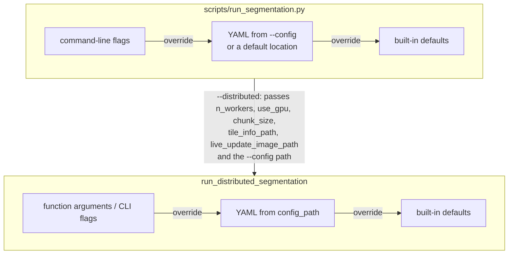

# Configuration

Segmentation runs are configured with a YAML file. This page lists every key the
code actually reads, with its type, default and effect, and a complete example
you can start from. Registration does not use a configuration file: its settings
are command-line options ([`smint-alignment`](cli.md#smint-alignment)) or
function arguments, recorded per run in [`job_spec.json`](data_formats.md#job_specjson).

Two programs read the file:

- **`scripts/run_segmentation.py`** reads every key below. Without `--distributed`
  it runs the single-process tiler (`process_large_image`); with `--distributed`
  it hands over to the Dask pipeline.
- **`run_distributed_segmentation`** (also `python -m smint.segmentation.distributed_seg
  --config_path …`) reads the model keys, `use_gpu`, `n_workers`, `chunk_size` and
  the [`distributed`](#the-distributed-section) section.

## Where values come from



Without `--config`, `run_segmentation.py` uses the first file that exists of
`./configs/segmentation_config.yaml`, `~/.smint/config.yaml` and the repository's
own `configs/segmentation_config.yaml`.

!!! warning "`--distributed` re-reads the file"
    In `--distributed` mode the Dask pipeline loads the file named by `--config`
    itself. Model names and model parameters given as flags (`--cell-model`,
    `--cell-diameter`, …) are therefore ignored, and without `--config` it uses the
    built-in `cyto` / `nuclei` models with Cellpose's default parameters. Put
    everything in the file and pass `--config`.

## Complete example

A configuration for a two-channel image (nucleus stain in channel 0, membrane or
cytoplasm in channel 1) segmented on four SLURM GPU workers. Every key is
described below.

```yaml title="my_config.yaml"
# Models: [cell model, nuclei model]. Built-in names or paths to trained models.
# Cellpose 3: cyto, cyto2, cyto3, nuclei, ...   Cellpose 4: cpsam only.
model_paths:
  - cyto3
  - nuclei

cell_model_params:
  diameter: 60             # pixels
  flow_threshold: 0.4
  cellprob_threshold: 0.0
  channels: [2, 1]         # cytoplasm = channel index 1, nucleus = channel index 0

nuclei_model_params:
  diameter: 25
  flow_threshold: 0.4
  cellprob_threshold: 0.0
  channels: [1, 0]         # nucleus = channel index 0, no second channel

use_gpu: true
n_workers: 4               # SLURM worker jobs (distributed) - ignored by single-process runs
chunk_size: [2048, 2048]   # tile size in pixels

# Single-process runs only
adaptive_nuclei:
  enable: false
visualization:
  enable: true
  num_chunks_to_visualize: 3
  background_channel_indices: [0, 1]

# Distributed runs only
distributed:
  backend: slurm
  tile_overlap: 256        # must exceed the largest cell radius
  split_multinucleated: true
  reconcile_nuclei: true
  stitch_merge_thresh: 0.5
  stitch_trim_thresh: 0.25
  worker_wait_timeout: 600
  slurm:
    queue: gpuq
    gpu_type: A30
    memory: 64GB
    walltime: "04:00:00"
```

Run it with either:

```bash
python scripts/run_segmentation.py --image slide.ome.tif --output-dir results/seg \
    --config my_config.yaml --distributed

python -m smint.segmentation.distributed_seg --image_path slide.ome.tif \
    --output_dir results/seg --config_path my_config.yaml
```

## Models and Cellpose parameters

| Key | Type | Default | Meaning |
| --- | --- | --- | --- |
| `model_paths` | list of 2 str | distributed: `[cyto, nuclei]`; `run_segmentation.py`: **required** | `[cell model, nuclei model]`, each a built-in Cellpose name or a path to a trained model. In distributed runs `null` skips that object type. On Cellpose 4 any built-in name other than `cpsam` falls back to `cpsam` with a warning |
| `cell_model_params` | mapping | see below | Parameters for the cell model |
| `nuclei_model_params` | mapping | see below | Parameters for the nuclei model |

Keys inside `cell_model_params` and `nuclei_model_params` (any other key is
ignored):

| Key | Type | Single-process default (cells / nuclei) | Distributed default | Meaning |
| --- | --- | --- | --- | --- |
| `diameter` | float | `120.0` / `40.0` | Cellpose's own | Expected object diameter in pixels |
| `flow_threshold` | float | `0.4` / `0.4` | Cellpose's own | Maximum flow error; raise to keep more objects |
| `cellprob_threshold` | float | `-1.5` / `-1.2` | Cellpose's own | Pixel probability cut-off; lower it to find fainter objects |
| `channels` | list of 2 int | `[1, 2]` / `[2, 0]` | `[0, 0]` | Cellpose 3 style `[main, nuclear]` channel pair: 1-based indices into the image's channel axis, `0` for none. Applied by SMINT before Cellpose, so it also works on Cellpose 4 |

!!! tip "Set `channels` for your image"
    The single-process defaults assume a specific channel order. `[2, 1]` means
    "cytoplasm in channel index 1, nuclei in channel index 0"; `[1, 0]` means
    "channel index 0 only". Check yours before running a whole slide.

## Run settings

| Key | Type | Default | Read by | Meaning |
| --- | --- | --- | --- | --- |
| `output_dir` | str | &mdash; | `run_segmentation.py` | Required by its validation, but always replaced by `--output-dir` |
| `chunk_size` | list `[height, width]` | `[2048, 2048]` | both | Tile size in pixels. The distributed pipeline uses square tiles of the first value. Must be a YAML list |
| `use_gpu` | bool | `true` | distributed | GPU workers. Single-process runs use the GPU whenever Cellpose finds one, whatever this says |
| `n_workers` | int or `null` | `null` | distributed | Local: number of workers (`null`: one per GPU with `dask-cuda`, otherwise `min(4, CPUs)`). SLURM: number of worker jobs (`null`: 4) |
| `tile_info_path` | str | &mdash; | `run_segmentation.py` | Tile-info file for the [live viewer](data_formats.md#live-viewer-files), rewritten after each tile. Relative paths are relative to the current directory |
| `live_update_image_path` | str | &mdash; | `run_segmentation.py` | PNG of the latest tile for the live viewer |

`run_segmentation.py --live-viewer` sets the last two to
`<output-dir>/current_tile_info.txt` and `<output-dir>/live_view.png`. When calling
`run_distributed_segmentation` directly, pass them as arguments; it does not read
them from the file.

## Single-process options

Read by `run_segmentation.py` without `--distributed`; the distributed pipeline
ignores them.

### `adaptive_nuclei`

Re-runs the nuclei model on a chunk with a lower `cellprob_threshold` while too few
nuclei are found relative to cells.

| Key | Type | Default | Meaning |
| --- | --- | --- | --- |
| `enable` | bool | `false` | Turn adaptive re-runs on |
| `trigger_ratio` | float | `0.05` | Re-run while nuclei / cells in the chunk is below this |
| `step_decrement` | float | `0.2` | Lower `cellprob_threshold` by this much per attempt |
| `cellprob_lower_limit` | float | `-6.0` | Never go below this threshold |
| `max_attempts` | int | `3` | Maximum re-runs per chunk |

### `visualization`

| Key | Type | Default | Meaning |
| --- | --- | --- | --- |
| `enable` | bool | `false` (`--visualize` turns it on) | Save outline overlays for some chunks |
| `output_dir` | str | `<output-dir>/visualizations` | Where the `chunk_<row>_<col>.png` overlays go |
| `num_chunks_to_visualize` | int | `5` | Number of randomly chosen chunks to overlay |
| `background_channel_indices` | list of int | `[0, 1]` | 0-based channels drawn under the outlines: one is shown grey, two as green and blue, three as green, blue and red. The first is also the live-view background |
| `roi_size` | list of 2 int | `[2024, 2024]` | Currently only logged: each overlay covers one whole chunk |

## The `distributed` section

Read by `run_distributed_segmentation`, and so by `run_segmentation.py --distributed`.
Function arguments and `distributed_seg` command-line flags take precedence.

| Key | Type | Default | Meaning |
| --- | --- | --- | --- |
| `backend` | `local` or `slurm` | `local` | Where Dask workers run: this machine (CPUs, or one worker per GPU with `dask-cuda`) or SLURM jobs via `dask-jobqueue` |
| `scheduler_address` | str | `null` | Connect to an existing Dask scheduler instead (e.g. `tcp://10.0.0.5:8786`); `backend` is then ignored |
| `tile_overlap` | int | `256` | Pixels each tile is expanded by on every side. Must exceed the radius of the largest cell |
| `split_multinucleated` | bool | `true` | Split cells containing several nuclei with a watershed seeded on the nuclei (needs both models) |
| `reconcile_nuclei` | bool | `true` | After stitching, make cells and nuclei consistent and assign every nucleus to one cell (adds `n_nuclei` / `cell_id` to the summaries) |
| `stitch_merge_thresh` | float | `0.5` | Merge two outlines whose overlap (intersection / smaller area) exceeds this: the same object seen by two tiles |
| `stitch_trim_thresh` | float | `0.25` | Below this overlap, trim the overlap from both outlines; at or above it (and not merged), drop the smaller one |
| `worker_wait_timeout` | int | `600` | Seconds to wait for the first worker before giving up |
| `slurm` | mapping | see below | Options for `dask_jobqueue.SLURMCluster`, used with `backend: slurm` |

### `distributed.slurm`

Any `dask_jobqueue.SLURMCluster` keyword (e.g. `account`, `local_directory`,
`job_extra_directives`) plus `gpu_type`. SMINT's defaults:

| Key | Default | Meaning |
| --- | --- | --- |
| `queue` | `gpuq` | SLURM partition for worker jobs |
| `cores` | `1` | Cores per worker job |
| `processes` | `1` | Dask worker processes per job |
| `memory` | `64GB` | Memory per worker job |
| `walltime` | `12:00:00` | Time limit per worker job |
| `python` | the current interpreter | Python the workers run |
| `log_directory` | `dask_logs` | Worker job logs, relative to the current directory |
| `gpu_type` | none | With `use_gpu`, request `--gres=gpu:<gpu_type>:1` per worker instead of `--gres=gpu:1` |

The generated worker job script is written to the run log, so you can check the
`#SBATCH` lines.

!!! note
    The `distributed_seg` flag `--slurm_gpu_type A30` replaces the whole
    `slurm` mapping with `{gpu_type: A30}`. To combine a GPU type with other
    SLURM options, put them all in the file.

## Keys that have no effect

The repository's `configs/segmentation_config.yaml` also contains `memory_limit`
and a `preprocessing` section (`sigma`, `normalize`, `channel_names`). No code reads
them. Its `output_dir`, `tile_info_path`, `live_update_image_path` and
`visualization.output_dir` are relative paths under `results/segmentation/`,
resolved against the directory you run from, and `visualization.enable` is `true`;
copy the file and adjust these before using it as your own.

## Next steps

- [Command line](cli.md#run_segmentation): flags that override these keys.
- [Data formats](data_formats.md#segmentation-outputs): what a run writes.
- [Segmentation API](api/segmentation.md): the functions behind the keys.
