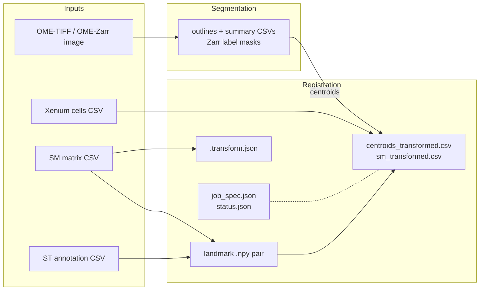
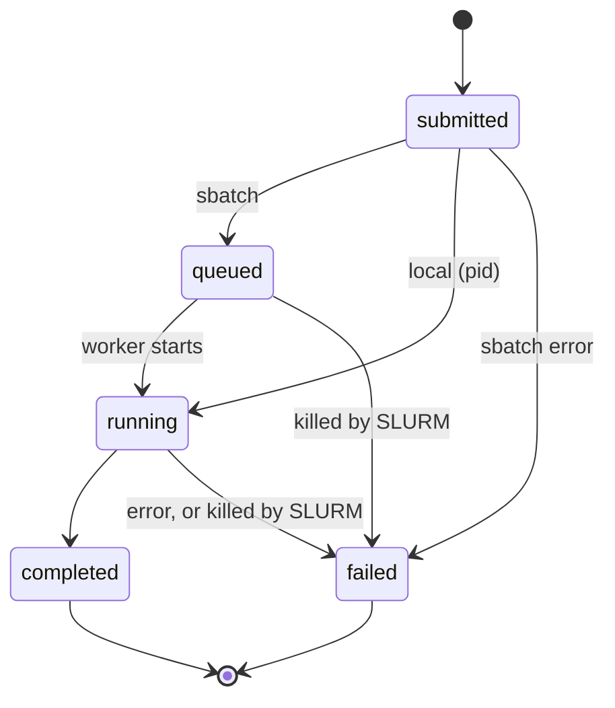

# Data formats

Every file SMINT reads or writes, with its columns, an example and the code that
produces or consumes it. Use this page to prepare inputs from your own
instruments and to find the column you need in an output. All tables are plain
CSV with a header row; coordinates are in the units of the file they came from
(pixels for segmentation output, microns for Xenium).



| File | Read or written by | Section |
| --- | --- | --- |
| Any table with coordinates | auto-detection | [Coordinate columns](#coordinate-columns) |
| Centroid CSV (nuclei, Xenium cells) | `smint-alignment centroid`, `register_centroid_files` | [Centroid CSVs](#centroid-csvs) |
| SM matrix CSV | `smint-alignment st-sm` / `pretransform`, `read_sm_matrix` | [SM matrix CSV](#sm-matrix-csv) |
| ST annotation CSV | `smint-alignment st-sm`, `read_st_annotations` | [ST annotation CSV](#st-annotation-csv) |
| `*_points.npy` | napari plugin, point annotator, `load_landmarks` | [Landmarks](#landmarks-npy) |
| `*.npz` raster | `prepare_landmark_inputs`, `save_rasterized` | [Landmarks](#raster-npz) |
| `<output>.transform.json` | `smint-alignment pretransform`, `save_transform` | [Pre-registration transform](#pretransform-json) |
| `job_spec.json`, `status.json`, logs | `smint.alignment.jobs`, `smint-register` | [Registration jobs](#registration-jobs) |
| `centroids_transformed.csv`, `sm_transformed.csv` | registration worker | [Registration outputs](#registration-outputs) |
| `cells_outlines.csv`, `*_summary.csv`, `*.zarr` | distributed segmentation | [Segmentation outputs](#segmentation-outputs) |
| `<base>_cells.csv`, `<base>_nuclei.csv` | single-process segmentation | [Segmentation outputs](#single-process-segmentation-outputs) |
| `current_tile_info.txt`, `live_view.png` | segmentation, `smint-viewer` | [Live viewer files](#live-viewer-files) |

## Coordinate columns

Tables from different sources name their coordinates differently. Wherever SMINT
auto-detects them, it tries these names **in order**, case-insensitively, and takes
the first that exists (`smint.alignment.columns.X_CANDIDATES` / `Y_CANDIDATES`):

| Priority | x column | y column | Typical source |
| --- | --- | --- | --- |
| 1 | `x_final` | `y_final` | ST annotation tables |
| 2 | `x_centroid` | `y_centroid` | Xenium `cells.csv`; SMINT segmentation summaries |
| 3 | `centroid_x` | `centroid_y` | Nucleus centroids from `calculate_centroids` |
| 4 | `x_transformed` | `y_transformed` | Output of an earlier SMINT registration |
| 5 | `x` | `y` | Metabolomics matrices |
| 6 | `X` | `Y` | Other tools |

So a table with both `x_final` and `x` resolves to `x_final`. Check what SMINT
will pick with `smint-alignment columns my_table.csv`.

| Where | Auto-detected? |
| --- | --- |
| `smint-alignment pretransform` (both files), `smint-alignment columns` | yes |
| ST table in `st-sm` / `register_sm_to_st` (`--st-x-col` / `--st-y-col` override) | yes |
| napari plugin loaders | yes |
| SM matrix in `st-sm` / `read_sm_matrix` | no: the columns named `x` and `y` (override with `--sm-x-col` / `--sm-y-col`) |
| `smint-alignment centroid` / `register_centroid_files` | **no**: `--source-cols` (default `centroid_x centroid_y`) and `--target-cols` (default `x_centroid y_centroid`) |

!!! warning "Several coordinate pairs in one table"
    ST tables often carry several plausible pairs from successive processing
    steps. A wrong pick misregisters silently instead of failing, so name the
    columns explicitly whenever more than one pair exists.

## Inputs

### Centroid CSVs

Two tables of `(x, y)` centroids from the **same** section: the *source* is moved
onto the *target*. Any other columns are carried through to the output unchanged.

**Source**, e.g. nuclei from SMINT segmentation. `cells_summary.csv` /
`nuclei_summary.csv` from the distributed pipeline already hold `x_centroid`,
`y_centroid`; centroids computed from single-process outlines with
`smint.segmentation.postprocess.calculate_centroids` are named `centroid_x`,
`centroid_y` (here from the synthetic test image used further down this page):

```text
cell_id,centroid_x,centroid_y,chunk_id
1,316.77,25.85,0_0
2,177.24,26.75,0_0
```

**Target**, e.g. Xenium `cells.csv`; only the two coordinate columns are read
(synthetic values):

```text
cell_id,x_centroid,y_centroid
0,256.95,473.62
1,2403.82,1164.32
```

Both must be in the **same units and roughly the same frame**: registration
corrects residual misalignment of the order of `--max-distance` (default 100),
not a different scale or orientation. Bring them together first with
[`pretransform`](cli.md#smint-alignment-pretransform) if needed.

### SM matrix CSV

A spatial metabolomics matrix: one row per pixel, its grid position and one
column per m/z feature. The delimiter is sniffed from the header line (`,` `;`
tab or `|`), so semicolon- and tab-separated exports work too.

| Column | Required | Meaning |
| --- | --- | --- |
| `x`, `y` | yes | Pixel grid position (any case; or name others with `--sm-x-col` / `--sm-y-col`) |
| `is_edge` | no | Edge flag; kept as is |
| `72.0796`, `88.0399`, … | no | One intensity column per m/z value |

```text
x,y,72.0796,88.0399
0,0,52.5,100.3
1,0,78.9,4.9
```

When read for registration ([`read_sm_matrix`](api/alignment.md#smint.alignment.read_sm_matrix)):

1. numeric headers are prefixed with `X` (`72.0796` → `X72.0796`), so they are valid
   identifiers and survive a round trip through R;
2. `x` and `y` are multiplied by `scale_xy` (`--scale-xy`, default **10**, the
   pixel-to-micron factor for the MALDI data SMINT was developed on; set it for your
   own pixel size, or 1 if the grid is already in microns);
3. with `rotate_left_90`, `(x, y) → (−y, x)`;
4. with `keep_positive=True` (default), an axis with negative values is shifted
   so its minimum is 0; non-negative coordinates are left unchanged
   (`--no-keep-positive` turns this off).

The registration output keeps these modified `x` / `y` and `X…` columns. Exports
named `*information_matrix_tissue_only_full_with_xy.csv` under
`<root>/layer_<n>/matrix/` are found by `find_sm_matrix_files`.

!!! tip
    These matrices can be hundreds of MB. Read only what you need:
    `pd.read_csv(path, usecols=["x", "y"])`, or `read_sm_matrix(path, usecols=["x", "y"])`.

### ST annotation CSV

The spatial transcriptomics side of a sequential-section registration: one row
per cell with its coordinates, auto-detected as above, and anything else you like
(annotations are carried along but not used). Illustrative rows:

```text
cell_id,x_final,y_final,Anno
1,1520.37,880.21,Tumour
2,1531.90,874.66,Stroma
```

## Landmarks

### Landmark `.npy` { #landmarks-npy }

Landmarks for `st-sm` come as a **pair** of files, one per modality, with the same
number of points (at least 3) in the same order. The format is the one the point
annotator writes and the napari plugin reproduces: a Python dict pickled into a
`.npy`, mapping a label (`"1"`, `"2"`, … in click order) to a one-element list
holding an `(x, y)` tuple in the coordinates of the data you clicked on.

```python
import numpy as np

points = {"1": [(1520.4, 880.2)], "2": [(2210.0, 1460.7)], "3": [(980.5, 2105.3)]}
np.save("landmarks_st_points.npy", points, allow_pickle=True)

np.load("landmarks_st_points.npy", allow_pickle=True).item()
# {'1': [(1520.4, 880.2)], '2': [(2210.0, 1460.7)], '3': [(980.5, 2105.3)]}
```

[`load_landmarks`](api/alignment.md#smint.alignment.load_landmarks) orders the points
by label (numerically for `"1"`…`"10"`) and returns them in STalign's **row–column**
order, `(y, x)`:

```python
from smint.alignment import load_landmarks
load_landmarks("landmarks_st_points.npy")
# array([[ 880.2, 1520.4],
#        [1460.7, 2210. ],
#        [2105.3,  980.5]])
```

Name the pair `<prefix>_st_points.npy` and `<prefix>_sm_points.npy`; that is what
the napari plugin and [`prepare_landmark_inputs`](api/alignment.md#smint.alignment.prepare_landmark_inputs) expect.

### Raster `.npz` { #raster-npz }

[`prepare_landmark_inputs`](api/alignment.md#smint.alignment.prepare_landmark_inputs)
rasterises each modality with STalign and saves `<prefix>_st.npz` and
`<prefix>_sm.npz` for the point annotator, with arrays `x` and `y` (pixel
positions along each axis, in coordinate units, `dx` apart) and `I` (the density
image, channels first). The annotator writes `<prefix>_st_points.npy` /
`<prefix>_sm_points.npy` beside them.

## Pre-registration transform

### `.transform.json` { #pretransform-json }

`smint-alignment pretransform --output sm_pre.csv` writes the transformed table and,
beside it, `sm_pre.csv.transform.json`
([`save_transform`](api/alignment.md#smint.alignment.save_transform)). This one is
from a synthetic metabolomics grid stored rotated by −90° at one tenth of the
target's scale:

```json
{
  "matrix": [
    [6.135756699848347e-16, -10.020451127819548, 3988.613063047138],
    [10.020451127819548, 6.135756699848347e-16, 0.2399003878131225],
    [0.0, 0.0, 1.0]
  ],
  "described": {
    "scale_x": 10.020451127819548,
    "scale_y": 10.020451127819548,
    "rotation_deg": 90.0,
    "shear_deg": 0.0,
    "translation": [3988.613063047138, 0.2399003878131225],
    "determinant": 100.40944080502001,
    "reflects": false
  },
  "source": "sm.csv",
  "target": "cells.csv",
  "rotation": 90.0,
  "flip_x": false,
  "flip_y": false,
  "scale_mode": "extent"
}
```

| Key | Meaning |
| --- | --- |
| `matrix` | 3×3 homogeneous affine; `[x', y', 1] = matrix @ [x, y, 1]` |
| `described` | Its decomposition ([`describe_pretransform`](api/alignment.md#smint.alignment.describe_pretransform)). `reflects: true` means a flip is included |
| `source`, `target`, `rotation`, `flip_x`, `flip_y`, `scale_mode` | The settings that produced it, as passed |

Replay it on other coordinates with
`apply_pretransform(xy, load_transform("sm_pre.csv.transform.json"))`.

## Registration jobs

`smint-alignment st-sm|centroid`, the napari plugin and
[`submit`](api/jobs.md#smint.alignment.jobs.submit) all create one directory per
job (`--output-dir`):

| File | Written by | When |
| --- | --- | --- |
| `job_spec.json` | caller | always: what to run |
| `status.json` | caller, then worker | always: current state, rewritten as the job progresses |
| `submit.sh` | caller | `sbatch` backend: the generated batch script |
| `<job_name>_<jobid>.out` / `.err` | SLURM | `sbatch` backend: worker stdout / stderr |
| `worker.log` | worker | `local` backend: worker stdout and stderr |
| `centroids_transformed.csv` or `sm_transformed.csv` | worker | on success; see [Registration outputs](#registration-outputs) |

### `job_spec.json`

The serialised [`JobSpec`](api/jobs.md#smint.alignment.jobs.JobSpec). This is the
spec of the Sample 2 z5 same-section run (file paths replaced by placeholders):

```json
{
  "round": "centroid",
  "inputs": {
    "source_file": "data/sample2_z5_nuclei.csv",
    "target_file": "data/sample2_z5_xenium_cells.csv"
  },
  "output_dir": "runs/z5_refine",
  "params": {
    "method": "multiround",
    "max_distance": 100.0,
    "validation_fraction": 0.25,
    "n_control": 1000,
    "tps_regularization": null,
    "source_cols": ["x_centroid", "y_centroid"],
    "target_cols": ["x_centroid", "y_centroid"],
    "refine": true,
    "refine_kwargs": {"snap_radius": 10.0, "assign_remaining": true}
  },
  "backend": "local",
  "resources": {
    "partition": "regular",
    "cpus_per_task": 8,
    "memory": "64G",
    "time_limit": "04:00:00",
    "job_name": "smint_centroid",
    "gpus": 0,
    "gpu_type": "A30"
  },
  "worker_python": "/path/to/env/bin/python",
  "created": "2026-10-26T15:11:52"
}
```

| Key | Meaning |
| --- | --- |
| `round` | `centroid` (same section) or `st_sm` (sequential sections, STalign) |
| `inputs` | `centroid`: `source_file`, `target_file`. `st_sm`: `st_file`, `sm_file`, `st_points`, `sm_points`. All must exist when the job is submitted |
| `output_dir` | The job directory. For `sbatch` it must be on storage the compute node sees (not `/tmp`) |
| `params` | Keyword arguments for `register_centroid_files` or `register_sm_to_st`; `output_path` overrides the output file name |
| `backend` | `local` (detached subprocess) or `sbatch` |
| `resources` | [`SlurmResources`](api/jobs.md#smint.alignment.jobs.SlurmResources); ignored for `local` |
| `worker_python` | Interpreter that runs `-m smint.cli.register`; for `st_sm` it needs STalign (numpy < 2) |
| `created` | Timestamp; reset when a spec is read back |

### `status.json`

Rewritten at each step, so a GUI or `--watch` can poll it without parsing logs.
[`poll`](api/jobs.md#smint.alignment.jobs.poll) also asks SLURM (`squeue`, then
`sacct`) and reports a job SLURM killed (out of memory, time limit, cancelled) as
`failed`, which the worker itself could not record.



| `state` | Meaning |
| --- | --- |
| `unknown` | No readable status file yet (returned by `read_status`, never written) |
| `submitted` | Spec written, worker not launched yet |
| `queued` | Accepted by `sbatch`; `job_id` is set |
| `running` | Worker started (`pid` for local jobs) |
| `completed` | Finished; `outputs` and, for `centroid`, `metrics` are set |
| `failed` | `message` holds the exception; `traceback` the full traceback |
| `cancelled` | Treated as final by `poll`; SMINT itself reports SLURM cancellations as `failed` |

Every status has `state`, `message` and `updated`. This is the `status.json` of the
same Sample 2 z5 run, a completed `centroid` round (path shortened):

```json
{
  "state": "completed",
  "message": "centroid round finished",
  "updated": "2026-10-26T15:12:13",
  "outputs": {
    "transformed_csv": "runs/z5_refine/centroids_transformed.csv"
  },
  "metrics": {
    "method": "multiround",
    "n_matched": 49206,
    "tre_initial": 10.957773145566303,
    "tre_fit": 4.447931821449571,
    "tre_validation": 4.925670066673518,
    "inlier_fraction": null,
    "rounds": [
      {"stage": "initial", "median_nn": 12.399709824113891},
      {"stage": "affine", "max_distance": 100.0, "block_size": 500.0, "blocks": 300,
       "consistent_blocks": 0.91, "median_nn": 5.376158600755868, "accepted": true},
      {"stage": "tps", "max_distance": 25.0, "block_size": 250.0, "blocks": 1013,
       "consistent_blocks": 0.7680157946692991, "median_nn": 5.4244016618258435,
       "accepted": false}
    ],
    "validation": {
      "before": {"median_nn": 12.437970058717603, "mutual_within_5": 0.10054078413699864,
                 "mutual_within_10": 0.3390716538981523},
      "after": {"median_nn": 5.382032714808998, "mutual_within_5": 0.4511491662911221,
                "mutual_within_10": 0.7585849481748536}
    },
    "refinement": {
      "n_assigned": 8266,
      "median_deviation": {"snapped": 4.140545587695355, "assigned": 8.544943093267737},
      "n_snapped": 57083,
      "fraction_snapped": 0.6420601534204665,
      "fraction_targets_matched": 0.8801567740110712,
      "snapped_per_pass": [55208, 56923, 57069, 57083],
      "n_filled": 9147,
      "consistency_tol": 6.955109026100267,
      "validation": {"n": 5594, "median_error": 3.9995483181583147,
                     "within_2": 0.1803718269574544, "within_5": 0.6603503754022166}
    }
  }
}
```

Reading it: the held-out target registration error fell from 11.0 to 4.9 µm
(`tre_initial` → `tre_validation`); round 1 (affine) was accepted and round 2
(TPS) rejected because it did not improve the median nearest-neighbour distance;
refinement snapped 57,083 nuclei onto their cells and assigned 8,266 more.

| `metrics` key | Meaning |
| --- | --- |
| `method` | Registration model used |
| `n_matched` | `multiround`: mutual nearest-neighbour pairs among the fit points after the transform. Single-round methods: pairs matched before fitting |
| `tre_initial`, `tre_fit`, `tre_validation` | Mean target registration error before, on fitted points, and on **held-out** points. Only `tre_validation` is a fair accuracy estimate |
| `inlier_fraction` | RANSAC inlier fraction (`ransac`, `ransac+tps`); null otherwise |
| `rounds` | `multiround` only: per round, block size, number of blocks, fraction consistent with the RANSAC fit, median nearest-neighbour distance and whether it was kept |
| `validation` | `multiround` only: [`alignment_quality`](api/alignment.md#smint.alignment.alignment_quality) of the held-out points before and after (`median_nn`, fraction mutual within 5 / 10 units) |
| `refinement` | Refinement summary, null with `--no-refine`: counts per status, `fraction_targets_matched`, `median_deviation` per status, and a held-out check of the snapped offset field (`validation.median_error`, `within_2`, `within_5`) |

An `st_sm` round reports `outputs` only. A failed job, here a `centroid` run whose
source file had no `centroid_x` / `centroid_y` columns:

```json
{
  "state": "failed",
  "message": "ValueError: Columns ['centroid_x', 'centroid_y'] not found in cells.csv. Available: cell_id, x_centroid, y_centroid",
  "updated": "2026-10-26T16:33:25",
  "traceback": "Traceback (most recent call last):\n  ...\nValueError: Columns ['centroid_x', 'centroid_y'] not found in cells.csv. ..."
}
```

## Registration outputs

### `centroids_transformed.csv`

Written by the `centroid` round (`register_centroid_files`): **every** source row,
with all its original columns, plus:

| Column | Meaning |
| --- | --- |
| `x_transformed_smooth`, `y_transformed_smooth` | Position after the fitted transform alone (only with refinement, the default) |
| `registration_status` | How the final position was obtained; see below (only with refinement) |
| `target_index` | 0-based row number in the target CSV of the partner cell; `-1` if none (only with refinement) |
| `neighbour_deviation` | For placed points: distance between this point's offset to its partner and the median offset of its snapped neighbours. Small (about the nucleus-in-cell scatter) for right pairs, about a cell spacing for wrong ones; empty for `filled` / `unmoved` (only with refinement) |
| `x_transformed`, `y_transformed` | **Final position**: refined when refinement ran, otherwise the transform alone |

| `registration_status` | Meaning | Final position |
| --- | --- | --- |
| `snapped` | Mutual nearest neighbour within `--snap-radius`, consistent with its neighbourhood | exactly on its target cell |
| `assigned` | Left over after snapping, then paired one-to-one with a free cell by minimum total distance; skipped the consistency test, so less certain | exactly on its target cell |
| `filled` | No partner; moved by the median offset of its snapped neighbours | smooth position + local offset |
| `unmoved` | No partner and no snapped neighbours in range | smooth position |

Rows from the Sample 2 z5 run, one per status (coordinates in µm, rounded; the
source file's own columns are omitted except the centroids):

| x_centroid | y_centroid | x_transformed_smooth | y_transformed_smooth | registration_status | target_index | neighbour_deviation | x_transformed | y_transformed |
| --- | --- | --- | --- | --- | --- | --- | --- | --- |
| 626.63 | 6097.85 | 666.11 | 6121.17 | unmoved | -1 | | 666.11 | 6121.17 |
| 471.74 | 7763.32 | 519.21 | 7794.19 | snapped | 11371 | 2.17 | 519.76 | 7793.32 |
| 927.07 | 7817.44 | 973.26 | 7846.87 | assigned | 29742 | 9.59 | 966.42 | 7839.82 |
| 1389.68 | 4330.35 | 1418.68 | 4343.47 | filled | -1 | | 1418.95 | 4342.49 |

To join nuclei to their Xenium cells:

```python
import pandas as pd

nuclei = pd.read_csv("runs/centroid/centroids_transformed.csv")
cells = pd.read_csv("xenium_cells.csv")
paired = nuclei[nuclei.registration_status == "snapped"]
joined = paired.merge(cells, left_on="target_index", right_index=True, suffixes=("", "_cell"))
```

!!! tip "Keep only the confident pairs"
    Filter on `registration_status == "snapped"`, or keep `assigned` pairs whose
    `neighbour_deviation` is close to that of the snapped ones. With
    `--no-refine`, only `x_transformed` / `y_transformed` are added.

### `sm_transformed.csv`

Written by the `st_sm` round (`register_sm_to_st`): the SM matrix as read for
registration (`x`, `y` scaled, rotated and shifted; m/z columns `X`-prefixed) plus
`x_transformed`, `y_transformed`, the position of every SM pixel in the ST frame.

!!! warning "Record the orientation"
    The CSV does not say which `orientation` produced it. With `stalign`, the
    columns are true x / y in the ST frame and overlay the ST cells; with
    `dataset` (the default) they are transposed relative to ST. The job's
    `job_spec.json` (`params.orientation`) is the record.

## Segmentation outputs

### Distributed segmentation outputs

[`run_distributed_segmentation`](api/segmentation.md#smint.segmentation.run_distributed_segmentation)
writes, into the output directory:

| File | Contents |
| --- | --- |
| `cells_outlines.csv`, `nuclei_outlines.csv` | One row per outline vertex, after stitching: `global_cell_id, x, y` |
| `cells_summary.csv` | One row per cell: `global_cell_id, x_centroid, y_centroid, area, n_nuclei` |
| `nuclei_summary.csv` | One row per nucleus: `global_cell_id, x_centroid, y_centroid, area, cell_id` |
| `cells.zarr`, `nuclei.zarr` | Label masks of the whole image |
| `distributed_seg_<YYYYmmdd-HHMMSS>.log` | Run log, including per-tile counts and stitching statistics |
| `dask_logs/` | SLURM backend only: worker job logs, in the **current** directory |

Coordinates are pixels of the full-resolution image (x = column, y = row);
`area` is in pixels². IDs start at 1 and are shared between a cell's outline and
summary rows. In `nuclei_summary.csv`, `cell_id` is the `global_cell_id` of the
cell containing the nucleus. With reconciliation off (`reconcile_nuclei: false`)
the `n_nuclei` / `cell_id` columns are absent.

These rows are from a 768 × 768 px synthetic two-channel image (225 cells) run in
four 384 px tiles with a 64 px overlap:

=== "cells_summary.csv"

    ```text
    global_cell_id,x_centroid,y_centroid,area,n_nuclei
    1,594.9310158986796,15.886284020479653,1237.0,1
    2,460.4094114926581,25.359463521794424,1441.5,1
    3,316.96730213749277,25.4841132293472,1442.5,1
    ```

=== "nuclei_summary.csv"

    ```text
    global_cell_id,x_centroid,y_centroid,area,cell_id
    1,594.5659898477157,13.83248730964467,197.0,1
    2,460.4469696969697,25.199494949494948,198.0,2
    3,317.19632414369255,25.54803675856307,199.5,3
    ```

=== "cells_outlines.csv"

    ```text
    global_cell_id,x,y
    1,579.0,0.0
    1,578.0,1.0
    1,577.0,2.0
    ```

Each outline is a closed ring: its last vertex repeats the first.

**Zarr label masks.** `uint32` arrays the size of the image (`(height, width)`),
chunked by tile, 0 for background, in the Zarr format of the installed `zarr`
package (v3 with zarr 3, v2 with zarr 2). Each tile writes only its core region,
with labels offset by `tile_id × 100000`, so IDs are unique across tiles but are
**not** the stitched `global_cell_id`s: use the CSVs for analysis and the masks for
display or pixel lookups.

```python
import zarr
masks = zarr.open_array("results/dist/cells.zarr", mode="r")
print(masks.shape, masks.dtype, masks.chunks)   # (768, 768) uint32 (384, 384)
labels = masks[0:384, 0:384]                     # NumPy array of one tile
```

### Single-process segmentation outputs

[`process_large_image`](api/segmentation.md#smint.segmentation.process_large_image)
(and `run_segmentation.py` without `--distributed`, which uses
`<output-dir>/cell_outlines` as the base path) writes:

| File | Contents |
| --- | --- |
| `<base>_cells.csv`, `<base>_nuclei.csv` | One row per outline vertex: `global_cell_id, chunk_id, x, y` (integer pixels) |
| `<base>.log` | Run log |
| `visualizations/chunk_<row>_<col>.png` | Outline overlays (cells red, nuclei cyan) for randomly chosen chunks, when visualisation is on; `<row>`, `<col>` are chunk indices |

`chunk_id` is `"<y>_<x>"`, the pixel origin of the chunk the object was found in.
IDs run consecutively over the whole image. Chunks do not overlap and are not
stitched, so a cell crossing a chunk edge appears once per chunk: on the same
synthetic image as above, 384 px chunks gave 234 cells for 225 real ones.

```text
global_cell_id,chunk_id,x,y
1,0_0,321,47
1,0_0,320,47
```

Get one centroid per object with
`smint.segmentation.postprocess.calculate_centroids(pd.read_csv("<base>_nuclei.csv"))`,
which returns `cell_id, centroid_x, centroid_y, chunk_id` (the mean of each
outline's vertices), ready to use as a registration source.

### Live viewer files

When a run is given `tile_info_path` and `live_update_image_path`
(`run_segmentation.py --live-viewer` sets them to `<output-dir>/current_tile_info.txt`
and `<output-dir>/live_view.png`), each finished tile rewrites:

- the PNG: the tile's latest segmentation (single process: the chunk with outlines;
  distributed: the tile's cell boundaries);
- the tile-info file: one line, `y,x,tile_height,tile_width,scan_height,scan_width,png_name`.

```text
0,384,384,384,768,768,live_view.png
```

[`smint-viewer`](cli.md#smint-viewer) reads both to show progress.

## Next steps

- [Configuration](configuration.md): the YAML keys behind the segmentation outputs.
- [Command line](cli.md): the commands that read and write these files.
- [Alignment API](api/alignment.md) and [Segmentation API](api/segmentation.md).
