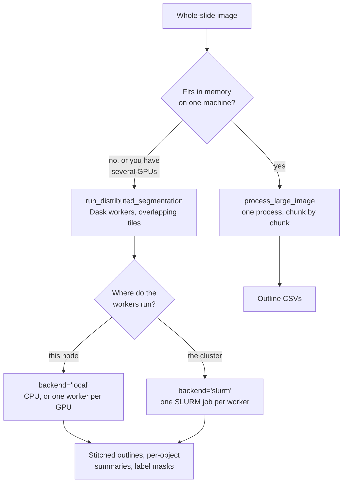

# Segment cells and nuclei

This guide shows you how to segment cells and nuclei across a whole-slide
image with SMINT: which entry point to use, how to run it from Python or the
command line, how to tune the Cellpose models, and what files you get back.
For *why* SMINT tiles and stitches the way it does, see
[Tiling and stitching](concepts/tiling_and_stitching.md); for a worked,
executed example, see the [segmentation tutorial](tutorials/01_segmentation.ipynb).

<figure markdown>

<figcaption>Sample 3 brain tissue: nuclei (cyan), GFAP (green) and phalloidin
(magenta), with cell outlines (white) and nucleus outlines (yellow) from a
fine-tuned Cellpose-SAM model on one GPU.</figcaption>
</figure>

## Choose an entry point

SMINT has two segmentation functions. Both run a cell model and a nucleus
model with Cellpose; they differ in how much of the slide they hold in memory
and where the work runs.



| | `process_large_image` | `run_distributed_segmentation` |
|---|---|---|
| Input | TIFF / OME-TIFF, read fully into memory | TIFF / OME-TIFF or Zarr / OME-Zarr, read lazily tile by tile |
| Runs on | One process (uses the GPU if Cellpose finds one) | Dask workers: local CPUs, local GPUs, SLURM jobs or an existing scheduler |
| Tile boundaries | Chunks without overlap | Overlapping tiles, stitched afterwards |
| Nuclei and cells | Segmented independently | Reconciled: every nucleus assigned to one cell |
| Extras | Adaptive nuclei threshold, per-chunk QC images | Per-object centroids and areas, full-resolution label masks |
| Install | `smint[distributed]` (for `shapely`, which `smint.segmentation` imports) | `smint[distributed]` (plus `dask-cuda` for local multi-GPU) |

!!! tip "Default to the distributed function"
    `run_distributed_segmentation` with `backend="local"` runs on a laptop
    too, and it is the only path that stitches across tile boundaries and
    links each nucleus to its cell. Use `process_large_image` when you want
    its adaptive nuclei threshold or quick per-chunk QC images.

## Prepare your image

- **Format.** OME-TIFF is preferred. `run_distributed_segmentation` also reads
  Zarr and OME-Zarr stores. Both functions turn the image into a
  channels-first `(C, Y, X)` stack.
- **Channels.** You need a nuclear stain (DAPI, Hoechst) for nuclei, and a
  membrane or cytoplasm stain (phalloidin, WGA, GFAP and so on) for cells.
- **Channel selection.** `channels` uses Cellpose 3's convention on both
  Cellpose versions: `[main, nuclear]`, **1-based**, `0` meaning "none". For a
  `(nuclei, cytoplasm)` stack, cells use `[2, 1]` (cytoplasm as the main
  channel, nuclei as the helper) and nuclei use `[1, 0]`.
- **Diameter.** Give the typical object diameter in **pixels** at the
  resolution of the image you segment.

!!! note "Cellpose 3 and Cellpose 4"
    SMINT works with both. A model is either a built-in name or a path to a
    trained model.

    - **Cellpose 3** ships `cyto`, `cyto2`, `cyto3` and `nuclei`.
    - **Cellpose 4** ships only Cellpose-SAM (`cpsam`). The Cellpose 3 names
      fall back to `cpsam` with a warning, so pass a path to a fine-tuned
      model if you need a specialised one.

    See [Installation](installation.md#cellpose-3-or-cellpose-4) for which to
    install.

## Segment on one machine

=== "Python"

    ```python
    from smint.segmentation import process_large_image

    results = process_large_image(
        image_path="slide.ome.tif",
        csv_base_path="results/slide",     # writes results/slide_cells.csv and _nuclei.csv
        chunk_size=(2048, 2048),
        cell_model_path="cyto3",           # built-in name or path to a trained model
        cells_diameter=60.0,
        cells_channels=[2, 1],             # [main, nuclear], 1-based
        nuclei_model_path="nuclei",
        nuclei_diameter=30.0,
        nuclei_channels=[1, 0],
        visualize=True,                    # QC PNGs for a few chunks
    )
    if "error" in results:
        raise RuntimeError(results["error"])
    print(results["total_cells"], results["total_nuclei"])
    print(results["cells_csv_path"], results["nuclei_csv_path"])
    ```

=== "Command line"

    `scripts/run_segmentation.py` (in a source checkout) wraps the same
    function. Model parameters come from a YAML file
    (`configs/segmentation_config.yaml`, see
    [Configuration](reference/configuration.md)); the flags override it.

    ```bash
    python scripts/run_segmentation.py \
        --image slide.ome.tif \
        --output-dir results \
        --config configs/segmentation_config.yaml \
        --cell-model cyto3 --cell-diameter 60 \
        --nuclei-model nuclei --nuclei-diameter 30 \
        --visualize --save-config
    ```

    This writes `results/cell_outlines_cells.csv`,
    `results/cell_outlines_nuclei.csv`, `results/segmentation.log` and, with
    `--save-config`, the effective `results/segmentation_config.yaml`.

!!! warning "Errors are returned, not raised"
    `process_large_image` returns `{"error": "..."}` when it cannot load the
    image or a model (for example when Cellpose is not installed). Check for
    the key, as above, before using the result.

### Retry faint nuclei automatically

When a chunk yields far fewer nuclei than cells, `process_large_image` can
lower the nuclei `cellprob_threshold` step by step and try again:

```python
results = process_large_image(
    ...,                                         # as above
    enable_adaptive_nuclei=True,
    adaptive_nuclei_trigger_ratio=0.05,          # retry if nuclei < 5% of cells
    nuclei_adaptive_cellprob_step_decrement=0.2,
    nuclei_adaptive_cellprob_lower_limit=-6.0,
    nuclei_max_adaptive_attempts=3,
)
```

In the YAML config these are the `adaptive_nuclei:` keys (`enable`,
`trigger_ratio`, `step_decrement`, `cellprob_lower_limit`, `max_attempts`).

## Segment a whole slide with Dask

`run_distributed_segmentation` cuts the slide into square core tiles
(`chunk_size`, default 2048 px), segments each tile **plus** a margin
(`tile_overlap`, default 256 px) on a Dask worker, and stitches the results
so that a cell on a tile boundary is kept once, and whole.

=== "Python"

    ```python
    from smint.segmentation import run_distributed_segmentation


    def main():
        results = run_distributed_segmentation(
            image_path="slide.ome.zarr",       # Zarr/OME-Zarr or TIFF/OME-TIFF
            output_dir="results/seg_run",
            cell_model="cyto3",                # name or path; False skips cells
            nuclei_model="nuclei",             # name or path; False skips nuclei
            cell_params={"diameter": 60, "channels": [2, 1]},
            nuclei_params={"diameter": 30, "channels": [1, 0]},
            chunk_size=2048,                   # core tile, px
            tile_overlap=256,                  # must exceed the largest cell radius
            backend="local",                   # or "slurm"
            n_workers=4,
            use_gpu=False,
        )
        print(results["total_cells"], results["total_nuclei"], results["n_tiles"])
        print(results["failed_tiles"])         # [] when every tile succeeded


    if __name__ == "__main__":
        main()
    ```

=== "Command line"

    The module has its own command line:

    ```bash
    python -m smint.segmentation.distributed_seg \
        --image_path slide.ome.zarr \
        --output_dir results/seg_run \
        --config_path configs/segmentation_config.yaml \
        --cell_model cyto3 --nuclei_model nuclei \
        --tile_size 2048 --tile_overlap 256 \
        --backend local --n_workers 4 --no_gpu
    ```

    Cellpose parameters (`diameter`, `flow_threshold`, `cellprob_threshold`,
    `channels`) come from the config file's `cell_model_params` and
    `nuclei_model_params`.

=== "YAML config"

    Every argument left as `None` is read from the config file, so a whole
    run can be described in YAML and passed as `config_path=`:

    ```yaml
    model_paths: ["cyto3", "nuclei"]       # [cell model, nuclei model]
    cell_model_params:
      diameter: 60
      channels: [2, 1]
    nuclei_model_params:
      diameter: 30
      channels: [1, 0]
    use_gpu: true
    n_workers: 4
    chunk_size: [2048, 2048]
    distributed:
      backend: slurm                       # or local
      tile_overlap: 256
      slurm:                               # dask_jobqueue.SLURMCluster options
        queue: gpuq
        gpu_type: A30
        memory: 64GB
        walltime: "04:00:00"
    ```

!!! warning "Guard your script with `if __name__ == \"__main__\":`"
    The local backend starts worker *processes*. In a plain script without the
    guard, they fail to start (`RuntimeError: Nanny failed to start`). Jupyter
    notebooks do not need it.

The run log is written to `output_dir/distributed_seg_<timestamp>.log`. To run
the workers as SLURM jobs, set `backend="slurm"` and pass
`dask_jobqueue.SLURMCluster` options in `slurm=` — see
[Running on HPC](hpc_deployment.md) and the
[distributed segmentation tutorial](tutorials/04_distributed_segmentation.ipynb).

<a id="stitching-tiles"></a>

### How tiles are stitched

Stitching is a port of the R workflow in `stitching/stitching.Rmd`
(`smint.segmentation.stitching`). Overlap is the intersection as a fraction
of the *smaller* object.

1. **Stitch nuclei, then cells** (cells must touch a stitched nucleus): merge
   pairs overlapping by more than `stitch_merge_thresh` (0.5) until nothing
   more merges, trim overlaps under `stitch_trim_thresh` (0.25) from both
   objects, and drop the smaller object of any pair still overlapping by 0.25
   or more.
2. **Reconcile cells with nuclei** (`reconcile_nuclei=True`): drop cells
   without a credible nucleus, grow cells over nuclei they mostly contain,
   split nuclei that straddle several cells, and assign every nucleus to
   exactly one cell. Nuclei with no cell become nucleus-only cells.

[Tiling and stitching](concepts/tiling_and_stitching.md) explains each rule
with pictures.

## Tune the models

| Setting | `process_large_image` | distributed `cell_params` / `nuclei_params` | What it does |
|---|---|---|---|
| Diameter | `cells_diameter`, `nuclei_diameter` | `diameter` | Expected object size in px; Cellpose rescales the image to it |
| Flow threshold | `cells_flow_threshold`, `nuclei_flow_threshold` | `flow_threshold` | Maximum flow error for a mask to be kept; higher keeps more, less regular, masks (default 0.4) |
| Cell probability | `cells_cellprob_threshold`, `nuclei_cellprob_threshold` | `cellprob_threshold` | Pixel threshold; lower finds fainter objects (defaults −1.5 cells, −1.2 nuclei) |
| Channels | `cells_channels`, `nuclei_channels` | `channels` | `[main, nuclear]`, 1-based, 0 = none |

!!! tip "Tune on a crop first"
    Cut a 2048 × 2048 px crop that contains your hardest region, iterate on it
    until the outlines look right, then launch the whole slide with the same
    parameters. For unusual morphology a fine-tuned model usually beats
    parameter tweaking; `segmentation/Cellpose_Train_and_Seg.ipynb` in the
    repository shows how to train one.

## Output files

`run_distributed_segmentation` writes to `output_dir`:

| File | Contents |
|---|---|
| `cells_outlines.csv`, `nuclei_outlines.csv` | One row per outline vertex: `global_cell_id`, `x`, `y` (IDs from 1 after stitching) |
| `cells_summary.csv` | One row per cell: `global_cell_id`, `x_centroid`, `y_centroid`, `area`, `n_nuclei` |
| `nuclei_summary.csv` | One row per nucleus: `global_cell_id`, `x_centroid`, `y_centroid`, `area`, `cell_id` (the containing cell) |
| `cells.zarr`, `nuclei.zarr` | Full-resolution label masks (per-tile IDs, **not** the stitched IDs) |

`process_large_image` writes `<csv_base_path>_cells.csv` and
`<csv_base_path>_nuclei.csv` (outline vertices: `global_cell_id`, `chunk_id`, `x`, `y`),
plus per-chunk PNGs in `visualize_output_dir` when `visualize=True`.

All coordinates and areas are in **image pixels**. The full column reference
is in [Data formats](reference/data_formats.md).

## Use the results for registration

The nuclei summary is the input for
[same-section registration](alignment.md#register-a-post-stain-onto-the-same-section).
Xenium coordinates are in µm, so convert first, then name the columns when
you call SMINT:

```python
import pandas as pd

pixel_size_um = 0.5      # placeholder: µm per pixel, from your image's metadata
nuc = pd.read_csv("results/seg_run/nuclei_summary.csv")
nuc[["x_centroid", "y_centroid"]] *= pixel_size_um
nuc.to_csv("results/nuclei_um.csv", index=False)
```

```bash
smint-alignment centroid --source results/nuclei_um.csv --target cells.csv \
    --source-cols x_centroid y_centroid --output-dir results/reg
```

`smint-alignment centroid` expects `centroid_x`/`centroid_y` in the source by
default, hence `--source-cols`. If the image and the Xenium section are not in
the same orientation, see [Coordinate frames](concepts/coordinate_frames.md).

## Troubleshooting

??? question "Cells or nuclei are missed"
    Check `diameter` first: a diameter off by a factor of two is the most
    common cause. Then lower `cellprob_threshold` (e.g. −1.5 → −3) or raise
    `flow_threshold` (0.4 → 0.6). For nuclei in `process_large_image`, turn on
    the adaptive threshold.

??? question "On Cellpose 4 every model gives the same result"
    Cellpose 4 has only `cpsam`; `cyto` and `nuclei` fall back to it with a
    warning in the log. Pass a path to a fine-tuned model, or install
    Cellpose 3 for the legacy models.

??? question "CUDA out of memory"
    Use a smaller `chunk_size` (e.g. 1024), or switch to
    `run_distributed_segmentation`, which holds one tile per worker.

??? question "Cells are cut in half at tile edges"
    `process_large_image` chunks do not overlap; use
    `run_distributed_segmentation`. In the distributed function, make
    `tile_overlap` larger than the largest cell radius in pixels.

??? question "Some tiles failed"
    `results["failed_tiles"]` lists their coordinates and the log in
    `output_dir` has each error; those regions are empty in the outputs. The
    run raises only if *every* tile fails.

## Next steps

- [Register the segmentation onto Xenium](alignment.md)
- [Run segmentation on a SLURM cluster](hpc_deployment.md)
- [Configuration reference](reference/configuration.md) ·
  [Segmentation API](reference/api/segmentation.md)
