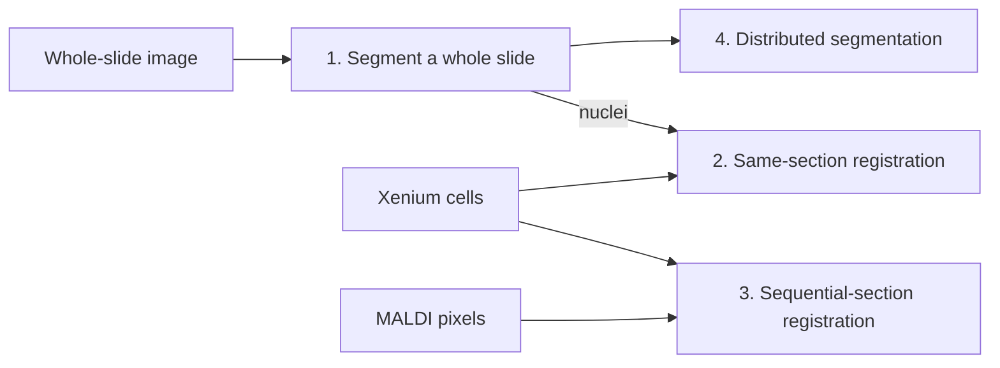
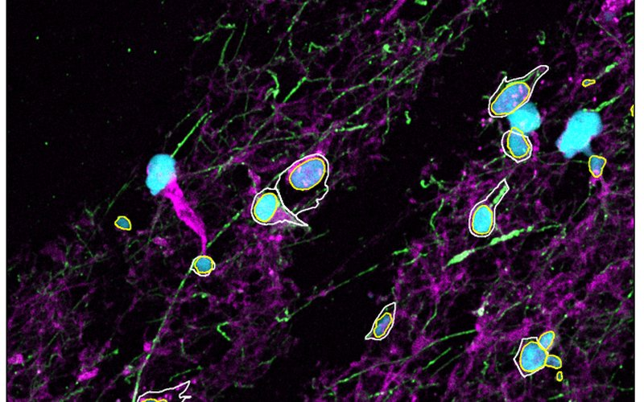
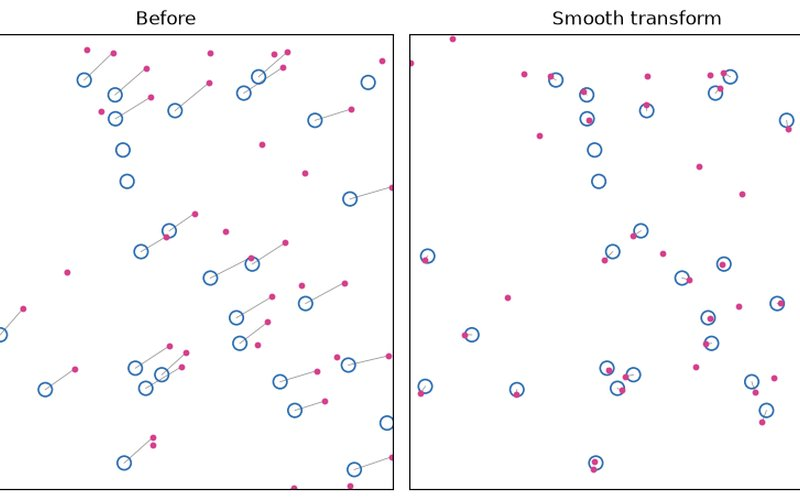
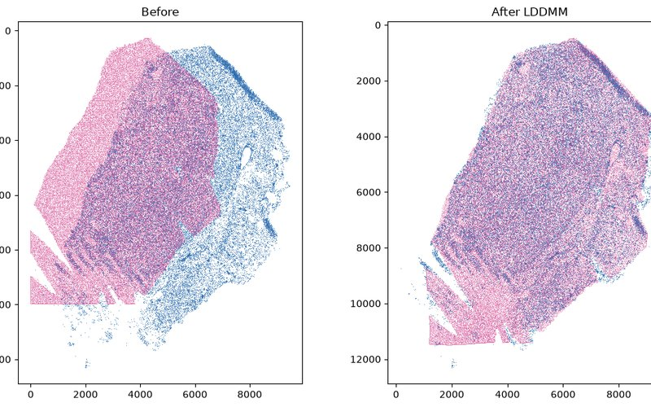
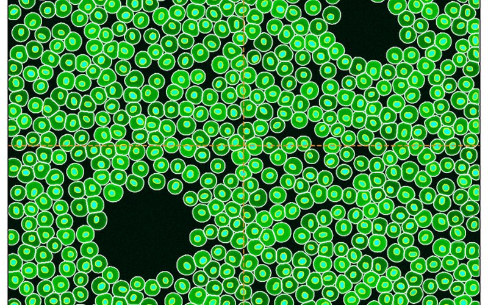

# Tutorials

Four executed notebooks, one per stage of the SMINT workflow. Each runs on
small data that ships with the repository — a synthetic dataset whose true
answer is known, then a de-identified crop of real data — and every output on
these pages is the stored result of running the notebook top to bottom.



<div class="grid cards" markdown>

-   [](01_segmentation.ipynb)

    **[1. Segment a whole slide](01_segmentation.ipynb)**

    ---

    Chunked cell and nucleus segmentation with `process_large_image` on a
    synthetic image and a 3-channel Sample 3 crop; what the outline CSVs hold.

    :material-clock-outline: ~1 min, 8 CPU cores · :material-package-variant: Cellpose 3

-   [](02_same_section_registration.ipynb)

    **[2. Same-section registration](02_same_section_registration.ipynb)**

    ---

    `register_centroids` (multiround) and `refine_by_assignment`: rounds log,
    held-out checks, statuses and `neighbour_deviation`, scored against the truth.

    :material-clock-outline: < 1 min, CPU · :material-package-variant: SMINT only

-   [](03_sequential_registration.ipynb)

    **[3. Sequential-section registration](03_sequential_registration.ipynb)**

    ---

    Orientation search, landmarks and STalign LDDMM for spatial metabolomics
    onto spatial transcriptomics; synthetic pair and Sample 2.

    :material-clock-outline: ~20 s per registration, one GPU · :material-package-variant: STalign (`numpy<2`)

-   [](04_distributed_segmentation.ipynb)

    **[4. Distributed segmentation on SLURM](04_distributed_segmentation.ipynb)**

    ---

    `run_distributed_segmentation` on local workers: tiles, overlap, the
    stitching log and outputs; the same call on SLURM GPUs.

    :material-clock-outline: ~1 min, 8 CPU cores · :material-package-variant: Cellpose 3, `smint[distributed]`

</div>

Then see the [worked examples on real data](../examples.md): the same steps on
full-size sections, with the commands, logs and timings of those runs.

## Run them yourself

Each notebook page links its `.ipynb` file in the introduction. To run one locally:

```bash
git clone https://github.com/JurgenKriel/SMINT.git
cd SMINT
pip install -e ".[distributed]" "cellpose<4" jupyterlab
python examples/make_tutorial_data.py      # optional: the data is already in docs/tutorials/data
cd docs/tutorials
jupyter lab
```

Notebooks read their inputs from `data/` relative to `docs/tutorials/`, and
write their outputs next to themselves. Tutorial 3 needs an environment with
STalign, which requires `numpy<2` and PyTorch — see
[Installation](../installation.md); run it on a GPU node if you can.

## The tutorial data

| File | What it is | Used in |
|---|---|---|
| `synthetic_wsi.ome.tif`, `synthetic_wsi_truth.csv` | 1024 × 1024 px, 2 channels (nuclei, cytoplasm), 753 known cells | 1, 4 |
| `synthetic_cells.csv`, `synthetic_nuclei.csv`, `synthetic_same_section_truth.csv` | 4,000 cells and 4,601 nuclei with a known offset, rotation, scale and warp | 2 |
| `synthetic_st.csv`, `synthetic_sm.csv`, `synthetic_*_points.npy`, `synthetic_sm_truth.csv` | ST cells and an SM pixel grid of one tissue shape, with 8 landmark pairs and the true position of every SM pixel | 3 |
| `sample3_crop.ome.tif` | Sample 3: a 2048 px region downsampled to 1024 × 1024 px; nuclei, GFAP, phalloidin | 1 |
| `sample2_xenium_z5_crop.csv`, `sample2_nuclei_z5_crop.csv` | Sample 2, section z5: Xenium cells and post-stain nuclei in a 1.5 mm × 1.5 mm window, re-origined | 2 |
| `sample2_st_z2.csv`, `sample2_sm_sectionB.csv`, `sample2_*_landmarks.npy` | Sample 2: Xenium section Z2 cells, a random quarter of MALDI section B pixels (coordinates only), 11 landmark pairs | 3 |

The synthetic files come from
[`examples/make_tutorial_data.py`](https://github.com/JurgenKriel/SMINT/blob/main/examples/make_tutorial_data.py),
which documents exactly how each was made. The real crops hold coordinates and
image intensities only — no identifiers, gene counts or m/z intensities.
