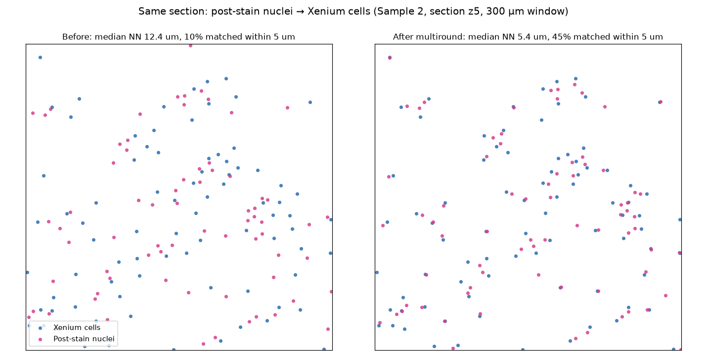
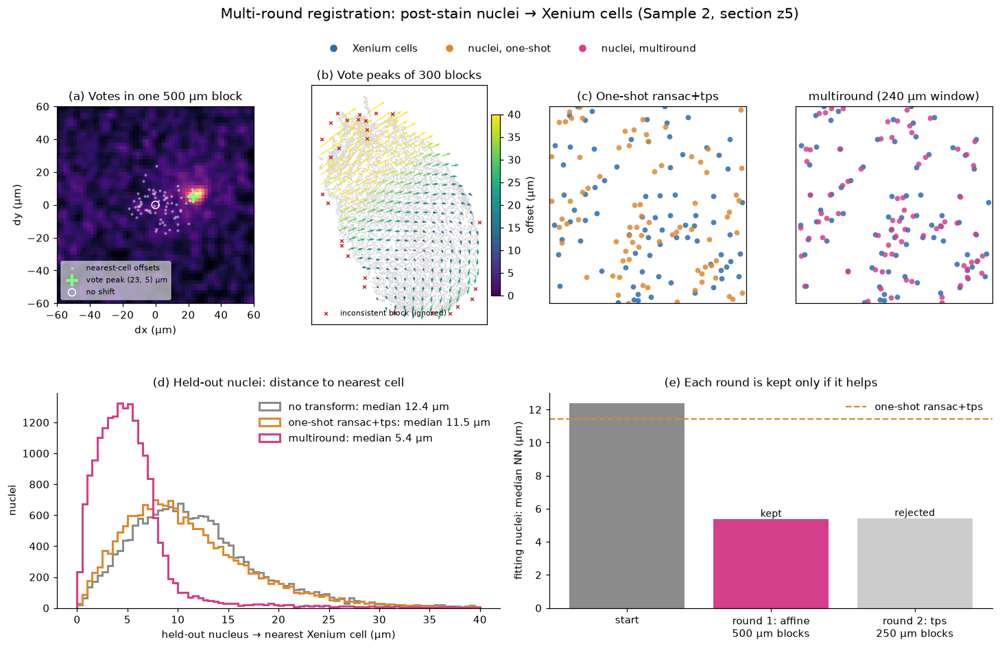
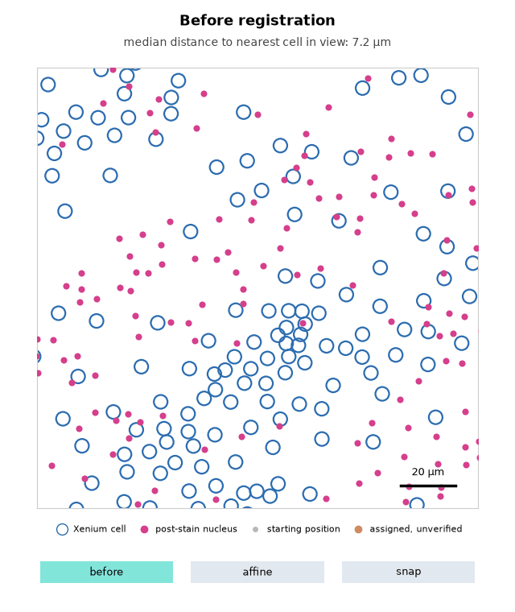

# Gallery

What SMINT output looks like on real tissue. Each figure links to the guide
or tutorial that produces it.

## Segmentation and registration

-   **Whole-slide segmentation**

    ---

    

    Sample 3: cells (white) and nuclei (yellow) segmented with a fine-tuned
    Cellpose-SAM model on nuclei (cyan), GFAP (green) and phalloidin
    (magenta).

    [:octicons-arrow-right-24: Segmentation guide](segmentation.md)

-   **Same-section registration**

    ---

    

    Sample 2, section z5: post-stain nuclei (pink) registered onto Xenium
    cells (blue) with multiround centroid registration.

    [:octicons-arrow-right-24: Same-section tutorial](tutorials/02_same_section_registration.ipynb)

-   **How multiround registration works**

    ---

    

    Displacement votes within a tissue block, the field of block peaks across
    the section, and the alignment before and after.

    [:octicons-arrow-right-24: Choosing a registration method](concepts/registration_methods.md)

-   **Snapping nuclei onto cells**

    ---

    

    After the smooth transform, matched nuclei are snapped exactly onto their
    Xenium cells; 88% of cells receive a distinct nucleus on Sample 2 z5.

    [:octicons-arrow-right-24: Alignment guide](alignment.md#snapping-nuclei-onto-their-cells)

-   **Registration, animated**

    ---

    

    A 160 µm window of Sample 2 z5: nuclei leave their starting positions
    (grey), move with the affine round and snap onto their Xenium cells.

    [:octicons-arrow-right-24: Alignment guide](alignment.md#snapping-nuclei-onto-their-cells)

<figure markdown>

<figcaption>Sequential-section registration on Sample 2: MALDI spatial
metabolomics (pink) onto Xenium spatial transcriptomics (blue) from a
neighbouring section, before registration, with 11 paired landmarks, and after
STalign LDDMM.
<a href="../alignment/#register-sequential-sections-with-stalign">Alignment guide</a>.</figcaption>
</figure>

## 3D cell-type maps of three samples

Registered serial sections stacked into 3D. Each point is a cell, coloured by
its annotated cell type; up to 3,000 cells per cell type are shown for each
sample so the page stays responsive.

  <a href="../samples_3d_comparison.html" target="_blank" rel="noopener">Open full screen ↗</a>

  <iframe
    src="../samples_3d_comparison.html"
    style="position: absolute; top: 0; left: 0; width: 100%; height: 100%; border: none;"
    loading="lazy"
    title="3D cell-type maps of Samples A, B and C">
  </iframe>

!!! tip "Using the 3D view"
    - **Choose a sample** with the Sample A / B / C buttons above the plot.
    - **Rotate** by dragging, **zoom** with the scroll wheel, a pinch or the
      + / − buttons, and **reset** the view with ↻.
    - **Open the legend** with the *Legend* button to see which colour is
      which cell type.

| Sample | Data | Shown as |
|---|---|---|
| Sample A | Spatial transcriptomics, cell centroids with a z coordinate | 3D scatter, coloured by cell type |
| Sample B | Spatial transcriptomics, eight registered serial sections | Sections stacked by z position |
| Sample C | Spatial transcriptomics, eight sections (layers z1–z8) | Sections stacked by layer |

Cell-type labels follow the glioblastoma tumour-microenvironment taxonomy
(AC-like, MES-like, OPC-like, NPC-like) plus normal brain and immune
populations. The page is generated by
`scripts/visualization/generate_3d_comparison.py` with Plotly.
